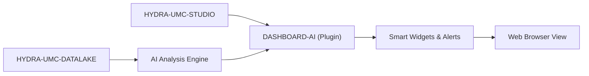

<!-- =============================================================================
HYDRA-UMC-DASHBOARD-AI - Statistical summaries and anomaly highlights for the STUDIO web dashboard
Copyright (C) JuanenRac (Electro Hobby 3D) <electrohobby3d@gmail.com>
GPL-3.0-or-later - see LICENSE
============================================================================= -->

<p align="center">
  
</p>

# 🧠 HYDRA-UMC-DASHBOARD-AI

<p align="center">🇺🇸 <b>English</b> | <a href="README_spa.md">🇪🇸 Español</a> | <a href="README_fra.md">🇫🇷 Français</a> | <a href="README_ita.md">🇮🇹 Italiano</a> | <a href="README_deu.md">🇩🇪 Deutsch</a> | <a href="README_zho.md">🇨🇳 简体中文</a> | <a href="README_jpn.md">🇯🇵 日本語</a> | <a href="README_por.md">🇵🇹 Português</a></p>

### 📈 Statistical Summaries and Anomaly Highlights for the STUDIO Web Dashboard (no language model)

<p align="center">
  
  
  
  
  
  
</p>

---

> **Honesty check - what actually runs today:** the trend-summary statistics (`lib/summary.ts`), the AI-provider gate and its honest statistical fallback (`lib/aiProvider.ts`), the external contract guard, the real HTTP clients (`api/datalakeClient.ts`, `api/anomalyClient.ts`), and per-panel render-failure isolation (`components/ErrorBoundary.tsx` - a crash in one panel's render stays contained to that panel's own card instead of unmounting the whole app) are real and covered by 189 passing Vitest tests (`npm test` - `tests/*.test.ts(x)`); the CM5 static-file server (`scripts/serve_static.py`) has its own 11 passing `unittest` tests (no directory listing, hardening headers, an idle-connection timeout, no path traversal). There is no real LLM-backed AI provider anywhere in this repo - `aiProvider.ts`'s gate is real, but every narrative shown today is the `NO_PROVIDER_CONFIGURED` statistical fallback, clearly labeled as such. Trend Prediction (a real forecast model) and Optimization Tips are both fully aspirational - no code exists for either yet. Anomaly Highlighting only checks HYDRA-UMC-ANOMALY-DETECTOR's own already-fitted baseline; it never fits one itself. See `CHANGELOG.md` for exactly what has shipped so far.

---

> **Safety and security status:** this ecosystem is not a certified safety system. There is no hardware E-STOP path, no firmware-enforced limits or interlocks and no verified motion command yet; firmware images are checked with CRC-32 and an Ed25519 signature, and a release build refuses the published development keys (the tool heads and expansion boards behind the relay still run URTC bootloaders, which take a shared-key HMAC-SHA256 instead of a signature); TLS and mutual TLS are optional and off by default; no custom board has been populated or tested yet. Read the [security baseline](https://github.com/JuanenRac/HYDRA-UMC-DOCS/blob/main/docs/SECURITY_BASELINE.md) and the [threat model](https://github.com/JuanenRac/HYDRA-UMC-DOCS/blob/main/docs/THREAT_MODEL.md) before relying on any statement here for the safety of a person.

---

## 📋 At a glance

| | |
|---|---|
| Version | `0.1.9` |
| Maturity | Functional |
| Tests | 189 (`npm test`) |
| Stack | TypeScript/React / Vite |
| Target | The Raspberry Pi CM5 of a HYDRA-UMC cell |
| On real hardware | Not yet: no run on real hardware is recorded for this version |

**Jump to:** [Overview](#-overview) · [Architecture](#-architecture) · [Security & Safety](#-security--safety) · [Interfaces](#-interfaces) · [Configuration](#-configuration) · [Quick start](#-quick-start) · [Testing](#-testing) · [Troubleshooting](#-troubleshooting) · [Repository Structure](#-repository-structure) · [Related Projects](#-related-projects)

## 🚦 Project status

Each line is one part of this repository and the light says how far it is today. It is written from what the repository can show (tests, builds, runs), not from what is planned.

🟢 Done and verified · 🟡 Works, with known limits · 🟠 Partly done or not verified yet · 🔴 Not done or not working

| Area | State | What it means here |
|---|---|---|
| Software | 🟡 | Works for its main purpose; the honesty check above lists what is still missing |
| Tests | 🟢 | 189 automated tests, run on every change |
| Real hardware | 🔴 | Not yet: no run on real hardware is recorded for this version |
| Documentation | 🟢 | README in eight languages, checked against the manifest on every change |

## 🎯 Overview

**HYDRA-UMC-DASHBOARD-AI** is the analytical plugin for the STUDIO web interface. It adds summaries computed from the stored history (minimum, maximum, average, latest value and trend direction) and anomaly highlights from the anomaly detector's statistics. No language model and no forecast are involved yet.

It is meant to turn raw telemetry into actionable summaries of swarm performance and energy consumption patterns, directly within the browser (planned: predictive maintenance alerts and AI-generated insights). It reuses HYDRA-UMC-STUDIO's own stack (React 19 + Vite + TypeScript) rather than introducing a new one, so it can eventually be embedded as a panel inside STUDIO itself.

### Key Features:
* 🧠 **Smart Summaries (v0)** — real min/max/average/latest/direction statistics computed from real HYDRA-UMC-DATALAKE history, with min/max/latest each linked back to the real observation timestamp that produced it. *(implemented as real statistics, not yet an LLM-generated summary — see Build & Release below)*
* 🔒 **AI-Provider Gate (v0)** — real input/output schema validation for the eventual LLM-backed narrative, plus a real, honestly-labeled statistical fallback used whenever no AI provider is configured or one fails/returns unstructured output. *(implemented and wired into the Trend Summary panel today; a real LLM-backed provider itself is planned)*
* 🛡️ **External Contract Guard (v0)** — validates every Datalake and anomaly-service response before a panel calculates with or renders it; malformed numbers, flags, oversized identifiers, and unsafe control characters are rejected. *(implemented; see [`docs/SECURITY.md`](docs/SECURITY.md))*
* 📈 **Trend Prediction** — a real forecast model, beyond v0's real-but-simple direction indicator. *(planned)*
* 🚨 **Anomaly Highlighting (v0)** — checks the most recent real samples against a real, already-fitted HYDRA-UMC-ANOMALY-DETECTOR baseline. *(implemented as a real text panel; overlaying it on STUDIO's own 3D view is planned)*
* 🛠️ **Optimization Tips** — suggests parameter changes to improve cycle time or motor lifespan. *(planned)*
* ⏳ **Remaining Useful Life (v0, off by default)** — a card that asks HYDRA-UMC-ANOMALY-DETECTOR for the days until the trend of the anomaly scores reaches a limit, with a range, explicit states (not enough data, not rising, limit reached), a small chart and configurable warnings; tested against a simulated data lake and detector. *(implemented; see [`docs/REMAINING_USEFUL_LIFE.md`](docs/REMAINING_USEFUL_LIFE.md))*
* ✅ **Toolchain scaffold** — a real React/Vite/TypeScript app that builds clean with `tsc --noEmit` and serves with Vite. *(implemented — see Build & Release below)*
* 🧯 **Per-Panel Render-Failure Isolation** — each panel is wrapped in its own `ErrorBoundary`; a render-time exception in one shows a contained fallback card instead of unmounting the entire dashboard. *(implemented — see `components/ErrorBoundary.tsx`)*

## 🧩 Role in HYDRA-UMC

**HYDRA-UMC-DASHBOARD-AI** is a read-only panel next to STUDIO: it turns the real history stored in HYDRA-UMC-DATALAKE into trend summaries (minimum, maximum, average, latest value and direction, each linked to the sample that produced it) and checks the newest samples against the baseline of HYDRA-UMC-ANOMALY-DETECTOR. It has no language model of its own: when no AI provider is configured it shows a statistical text and says so.

## 🏛️ Architecture

<p align="center">
  
</p>

<details>
<summary>Text version of the diagram (Mermaid)</summary>



</details>

### ARCHITECTURE & DESIGN DECISIONS

* **Why this is a Node/TS project, not a Python one like the other AI-adjacent projects.** It's a direct extension of HYDRA-UMC-STUDIO's own React/Vite frontend, not a standalone AI service - matching STUDIO's own stack (rather than HYDRA-UMC-COGNITIVE-NODE's Python one) is what lets it actually mount as a real STUDIO panel later, not a separate app users have to switch to.
* **Why it's a sibling of STUDIO, not a folder inside it.** Keeping this as its own repo/build lets the AI-dashboard layer version and ship independently of STUDIO's own robot-control release cadence, the same reasoning that split HYDRA-UMC-SERVER out of STUDIO in the first place.
* **Why the entry point only prints identity/version/role today.** Andamiaje (scaffolding) stage: proving the package builds cleanly precedes the real dashboard panels.
* **How this fits the rest of the ecosystem.** Extends HYDRA-UMC-STUDIO with statistical summaries and anomaly highlights; a language-model back end from HYDRA-UMC-COGNITIVE-NODE is planned and not connected today.
* **Why the Anomaly Check panel checks `/stats` before offering to score anything.** HYDRA-UMC-ANOMALY-DETECTOR's own detector is one shared, in-memory-fitted baseline (see that project's own `api.py`) - this dashboard deliberately does not manage fitting it (mutating shared detector state from a read-oriented dashboard would be a real coupling smell). A real "not fitted yet" state is shown as exactly that, not folded into a generic error.
* **Why the Trend Summary reports "direction", not a forecast.** A real first-to-last delta sign (with a small relative-noise threshold so a flat signal doesn't flicker "up"/"down") is honest about what v0 actually computes - a real forecast model is separate, real future work, not something to fake with a linear extrapolation dressed up as "prediction".
* **Why `safeGenerateNarrative()` validates the request but never throws for a bad response.** A malformed request is a real wiring bug in this codebase - there's no summary to honestly fall back to, so it's allowed to throw. A malformed/unstructured *response* from a provider is a fact of life for any real external API - that path always degrades to the real statistical fallback instead of crashing the panel, because the caller already has everything it needs (the real summary) to say something true.
* **Why `NO_PROVIDER_CONFIGURED` reuses `summary.ts` instead of a separate fallback implementation.** A second, independent "fallback narrative" formula would drift from the real statistics the panel already trusts and displays numerically - reusing the same `TrendSummary` values keeps the fallback narrative provably consistent with the numbers right next to it.

## 🖼️ Screenshots

Captured at 1920×1080 on a test bench, with sample data and no real installation behind them.

<table>
<tr><td width="50%" valign="top"><br><sub>The two panels: the trend summary of a vibration series read from the data lake, and the anomaly check that scores its latest window against the fitted baseline.</sub></td></tr>
</table>

## 🔒 Security & Safety

| Threat | Defence | Where |
|---|---|---|
| The static server forwarding more than it should | Only `/api/datalake` and `/api/anomaly` are forwarded; with a token, only the calls listed in `TOKEN_ALLOWED_CALLS`; bodies are capped at 4 MiB | `scripts/serve_static.py` |
| Service tokens exposed on the network | With service tokens configured, the server refuses to start on an address that is not loopback unless that is asked for explicitly; a token with a control character is rejected | `scripts/serve_static.py` |
| A page loading scripts or calling hosts it should not | A Content-Security-Policy on every answer: scripts only from the page itself, no framing, connections only to its own origin; extra origins are added one by one with `--connect-src` and must be plain origins | `scripts/serve_static.py` |
| Text from an AI provider carrying control or bidirectional characters, or a malformed answer | The narrative is limited to 2000 characters and unsafe characters are dropped; a malformed answer falls back to the statistical text instead of breaking the panel | `src/lib/aiProvider.ts` |
| A hung service freezing the page | Every request has a 5 s time limit, a query asks for 5000 samples at most per window and 12 window attempts, and one panel that crashes shows a contained card while the other keeps working | `src/api/fetchWithTimeout.ts`, `src/api/datalakeClient.ts`, `src/components/ErrorBoundary.tsx` |

**What it never does:** write to the history store, fit the anomaly baseline, or act on a robot. It is a reading panel.

## 🔌 Interfaces

| Topic or route | What it carries |
|---|---|
| `/api/datalake/*` | forwarded to HYDRA-UMC-DATALAKE on `127.0.0.1:8095` (read calls only when a token is used) |
| `/api/anomaly/*` | forwarded to HYDRA-UMC-ANOMALY-DETECTOR on `127.0.0.1:8097` |
| `/dashboard-ai`, `/api/ai/datalake`, `/api/ai/anomaly-detector` | behind HYDRA-UMC-SERVER the page lives at `/dashboard-ai` and reads through the relay of that server, with the access token of the STUDIO session |
| `/api/anomaly/rul` | only with the Remaining useful life card on: the page posts the newest anomaly scores and reads the days to the limit, with a range and an explicit state; the detector must run with `--rul` |

## ⚙️ Configuration

| Variable | Default | What it sets |
|---|---|---|
| `--dir` | `dist/` | the built page to serve |
| `--addr`, `--port` | `127.0.0.1`, `8115` | where to listen |
| `--datalake`, `--anomaly` | `http://127.0.0.1:8095`, `http://127.0.0.1:8097` | where the two services are |
| `--connect-src` | none | an extra origin the page may call, for a build with `VITE_DATALAKE_URL` / `VITE_ANOMALY_URL`; repeat it per origin |
| `--csp`, `HYDRA_DASHBOARD_CSP` | `default` | `default`, or a full policy of your own |
| `HYDRA_UMC_DATALAKE_READ_TOKEN`, `HYDRA_UMC_DATALAKE_TOKEN`, `HYDRA_UMC_ANOMALY_TOKEN` | no token | the token the server presents to each service; `_FILE` variants read it from a file |
| `VITE_DATALAKE_URL`, `VITE_ANOMALY_URL` | `/api/datalake`, `/api/anomaly` | browser-visible service URLs set at build time; never put a credential in them |
| `VITE_RUL_ENABLED` | `false` | `true` (exactly that) adds the Remaining useful life card; with anything else there is no card and no request to the detector |
| `VITE_RUL_URL`, `VITE_RUL_SOURCE_ID`, `VITE_RUL_KIND`, `VITE_RUL_FIELD`, `VITE_RUL_LIMIT`, `VITE_RUL_POINTS` | the anomaly URL, `robot-1`, `anomaly_score`, `value`, `1`, `200` | the detector that answers `POST /rul`, the series of anomaly scores read from the data lake, the score that counts as the limit, and how many of the newest samples (1 to 1000) are sent |
| `VITE_RUL_WARN_DAYS`, `VITE_RUL_CRITICAL_DAYS`, `VITE_RUL_TIMEOUT_MS` | `30`, `7`, `5000` | the card warns when the earliest plausible day is within this many days, and turns critical within the second number (never above the first); the request time limit in milliseconds |

## 🚀 Quick start

Requires Node.js 20 or newer with npm; the static server needs Python 3.10 or newer.

```bash
./dev.sh                                    # installs the dependencies and starts the Vite dev server on port 5174 (dev.bat on Windows)
./build.sh                                  # runs the tests, type-checks and builds dist/ (build.bat on Windows)
python scripts/serve_static.py --port 8115  # serves dist/ and forwards /api/datalake and /api/anomaly
```

## 🧪 Testing

189 automated tests run with `npm test`. The static server has its own Python tests in `scripts/test_serve_static.py`. They need no hardware and no running service.

The CI runs `HYDRA_UMC_CI=1 python tools/ci_validate.py`, which checks the manifest, the documents, the eight READMEs and the pictures.

## 🏗️ Build & Release

Requires Node.js >= 20.

```bash
# Linux/macOS
./dev.sh      # installs dependencies, starts the Vite dev server on :5174
./build.sh    # installs deps, runs the real test suite, type-checks, builds dist/

# Windows
dev.bat
build.bat
```

`npm run build` chains `tsc --noEmit && vite build`; it never changes the version, so a broken build can never ship a bumped version number. `npm run dev` starts Vite on port `5174` (separate from HYDRA-UMC-STUDIO's own `5173`, so both can run side by side). `npm test` runs the real Vitest suite directly.

By default the two real panels call the same-origin paths `/api/datalake` and `/api/anomaly`, which `scripts/serve_static.py` (and the Vite dev server) forward to HYDRA-UMC-DATALAKE on `127.0.0.1:8095` and HYDRA-UMC-ANOMALY-DETECTOR on `127.0.0.1:8097` (neither service sends CORS headers, so the browser could not call them directly) - override with `VITE_DATALAKE_URL`/`VITE_ANOMALY_URL` (set before `vite build`/`vite dev`, Vite inlines them at build time) to point at a different deployment.

Behind HYDRA-UMC-SERVER the page is served at `/dashboard-ai` (HYDRA-UMC-SERVER's `build-frontend` builds and copies it when this repository is checked out next to it). There it reads through the relay of that server, `/api/ai/datalake` (read-only) and `/api/ai/anomaly-detector`, with the access token of the person who signed in to HYDRA-UMC-STUDIO in the same browser (the token is only ever sent to same-origin addresses), so the roles of the server apply and the services keep their own Bearer tokens private to the server. A refused session says so on the panel (sign in through STUDIO; an administrator or an operator is needed). With the dashboard there, HYDRA-UMC-ANOMALY-DETECTOR can be started with `HYDRA_UMC_ANOMALY_PROTECT_READS=1`.

`scripts/serve_static.py` sends a Content-Security-Policy with every answer: scripts only from the page itself (no inline scripts, no plugins), no framing, and connections only to the page's own origin. A build with `VITE_DATALAKE_URL`/`VITE_ANOMALY_URL` adds the origins it calls with `--connect-src ORIGIN` (repeatable); `--csp off` (or `HYDRA_DASHBOARD_CSP=off`) sends none, for a front proxy that sets it, and any other `--csp` value is used as the complete policy. `npm run lint` runs ESLint (recommended rules, typescript-eslint and the rules of React hooks); CI runs it next to the type check and the tests. In the standalone mode the same script presents the Bearer token of a service that asks for one (`HYDRA_UMC_DATALAKE_READ_TOKEN`, else `HYDRA_UMC_DATALAKE_TOKEN`, and `HYDRA_UMC_ANOMALY_TOKEN`, each also as `..._FILE`, a file whose first line is the token), so the page never holds it. The token goes out only on the calls the dashboard makes (the reads of the data lake, the status of the detector and the scoring of a window); fitting a baseline, writing to the data lake or its retention go out without it and the service refuses them. A server bound to an address other than loopback refuses to start with tokens unless `--allow-tokens-off-loopback` is given.

Read [`docs/SECURITY.md`](docs/SECURITY.md) before configuring those browser-visible URLs or connecting a real AI provider; it defines the response validation, content safety, failure behaviour, and no-secrets deployment rule.

Every real Trend Summary fetch also runs the real AI-provider gate. With no real provider configured (v0's honest default), the panel shows the real statistical fallback, clearly labeled:

```ts
import { safeGenerateNarrative, NO_PROVIDER_CONFIGURED } from './lib/aiProvider'

const narrative = await safeGenerateNarrative(NO_PROVIDER_CONFIGURED, { sourceId, kind, field, summary })
// { narrative: "robot-1/motor_temp/value: 4 sample(s), ranging 10.00 to 50.00,
//    averaging 29.00, latest 36.00 (rising).", generatedBy: 'statistical-fallback' }
```

A provider that throws, or returns a response missing/malformed `narrative`, degrades to that exact same real fallback instead of crashing the panel or rendering nothing.

## 🩺 Troubleshooting

| You see | Because | Do |
|---|---|---|
| The panels are empty and the console says a request failed | The static server is not running, or DATALAKE or the anomaly service is not on the address given | Start `scripts/serve_static.py` and check `--datalake` and `--anomaly` |
| The server refuses to start with tokens | A service token is set and `--addr` is not a loopback address | Bind to `127.0.0.1`, or put the page behind HYDRA-UMC-SERVER |
| The summary says "statistical fallback" | No AI provider is configured, or the provider answered with something that failed validation | This is the expected default; the numbers are real |
| The tests time out when many run at once | The machine is loaded and a Vitest worker did not answer in time | Run `npx vitest run --pool=threads`, or run it when nothing else is building |

## 📂 Repository Structure

<p align="center">
  
</p>

<details>
<summary>Text version of the tree</summary>

```text
HYDRA-UMC-DASHBOARD-AI/
├── src/                                                     source code
│   ├── api/                                                 Real HTTP clients: datalakeClient.ts, anomalyClient.ts, rulClient.ts
│   ├── lib/                                                 statistics, AI-provider gate, session and endpoints, remaining-useful-life reading and texts
│   ├── components/                                          the panels (one is off by default), the chart, the error boundary
│   ├── main.tsx                                             Application entry point
│   ├── App.tsx                                              Root component - mounts both real panels
│   ├── index.css                                            Base stylesheet
│   └── vite-env.d.ts                                        VITE_DATALAKE_URL / VITE_ANOMALY_URL / VITE_RUL_* typing
├── tests/                                                   Real tests: HTTP round-trips + component tests
├── scripts/                                                 the static server and its tests
├── systemd/                                                 service unit
├── tools/                                                   project tools and CI checks
├── docs/                                                    documents of the project
├── images/                                                  Media and diagrams
├── .github/                                                 CI workflow and issue templates
├── index.html                                               Vite entry HTML
├── vite.config.ts                                           Vite bundler + Vitest configuration
├── tsconfig.json / tsconfig.app.json / tsconfig.node.json   TypeScript configuration (app and node)
├── bump_manifest_version.py                                 Syncs hydra-umc.project.json's version to package.json's (--sync)
├── dev.sh / dev.bat                                         Real dev server: install deps + vite
├── build.sh / build.bat                                     Validate and build (building never changes the version)
├── package.json                                             package metadata and scripts
├── CHANGELOG.md                                             what changed in each version
├── build-test.sh                                            non-mutating build check
├── hydra-umc.project.json                                   manifest: version, maturity, family
└── test.sh                                                  runs the tests
```

</details>

## 🗺️ Roadmap & Known limits

**Known limits today**

* **Planned:** a real forecast (trend prediction), optimisation tips, an AI provider behind the gate (HYDRA-UMC-COGNITIVE-NODE is the intended back end and is not connected), and an overlay of the anomaly verdict on the 3D view of STUDIO.
* The summaries are statistics (minimum, maximum, average, latest and direction), not a forecast.
* Tried against live sibling services on a computer; never with data from a real plant.

## 🌍 Languages

This README and the documents of the repository exist in eight languages: English, Spanish, German, French, Italian, Japanese, Chinese and Portuguese (Portugal). They are written together and checked in the CI so that the eight files have the same sections and the same links.

## 🔗 Related Projects

This project is part of the HYDRA-UMC robotics ecosystem by the same author (JuanenRac / Electro Hobby 3D). Worth knowing about, since a request might actually be about one of these rather than this repository.

**Directly Related**
- **[HYDRA-UMC-STUDIO](https://github.com/JuanenRac/HYDRA-UMC-STUDIO)** — web control dashboard with real-time multi-robot 3D visualization — the dashboard this project directly extends.
- **[HYDRA-UMC-COGNITIVE-NODE](https://github.com/JuanenRac/HYDRA-UMC-COGNITIVE-NODE)** — integration hub for the Hailo-10 cognitive pipeline (LLM/VLA/voice orchestration) — the AI backend feeding this dashboard.
- **[HYDRA-UMC-DATALAKE](https://github.com/JuanenRac/HYDRA-UMC-DATALAKE)** — real sqlite3-backed time-series store with a real ingest/query HTTP API — the real history the Smart Summaries panel computes its statistics from.
- **[HYDRA-UMC-ANOMALY-DETECTOR](https://github.com/JuanenRac/HYDRA-UMC-ANOMALY-DETECTOR)** — real FFT + statistical baseline anomaly detector with drift monitoring — the fitted baseline the Anomaly Highlighting panel scores recent samples against.

**Also Part of the Ecosystem**

*Core Hardware & Platform*
- **[HYDRA-UMC](https://github.com/JuanenRac/HYDRA-UMC)** — the robot-arm motherboard design: CM5 host + dual-core STM32H745, meant to orchestrate up to 8 tool arms over CAN-OTA/SPI-OTA (firmware at an early stage; no populated board yet).
- **[HYDRA-UMC-OS](https://github.com/JuanenRac/HYDRA-UMC-OS)** — reproducible Raspberry Pi OS product layer for the CM5: read-only agent, validated config/profiles, WiFi first-contact provisioning.
- **[HYDRA-UMC-SDK](https://github.com/JuanenRac/HYDRA-UMC-SDK)** — the shared JSON-Schema contract and software job-gate boundary every bridge validates its commands against (not a certified safety function).
- **[HYDRA-UMC-CONNECTOR-HUB](https://github.com/JuanenRac/HYDRA-UMC-CONNECTOR-HUB)** — declarative adapter-manifest registry and validator for external-machine connectors; extends the SDK's own contract idea to external machines without replacing the industrial-gateway projects.

*Core Backend & Clients*
- **[HYDRA-UMC-SERVER](https://github.com/JuanenRac/HYDRA-UMC-SERVER)** — the real headless backend (REST/WebSocket) every control client actually talks to.
- **[HYDRA-UMC-SUITE](https://github.com/JuanenRac/HYDRA-UMC-SUITE)** — desktop (PySide6) swarm command center for multiple servers at once, packaged as a standalone executable.
- **[HYDRA-UMC-ANDROID-CONTROL](https://github.com/JuanenRac/HYDRA-UMC-ANDROID-CONTROL)** — native Android control app with biometric login and a paired Wear OS companion.
- **[HYDRA-UMC-IOS-CONTROL](https://github.com/JuanenRac/HYDRA-UMC-IOS-CONTROL)** — iOS/iPadOS control app (Flutter) with real-time WebSocket sync.
- **[HYDRA-UMC-DSI](https://github.com/JuanenRac/HYDRA-UMC-DSI)** — native touch UI for the onboard 7" DSI touchscreen, embedded on the CM5 itself.
- **[HYDRA-UMC-EDITOR-URDF](https://github.com/JuanenRac/HYDRA-UMC-EDITOR-URDF)** — desktop graphical URDF creator/editor that pushes finished models into STUDIO's own catalog.
- **[HYDRA-UMC-EDITOR-STL](https://github.com/JuanenRac/HYDRA-UMC-EDITOR-STL)** — desktop STL model editor, transforming/replacing/removing/adding real parts in the same model catalog HYDRA-UMC-EDITOR-URDF also edits.
- **[HYDRA-UMC-BRIDGE-AMR](https://github.com/JuanenRac/HYDRA-UMC-BRIDGE-AMR)** — coordination boundary for AGV/AMR fleets via a VDA 5050 MQTT publisher (tested against an emulated fleet only).
- **[HYDRA-UMC-BRIDGE-CNC](https://github.com/JuanenRac/HYDRA-UMC-BRIDGE-CNC)** — high-level CNC-cell coordinator with GRBL status/control-byte access (tested against an emulator only).
- **[HYDRA-UMC-BRIDGE-DROIDS](https://github.com/JuanenRac/HYDRA-UMC-BRIDGE-DROIDS)** — coordination boundary for legged/humanoid droids, with a Boston Dynamics Spot command sender (tested against an emulator only).
- **[HYDRA-UMC-BRIDGE-LASER](https://github.com/JuanenRac/HYDRA-UMC-BRIDGE-LASER)** — laser-cell coordinator reading 3 key/enclosure/interlock GPIO signals (tested against a fake chip only; it cannot arm or fire a laser).
- **[HYDRA-UMC-BRIDGE-OPENPNP](https://github.com/JuanenRac/HYDRA-UMC-BRIDGE-OPENPNP)** — safe high-level board-flow coordinator for OpenPnP pick-and-place.
- **[HYDRA-UMC-BRIDGE-PRINTER3D](https://github.com/JuanenRac/HYDRA-UMC-BRIDGE-PRINTER3D)** — safe coordination boundary for Moonraker/Klipper 3D printers, with real gated job commands.
- **[HYDRA-UMC-BRIDGE-ROS2](https://github.com/JuanenRac/HYDRA-UMC-BRIDGE-ROS2)** — coordinator with a lazily imported rclpy ROS 2 transport (not yet run against a ROS 2 installation).
- **[HYDRA-UMC-BRIDGE-UAV](https://github.com/JuanenRac/HYDRA-UMC-BRIDGE-UAV)** — coordination boundary for camera-equipped UAVs, with a MAVLink command sender (tested against an emulator only).

*URTC Tool Platform*
- **[URTC](https://github.com/JuanenRac/URTC)** — firmware for the physical Universal Robot Tool Controller PCB, 25+ tool profiles over CAN bus.
- **[URTC-FLASHER](https://github.com/JuanenRac/URTC-FLASHER)** — desktop GUI flashing tool for URTC boards, CAN-OTA plus full-chip SWD/JTAG.
- **[URTC-TESTER](https://github.com/JuanenRac/URTC-TESTER)** — desktop live CAN-bus diagnostic tool for URTC boards, one panel per tool profile.
- **[URTC-WEB-STUDIO](https://github.com/JuanenRac/URTC-WEB-STUDIO)** — browser-based alternative to URTC-TESTER via the Web Serial API, no local install needed.
- **[URTC-GATEWAY](https://github.com/JuanenRac/URTC-GATEWAY)** — gateway in front of the URTC CAN bus: an allowed list of identifiers, a rate limit and a session key; software tested on a computer, not yet on a real bus.

*Vision AI Node (Hailo-8)*
- **[HYDRA-UMC-VISION-NODE](https://github.com/JuanenRac/HYDRA-UMC-VISION-NODE)** — integration hub for the Hailo-8 vision pipeline, with a real per-stage hardware-readiness check.
- **[HYDRA-UMC-DETECTION-HEF](https://github.com/JuanenRac/HYDRA-UMC-DETECTION-HEF)** — real compiled-model registry with Hailo-architecture/checksum safe-load verification.
- **[HYDRA-UMC-VISION-STREAMER](https://github.com/JuanenRac/HYDRA-UMC-VISION-STREAMER)** — real GStreamer pipeline + MediaMTX config generator with a real HailoRT integration boundary.
- **[HYDRA-UMC-VISUAL-SERVOING-API](https://github.com/JuanenRac/HYDRA-UMC-VISUAL-SERVOING-API)** — Position-Based Visual Servoing correction law with authorisation gated on the zone state; no camera pose estimation yet.
- **[HYDRA-UMC-SAFETY-ZONES](https://github.com/JuanenRac/HYDRA-UMC-SAFETY-ZONES)** — v0 zone-breach, calibration-freshness and E-STOP-request logic that takes object positions from a file; no detector feeds it and no physical E-STOP is wired to it yet.

*Cognitive AI Node (Hailo-10)*
- **[HYDRA-UMC-VLA-ENGINE](https://github.com/JuanenRac/HYDRA-UMC-VLA-ENGINE)** — real action-token encoding/decoding and trajectory generation for a Vision-Language-Action model.
- **[HYDRA-UMC-VOICE-UI](https://github.com/JuanenRac/HYDRA-UMC-VOICE-UI)** — real voice front-end (VAD + intent parser) with a bounded, confirmation-gated Watch relay.
- **[HYDRA-UMC-SEMANTIC-PLANNER](https://github.com/JuanenRac/HYDRA-UMC-SEMANTIC-PLANNER)** — real rule-based task decomposition and semantic error recovery over MCU error codes.
- **[HYDRA-UMC-DOCS-QA](https://github.com/JuanenRac/HYDRA-UMC-DOCS-QA)** — real stdlib-only TF-IDF document search over this ecosystem's own Markdown docs.
- **[HYDRA-UMC-LOCAL-TECHNICIAN](https://github.com/JuanenRac/HYDRA-UMC-LOCAL-TECHNICIAN)** — local, policy-gated AI maintenance technician for the ecosystem itself - observes, diagnoses and proposes fixes; the two highest risk levels are deliberately not implemented yet.

*Orchestration & Swarm*
- **[HYDRA-UMC-ORCHESTRATOR](https://github.com/JuanenRac/HYDRA-UMC-ORCHESTRATOR)** — integration hub with a real gRPC/Protobuf health-report contract and mission state machine.
- **[HYDRA-UMC-JOB-DISPATCHER](https://github.com/JuanenRac/HYDRA-UMC-JOB-DISPATCHER)** — real priority-based job queue with deduplication, over a real HTTP API.
- **[HYDRA-UMC-NODE-HEALING](https://github.com/JuanenRac/HYDRA-UMC-NODE-HEALING)** — real gRPC-based fleet health watchdog with retry/backoff and identity-mismatch detection.
- **[HYDRA-UMC-PATH-PLANNER-3D](https://github.com/JuanenRac/HYDRA-UMC-PATH-PLANNER-3D)** — real RRT-based 3D path planner with real obstacle/workspace collision validation.
- **[HYDRA-UMC-SWARM-SYNC](https://github.com/JuanenRac/HYDRA-UMC-SWARM-SYNC)** — real CRDT LWW-Element-Map state sync, property-tested for multi-cell convergence.

*Digital Twin & Simulation*
- **[HYDRA-UMC-TWIN](https://github.com/JuanenRac/HYDRA-UMC-TWIN)** — integration hub for the digital-twin engine, with a real version-compatibility sync contract.
- **[HYDRA-UMC-HIL-BRIDGE](https://github.com/JuanenRac/HYDRA-UMC-HIL-BRIDGE)** — hardware-in-the-loop router with a software collision interlock between simulation and real hardware (tested without real hardware).
- **[HYDRA-UMC-PHYSICS-REPLICA](https://github.com/JuanenRac/HYDRA-UMC-PHYSICS-REPLICA)** — real forward kinematics and joint-limit validation over a real URDF subset.
- **[HYDRA-UMC-SYNTHETIC-DATA-GEN](https://github.com/JuanenRac/HYDRA-UMC-SYNTHETIC-DATA-GEN)** — real procedural 2D scene generator with YOLO/COCO annotation export.

*Data & Analytics*
- **[HYDRA-UMC-PRODUCTION-REPORTS](https://github.com/JuanenRac/HYDRA-UMC-PRODUCTION-REPORTS)** — real OEE/availability calculation over DATALAKE history, with reproducible CSV export.
- **[HYDRA-UMC-TELEMETRY-COLLECTOR](https://github.com/JuanenRac/HYDRA-UMC-TELEMETRY-COLLECTOR)** — real CAN/WebSocket ingestion pipeline into DATALAKE, with sequence deduplication.

*Industrial Gateway*
- **[HYDRA-UMC-GATEWAY-INDUSTRIAL](https://github.com/JuanenRac/HYDRA-UMC-GATEWAY-INDUSTRIAL)** — integration hub relaying to industrial protocols, with a real command allowlist/backpressure layer.
- **[HYDRA-UMC-OPCUA-SERVER](https://github.com/JuanenRac/HYDRA-UMC-OPCUA-SERVER)** — real OPC-UA address space, verified with a real binary-protocol client session.
- **[HYDRA-UMC-MQTT-BROKER](https://github.com/JuanenRac/HYDRA-UMC-MQTT-BROKER)** — real MQTT broker with optional per-client authentication and topic ACLs.
- **[HYDRA-UMC-MTCONNECT-ADAPTER](https://github.com/JuanenRac/HYDRA-UMC-MTCONNECT-ADAPTER)** — real MTConnect `/probe` and `/current` XML endpoints with degraded-mode output.

*Complementary Tools & Ecosystem Operations*
- **[HYDRA-UMC-TOOL-CLI](https://github.com/JuanenRac/HYDRA-UMC-TOOL-CLI)** — fleet CLI with a real, stable exit-code contract, a genuine live client of HYDRA-UMC-SERVER's own API.
- **[HYDRA-UMC-WATCH](https://github.com/JuanenRac/HYDRA-UMC-WATCH)** — WearOS companion app with haptic alert patterns and a paired-phone voice relay (not yet run on a physical watch).
- **[URTC-SMART-RACK](https://github.com/JuanenRac/URTC-SMART-RACK)** — firmware for a board-mounting rack with real tool-ID decoding and Smart Idle pre-heating logic.
- **[URTC-VISION-TOOL](https://github.com/JuanenRac/URTC-VISION-TOOL)** — firmware plus a real Python vision companion for a thermal/RGB inspection tool head.
- **[HYDRA-UMC-UPDATER](https://github.com/JuanenRac/HYDRA-UMC-UPDATER)** — administrative desktop tool that discovers, clones and updates every repo in this ecosystem.
- **[HYDRA-UMC-OS-REBUILDER](https://github.com/JuanenRac/HYDRA-UMC-OS-REBUILDER)** — Windows/Linux desktop tool that builds a ready-to-flash CM5 image pre-loaded with the ecosystem's most current versions, with Raspberry-Pi-Imager-style first-boot Wi-Fi/user/SSH configuration.
- **[HYDRA-UMC-OPS-AGENT](https://github.com/JuanenRac/HYDRA-UMC-OPS-AGENT)** — maintenance-incident coordinator: a low-privilege edge role collects a sanitized inventory/health snapshot, a control-plane role renders it read-only and asks an AI provider to suggest a diagnosis - never applies a patch or deploys anything.
- **[HYDRA-UMC-DEV-SERVER](https://github.com/JuanenRac/HYDRA-UMC-DEV-SERVER)** — reproducible development host (Raspberry Pi 5 / CM5) that stores the ecosystem's source and runs bounded build/test tasks under a durable queue; a dedicated dev role, explicitly not an operational CM5.

## 📚 Documentation

Where to read more:

* [Security baseline of the ecosystem](https://github.com/JuanenRac/HYDRA-UMC-DOCS/blob/main/docs/SECURITY_BASELINE.md)
* [Threat model of the ecosystem](https://github.com/JuanenRac/HYDRA-UMC-DOCS/blob/main/docs/THREAT_MODEL.md)
* [Changelog of this repository](CHANGELOG.md)
* [License of this repository](LICENSE.md)

## 🤝 Contributing & Community

* Before a pull request run `HYDRA_UMC_CI=1 py -3 tools/ci_validate.py` (or `HYDRA_UMC_CI=1 python3 tools/ci_validate.py`): it must print `CI_VALIDATION=PASS`. Do not run `build.sh` or `build.bat` for this check; building is not a check.
* The eight READMEs are written from one source in HYDRA-UMC-DOCS; do not edit them by hand. Change the source and write them again with `tools/make_readmes.py`.
* Do not state in a README what has not run: say "simulated" or "not tried on hardware" where that is the truth.
* See [CONTRIBUTING.md](CONTRIBUTING.md), the [code of conduct](CODE_OF_CONDUCT.md), [SECURITY.md](SECURITY.md) and [SUPPORT.md](SUPPORT.md).

## 👤 AUTHOR

**JuanenRac (Electro Hobby 3D)** · electrohobby3d@gmail.com

## 📜 LICENSE

GPL-3.0-or-later - [LICENSE](LICENSE).
