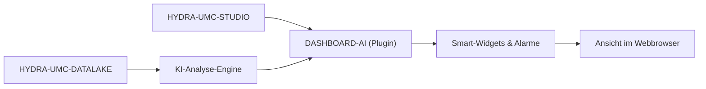

<!-- =============================================================================
HYDRA-UMC-DASHBOARD-AI - Statistical summaries and anomaly highlights for the STUDIO web dashboard
Copyright (C) JuanenRac (Electro Hobby 3D) <electrohobby3d@gmail.com>
GPL-3.0-or-later - see LICENSE
============================================================================= -->

<p align="center">
  
</p>

# 🧠 HYDRA-UMC-DASHBOARD-AI

<p align="center"><a href="README.md">🇺🇸 English</a> | <a href="README_spa.md">🇪🇸 Español</a> | <a href="README_fra.md">🇫🇷 Français</a> | <a href="README_ita.md">🇮🇹 Italiano</a> | 🇩🇪 <b>Deutsch</b> | <a href="README_zho.md">🇨🇳 简体中文</a> | <a href="README_jpn.md">🇯🇵 日本語</a> | <a href="README_por.md">🇵🇹 Português</a></p>

### 📈 Statistische Zusammenfassungen und Anomalie-Hervorhebung für das STUDIO-Web-Dashboard (kein Sprachmodell)

<p align="center">
  
  
  
  
  
  
</p>

---

> **Ehrlichkeitscheck - was heute wirklich läuft:** die Trend-Zusammenfassungsstatistik (`lib/summary.ts`), das KI-Anbieter-Gate mit seinem ehrlichen statistischen Fallback (`lib/aiProvider.ts`), der externe Vertragswächter, die echten HTTP-Clients (`api/datalakeClient.ts`, `api/anomalyClient.ts`) und die Isolation von Render-Fehlern pro Panel (`components/ErrorBoundary.tsx` - ein Absturz beim Rendern eines Panels bleibt auf dessen eigene Karte begrenzt, statt die gesamte App zu demontieren) sind real und durch 189 bestehende Vitest-Tests abgedeckt (`npm test` - `tests/*.test.ts(x)`); der CM5-Static-File-Server (`scripts/serve_static.py`) hat seine eigenen 11 bestehenden `unittest`-Tests (keine Verzeichnislisten, Härtungs-Header, Zeitlimit für untätige Verbindungen, keine Pfadumgehung). Es gibt in diesem Repository nirgendwo einen echten LLM-gestützten KI-Anbieter - das Gate von `aiProvider.ts` ist real, aber jede heute gezeigte Erzählung ist der `NO_PROVIDER_CONFIGURED`-Statistik-Fallback, klar als solcher gekennzeichnet. Trend-Vorhersage (ein echtes Prognosemodell) und Optimierungstipps sind beide vollständig aspirativ - für keines von beiden existiert bisher Code. Die Anomalie-Hervorhebung prüft nur die bereits angepasste Baseline von HYDRA-UMC-ANOMALY-DETECTOR; sie passt selbst nie eine an. Siehe `CHANGELOG.md` für das, was bisher genau ausgeliefert wurde.

---

> **Stand von Sicherheit (Safety) und Security:** Dieses Ökosystem ist kein zertifiziertes Sicherheitssystem. Es gibt noch keinen Hardware-E-STOP-Pfad, keine von der Firmware durchgesetzten Grenzen oder Verriegelungen und keinen verifizierten Bewegungsbefehl; Firmware-Images werden mit CRC-32 und einer Ed25519-Signatur geprüft, und ein Release-Build verweigert die veröffentlichten Entwicklungsschlüssel (die Werkzeugköpfe und Erweiterungsplatinen hinter dem Relais laufen noch mit URTC-Bootloadern, die statt einer Signatur ein HMAC-SHA256 mit gemeinsamem Schlüssel verwenden); TLS und gegenseitiges TLS sind optional und standardmäßig aus; noch keine eigene Platine wurde bestückt oder getestet. Lesen Sie die [Sicherheitsbasis](https://github.com/JuanenRac/HYDRA-UMC-DOCS/blob/main/docs/SECURITY_BASELINE.md) und das [Bedrohungsmodell](https://github.com/JuanenRac/HYDRA-UMC-DOCS/blob/main/docs/THREAT_MODEL.md), bevor Sie sich für die Sicherheit einer Person auf eine Aussage hier verlassen.

---

## 📋 Auf einen Blick

| | |
|---|---|
| Version | `0.1.8` |
| Reifegrad | Funktionsfähig |
| Tests | 189 (`npm test`) |
| Technik | TypeScript/React / Vite |
| Ziel | Der Raspberry Pi CM5 einer HYDRA-UMC-Zelle |
| Auf echter Hardware | Noch nicht: für diese Version ist kein Lauf auf echter Hardware vermerkt |

**Springe zu:** [Überblick](#-überblick) · [Architektur](#-architektur) · [Sicherheit und Schutz](#-sicherheit-und-schutz) · [Schnittstellen](#-schnittstellen) · [Konfiguration](#-konfiguration) · [Schnellstart](#-schnellstart) · [Tests](#-tests) · [Fehlerbehebung](#-fehlerbehebung) · [Struktur des Repositorys](#-struktur-des-repositorys) · [Verwandte Projekte](#-verwandte-projekte)

## 🚦 Projektstatus

Jede Zeile ist ein Teil dieses Repositorys, und die Ampel sagt, wie weit er heute ist. Sie beruht auf dem, was das Repository zeigen kann (Tests, Builds, Läufe), nicht auf dem, was geplant ist.

🟢 Fertig und überprüft · 🟡 Funktioniert, mit bekannten Grenzen · 🟠 Teilweise fertig oder noch nicht überprüft · 🔴 Nicht gemacht oder funktioniert nicht

| Bereich | Stand | Was das hier bedeutet |
|---|---|---|
| Software | 🟡 | Funktioniert für seinen Hauptzweck; die Ehrlichkeitsprüfung oben nennt, was noch fehlt |
| Tests | 🟢 | 189 automatische Tests, bei jeder Änderung ausgeführt |
| Echte Hardware | 🔴 | Noch nicht: für diese Version ist kein Lauf auf echter Hardware vermerkt |
| Dokumentation | 🟢 | README in acht Sprachen, bei jeder Änderung gegen das Manifest geprüft |

## 🎯 Überblick

**HYDRA-UMC-DASHBOARD-AI** ist das analytische Plugin für die STUDIO-Weboberfläche. Es ergänzt Zusammenfassungen aus dem gespeicherten Verlauf (Minimum, Maximum, Mittelwert, letzter Wert und Trendrichtung) sowie Anomalie-Hervorhebungen aus den Statistiken des Anomaliedetektors. Ein Sprachmodell und eine Prognose sind noch nicht beteiligt.

Es soll rohe Telemetrie in umsetzbare Zusammenfassungen der Schwarmleistung und der Energieverbrauchsmuster verwandeln, direkt im Browser (geplant: Warnungen zur vorausschauenden Wartung und KI-generierte Einblicke). Es nutzt den eigenen Stack von HYDRA-UMC-STUDIO (React 19 + Vite + TypeScript) statt einen neuen einzuführen, sodass es später als Panel in STUDIO selbst eingebettet werden kann.

### Hauptmerkmale:
* 🧠 **Smart Summaries (v0)** — echte Min/Max/Durchschnitt/Letzter-Wert/Trend-Statistiken, berechnet aus dem echten Verlauf von HYDRA-UMC-DATALAKE, wobei Min/Max/Letzter-Wert jeweils mit dem echten Beobachtungszeitpunkt verknüpft sind, der sie erzeugt hat. *(implementiert als echte Statistiken, noch keine KI-generierte Zusammenfassung — siehe Build und Veröffentlichung unten)*
* 🔒 **KI-Anbieter-Gate (v0)** — echte Ein-/Ausgabe-Schema-Validierung für die zukünftige LLM-gestützte Erzählung, plus ein echter, ehrlich beschrifteter statistischer Fallback, der verwendet wird, wann immer kein KI-Anbieter konfiguriert ist oder einer fehlschlägt/unstrukturierte Ausgabe zurückgibt. *(heute implementiert und in das Trend-Summary-Panel eingebunden; ein echter LLM-gestützter Anbieter selbst ist geplant)*
* 🛡️ **Externes Vertrags-Gate (v0)** — validiert jede Datalake- und Anomaliedienst-Antwort, bevor ein Panel damit rechnet oder sie darstellt; fehlerhafte Zahlen, Flags, überlange Kennungen und unsichere Steuerzeichen werden abgewiesen. *(implementiert; siehe [`docs/SECURITY.md`](docs/SECURITY.md))*
* 📈 **Trendvorhersage** — ein echtes Vorhersagemodell, über den echten, aber einfachen Richtungsindikator von v0 hinaus. *(geplant)*
* 🚨 **Anomalie-Hervorhebung (v0)** — prüft die neuesten echten Messwerte gegen eine echte, bereits kalibrierte Baseline von HYDRA-UMC-ANOMALY-DETECTOR. *(implementiert als echtes Textpanel; die Überlagerung in STUDIOs eigener 3D-Ansicht ist geplant)*
* 🛠️ **Optimierungstipps** — schlägt Parameteränderungen zur Verbesserung von Zykluszeit oder Motorlebensdauer vor. *(geplant)*
* ⏳ **Restnutzungsdauer (v0, standardmäßig aus)** — eine Karte, die HYDRA-UMC-ANOMALY-DETECTOR nach den Tagen fragt, bis der Trend der Anomalie-Scores einen Grenzwert erreicht, mit Bereich, ausdrücklichen Zuständen (zu wenig Daten, steigt nicht, Grenzwert erreicht), kleinem Diagramm und konfigurierbaren Warnungen; getestet mit simuliertem Data Lake und Detektor. *(umgesetzt; siehe [`docs/REMAINING_USEFUL_LIFE.md`](docs/REMAINING_USEFUL_LIFE.md))*
* ✅ **Toolchain-Grundgerüst** — eine echte React/Vite/TypeScript-App, die sauber mit `tsc --noEmit` baut und mit Vite ausgeliefert wird. *(implementiert — siehe Build und Veröffentlichung unten)*
* 🧯 **Render-Fehler-Isolation pro Panel** — jedes Panel ist in seine eigene `ErrorBoundary` eingebettet; eine Ausnahme beim Rendern in einem Panel zeigt eine eingedämmte Fallback-Karte, statt das gesamte Dashboard zu demontieren. *(implementiert — siehe `components/ErrorBoundary.tsx`)*

## 🧩 Rolle in HYDRA-UMC

**HYDRA-UMC-DASHBOARD-AI** ist ein schreibgeschütztes Panel neben STUDIO: Es macht aus dem echten Verlauf in HYDRA-UMC-DATALAKE Trendzusammenfassungen (Minimum, Maximum, Mittelwert, letzter Wert und Richtung, jeweils mit der Probe verknüpft, die ihn erzeugt hat) und prüft die neuesten Proben gegen die Basislinie von HYDRA-UMC-ANOMALY-DETECTOR. Es hat kein eigenes Sprachmodell: Ist kein KI-Anbieter eingerichtet, zeigt es einen statistischen Text und sagt das auch.

## 🏛️ Architektur

<p align="center">
  
</p>

<details>
<summary>Textversion des Diagramms (Mermaid)</summary>



</details>

### ARCHITEKTUR & DESIGNENTSCHEIDUNGEN

* **Warum es ein Node/TS-Projekt ist, kein Python-Projekt wie die anderen KI-nahen Projekte.** Es ist eine direkte Erweiterung des eigenen React/Vite-Frontends von HYDRA-UMC-STUDIO, kein eigenständiger KI-Dienst - sich am eigenen Stack von STUDIO auszurichten (statt am Python-Stack von HYDRA-UMC-COGNITIVE-NODE) ist das, was es später erlaubt, wirklich als echtes STUDIO-Panel eingebunden zu werden, keine separate App, zu der Nutzer wechseln müssten.
* **Warum es Geschwister von STUDIO ist, kein Ordner darin.** Dies als eigenes Repo/Build zu behalten erlaubt es der KI-Dashboard-Schicht, unabhängig vom eigenen Release-Rhythmus der Robotersteuerung von STUDIO zu versionieren und auszuliefern - derselbe Grund, der seinerzeit HYDRA-UMC-SERVER von STUDIO abgespalten hat.
* **Warum der Einstiegspunkt heute nur Identität/Version/Rolle ausgibt.** Andamiaje-Stadium: der Nachweis, dass das Paket sauber kompiliert, geht den echten Dashboard-Panels voraus.
* **Wie sich das ins restliche Ökosystem einfügt.** Erweitert HYDRA-UMC-STUDIO um statistische Zusammenfassungen und Anomalie-Hervorhebungen; ein Sprachmodell-Backend von HYDRA-UMC-COGNITIVE-NODE ist geplant und heute nicht angebunden.
* **Warum das Anomalie-Check-Panel `/stats` prüft, bevor es überhaupt anbietet, etwas zu bewerten.** Der eigene Detektor von HYDRA-UMC-ANOMALY-DETECTOR ist eine einzige, gemeinsam genutzte, im Speicher kalibrierte Baseline (siehe das eigene `api.py` dieses Projekts) - dieses Dashboard verwaltet ihre Kalibrierung bewusst nicht (den gemeinsamen Detektor-Zustand von einem lesend orientierten Dashboard aus zu verändern wäre eine echte, unerwünschte Kopplung). Ein echter "noch nicht kalibriert"-Zustand wird genau als solcher angezeigt, nie in einen generischen Fehler verschmolzen.
* **Warum die Trendzusammenfassung eine "Richtung" meldet, keine Vorhersage.** Ein echtes Vorzeichen des Erst-zu-Letzt-Deltas (mit einer kleinen relativen Rausch-Schwelle, damit ein flaches Signal nicht zwischen "steigend"/"fallend" flackert) ist ehrlich darüber, was v0 tatsächlich berechnet - ein echtes Vorhersagemodell ist eigenständige, echte zukünftige Arbeit, nicht etwas, das mit einer linearen Extrapolation vorgetäuscht wird, die als "Vorhersage" verkleidet ist.
* **Warum `safeGenerateNarrative()` die Anfrage validiert, aber bei einer schlechten Antwort nie einen Fehler wirft.** Eine fehlerhafte Anfrage ist ein echter Verdrahtungsfehler in diesem Code - es gibt keine Zusammenfassung, auf die ehrlich zurückgegriffen werden könnte, daher darf sie einen Fehler werfen. Eine *fehlerhafte/unstrukturierte* Antwort eines Anbieters ist eine reale Tatsache bei jeder echten externen API - dieser Pfad degradiert immer zum echten statistischen Fallback, statt das Panel abstürzen zu lassen, weil der Aufrufer bereits alles hat, was er braucht (die echte Zusammenfassung), um etwas Wahres zu sagen.
* **Warum `NO_PROVIDER_CONFIGURED` `summary.ts` wiederverwendet statt einer separaten Fallback-Implementierung.** Eine zweite, unabhängige "Fallback-Erzählung"-Formel würde von den echten Statistiken abweichen, denen das Panel bereits vertraut und die es bereits numerisch anzeigt - die Wiederverwendung derselben `TrendSummary`-Werte hält die Fallback-Erzählung nachweislich konsistent mit den Zahlen direkt daneben.

## 🖼️ Screenshots

Aufgenommen mit 1920×1080 auf einem Prüfstand, mit Beispieldaten und ohne eine echte Anlage dahinter.

<table>
<tr><td width="50%" valign="top"><br><sub>Die zwei Panels: die Trendzusammenfassung einer aus dem Data Lake gelesenen Schwingungsreihe und die Anomalieprüfung, die ihr jüngstes Fenster gegen die angepasste Baseline bewertet.</sub></td></tr>
</table>

## 🔒 Sicherheit und Schutz

| Bedrohung | Abwehr | Wo |
|---|---|---|
| Der statische Server leitet mehr weiter als er soll | Nur `/api/datalake` und `/api/anomaly` werden weitergeleitet; mit Token nur die Aufrufe aus `TOKEN_ALLOWED_CALLS`; Bodys sind auf 4 MiB begrenzt | `scripts/serve_static.py` |
| Dienst-Tokens im Netzwerk offengelegt | Sind Dienst-Tokens gesetzt, startet der Server nicht auf einer Nicht-Loopback-Adresse, außer es wird ausdrücklich verlangt; ein Token mit Steuerzeichen wird abgelehnt | `scripts/serve_static.py` |
| Eine Seite, die Skripte lädt oder Hosts aufruft, die sie nicht soll | Eine Content-Security-Policy bei jeder Antwort: Skripte nur von der Seite selbst, keine Frames, Verbindungen nur zum eigenen Origin; weitere Origins kommen einzeln über `--connect-src` hinzu und müssen einfache Origins sein | `scripts/serve_static.py` |
| Text eines KI-Anbieters mit Steuer- oder bidirektionalen Zeichen oder eine fehlerhafte Antwort | Der Text ist auf 2000 Zeichen begrenzt und unsichere Zeichen werden verworfen; eine fehlerhafte Antwort fällt auf den statistischen Text zurück, statt das Panel zu zerstören | `src/lib/aiProvider.ts` |
| Ein hängender Dienst, der die Seite einfriert | Jede Anfrage hat ein Limit von 5 s, eine Abfrage holt höchstens 5000 Proben pro Fenster mit 12 Fensterversuchen, und ein abstürzendes Panel zeigt eine abgegrenzte Karte, während das andere weiterläuft | `src/api/fetchWithTimeout.ts`, `src/api/datalakeClient.ts`, `src/components/ErrorBoundary.tsx` |

**Was es nie tut:** in den Verlaufsspeicher schreiben, die Anomalie-Basislinie anpassen oder auf einen Roboter einwirken. Es ist ein Lesepanel.

## 🔌 Schnittstellen

| Topic oder Route | Was es trägt |
|---|---|
| `/api/datalake/*` | an HYDRA-UMC-DATALAKE auf `127.0.0.1:8095` weitergeleitet (mit Token nur lesende Aufrufe) |
| `/api/anomaly/*` | an HYDRA-UMC-ANOMALY-DETECTOR auf `127.0.0.1:8097` weitergeleitet |
| `/dashboard-ai`, `/api/ai/datalake`, `/api/ai/anomaly-detector` | hinter HYDRA-UMC-SERVER liegt die Seite unter `/dashboard-ai` und liest über das Relay dieses Servers, mit dem Zugriffstoken der STUDIO-Sitzung |
| `/api/anomaly/rul` | nur bei eingeschalteter Karte für die Restnutzungsdauer: Die Seite sendet die neuesten Anomalie-Scores und liest die Tage bis zum Grenzwert mit Bereich und ausdrücklichem Zustand; der Detektor muss mit `--rul` laufen |

## ⚙️ Konfiguration

| Variable | Standard | Was sie festlegt |
|---|---|---|
| `--dir` | `dist/` | die gebaute Seite, die ausgeliefert wird |
| `--addr`, `--port` | `127.0.0.1`, `8115` | worauf gelauscht wird |
| `--datalake`, `--anomaly` | `http://127.0.0.1:8095`, `http://127.0.0.1:8097` | wo die beiden Dienste laufen |
| `--connect-src` | keiner | ein zusätzlicher Origin, den die Seite aufrufen darf, für einen Build mit `VITE_DATALAKE_URL` / `VITE_ANOMALY_URL`; je Origin wiederholen |
| `--csp`, `HYDRA_DASHBOARD_CSP` | `default` | `default` oder eine vollständige eigene Richtlinie |
| `HYDRA_UMC_DATALAKE_READ_TOKEN`, `HYDRA_UMC_DATALAKE_TOKEN`, `HYDRA_UMC_ANOMALY_TOKEN` | kein Token | der Token, den der Server jedem Dienst zeigt; die `_FILE`-Varianten lesen ihn aus einer Datei |
| `VITE_DATALAKE_URL`, `VITE_ANOMALY_URL` | `/api/datalake`, `/api/anomaly` | im Browser sichtbare Dienst-URLs, beim Build gesetzt; nie eine Zugangsdaten-Angabe hineinschreiben |
| `VITE_RUL_ENABLED` | `false` | `true` (genau so) fügt die Karte für die Restnutzungsdauer hinzu; bei jedem anderen Wert gibt es weder Karte noch Anfrage an den Detektor |
| `VITE_RUL_URL`, `VITE_RUL_SOURCE_ID`, `VITE_RUL_KIND`, `VITE_RUL_FIELD`, `VITE_RUL_LIMIT`, `VITE_RUL_POINTS` | the anomaly URL, `robot-1`, `anomaly_score`, `value`, `1`, `200` | der Detektor, der `POST /rul` beantwortet, die aus dem Data Lake gelesene Serie der Anomalie-Scores, der Score, der als Grenzwert gilt, und wie viele der neuesten Proben (1 bis 1000) gesendet werden |
| `VITE_RUL_WARN_DAYS`, `VITE_RUL_CRITICAL_DAYS`, `VITE_RUL_TIMEOUT_MS` | `30`, `7`, `5000` | die Karte warnt, wenn der früheste plausible Tag innerhalb dieser Tage liegt, und wird kritisch innerhalb der zweiten Zahl (nie größer als die erste); das Zeitlimit der Anfrage in Millisekunden |

## 🚀 Schnellstart

Benötigt Node.js 20 oder neuer mit npm; der statische Server braucht Python 3.10 oder neuer.

```bash
./dev.sh                                    # installs the dependencies and starts the Vite dev server on port 5174 (dev.bat on Windows)
./build.sh                                  # runs the tests, type-checks and builds dist/ (build.bat on Windows)
python scripts/serve_static.py --port 8115  # serves dist/ and forwards /api/datalake and /api/anomaly
```

## 🧪 Tests

189 automatische Tests laufen mit `npm test`. Der statische Server hat eigene Python-Tests in `scripts/test_serve_static.py`. Sie brauchen weder Hardware noch einen laufenden Dienst.

Die CI führt `HYDRA_UMC_CI=1 python tools/ci_validate.py` aus; das prüft das Manifest, die Dokumente, die acht READMEs und die Bilder.

## 🏗️ Build und Veröffentlichung

Erfordert Node.js >= 20.

```bash
# Linux/macOS
./dev.sh      # installiert Abhängigkeiten, startet den Vite-Dev-Server auf :5174
./build.sh    # installiert Abhängigkeiten, führt die echte Testsuite aus, prüft Typen, baut dist/

# Windows
dev.bat
build.bat
```

`npm run build` verkettet `tsc --noEmit && vite build`; es ändert die Version nie, sodass ein defekter Build niemals eine erhöhte Versionsnummer ausliefert. `npm run dev` startet Vite auf Port `5174` (getrennt vom eigenen `5173` von HYDRA-UMC-STUDIO, damit beide gleichzeitig laufen können). `npm test` führt die echte Vitest-Suite direkt aus.

Standardmäßig rufen die beiden echten Panels die gleich-originalen Pfade `/api/datalake` und `/api/anomaly` auf, die `scripts/serve_static.py` (und der Vite-Dev-Server) an HYDRA-UMC-DATALAKE auf `127.0.0.1:8095` und HYDRA-UMC-ANOMALY-DETECTOR auf `127.0.0.1:8097` weiterleiten (keiner der Dienste sendet CORS-Header, der Browser könnte sie nicht direkt aufrufen) - überschreibbar mit `VITE_DATALAKE_URL`/`VITE_ANOMALY_URL` (vor `vite build`/`vite dev` gesetzt, Vite bindet sie zur Build-Zeit ein), um auf ein anderes Deployment zu zeigen.

Hinter HYDRA-UMC-SERVER wird die Seite unter `/dashboard-ai` ausgeliefert (das `build-frontend` von HYDRA-UMC-SERVER baut und kopiert sie, wenn dieses Repository daneben ausgecheckt ist). Dort liest sie über das Relay dieses Servers, `/api/ai/datalake` (nur lesend) und `/api/ai/anomaly-detector`, mit dem Zugriffstoken der Person, die sich im selben Browser in HYDRA-UMC-STUDIO angemeldet hat (das Token wird nur an Adressen desselben Ursprungs gesendet); so gelten die Rollen des Servers, und die Dienste behalten ihre eigenen Bearer-Token privat beim Server. Eine abgelehnte Sitzung wird im Panel gemeldet (über STUDIO anmelden; Administrator oder Bediener nötig). Mit dem Dashboard dort kann HYDRA-UMC-ANOMALY-DETECTOR mit `HYDRA_UMC_ANOMALY_PROTECT_READS=1` gestartet werden.

`scripts/serve_static.py` sendet mit jeder Antwort eine Content-Security-Policy: Skripte nur von der Seite selbst (keine Inline-Skripte, keine Plugins), kein Einbetten in Frames und Verbindungen nur zum eigenen Ursprung der Seite. Ein Build mit `VITE_DATALAKE_URL`/`VITE_ANOMALY_URL` fügt die Ursprünge, die er aufruft, mit `--connect-src URSPRUNG` hinzu (wiederholbar); `--csp off` (oder `HYDRA_DASHBOARD_CSP=off`) sendet keine, für einen vorgeschalteten Proxy, der sie setzt, und jeder andere `--csp`-Wert wird als vollständige Richtlinie verwendet. `npm run lint` führt ESLint aus (empfohlene Regeln, typescript-eslint und die Regeln der React-Hooks); die CI führt es neben der Typprüfung und den Tests aus. Im eigenständigen Modus legt dasselbe Skript das Bearer-Token eines Dienstes vor, der eines verlangt (`HYDRA_UMC_DATALAKE_READ_TOKEN`, sonst `HYDRA_UMC_DATALAKE_TOKEN`, und `HYDRA_UMC_ANOMALY_TOKEN`, jeweils auch als `..._FILE`, eine Datei, deren erste Zeile das Token ist), sodass die Seite es nie besitzt. Das Token geht nur bei den Aufrufen hinaus, die das Dashboard macht (die Lesezugriffe auf den Data Lake, der Status des Detektors und die Bewertung eines Fensters); das Anpassen einer Baseline, Schreibzugriffe auf den Data Lake oder seine Aufbewahrung gehen ohne Token hinaus und der Dienst lehnt sie ab. Ein Server, der an eine andere Adresse als Loopback gebunden ist, startet mit Tokens nicht, außer `--allow-tokens-off-loopback` ist angegeben.

Lies [`docs/SECURITY.md`](docs/SECURITY.md), bevor du diese im Browser sichtbaren URLs konfigurierst oder einen echten KI-Anbieter verbindest; es definiert Antwortvalidierung, Inhaltssicherheit, Fehlerverhalten und die Regel, keine Geheimnisse einzubinden.

Jeder echte Trend-Summary-Abruf durchläuft auch das echte KI-Anbieter-Gate. Ohne konfigurierten echten Anbieter (v0s ehrlicher Standard) zeigt das Panel den echten statistischen Fallback, klar beschriftet:

```ts
import { safeGenerateNarrative, NO_PROVIDER_CONFIGURED } from './lib/aiProvider'

const narrative = await safeGenerateNarrative(NO_PROVIDER_CONFIGURED, { sourceId, kind, field, summary })
// { narrative: "robot-1/motor_temp/value: 4 sample(s), ranging 10.00 to 50.00,
//    averaging 29.00, latest 36.00 (rising).", generatedBy: 'statistical-fallback' }
```

Ein Anbieter, der einen Fehler wirft oder eine Antwort mit fehlendem oder fehlerhaftem `narrative` zurückgibt, degradiert zu genau diesem echten Fallback, statt das Panel abstürzen zu lassen oder nichts anzuzeigen.

## 🩺 Fehlerbehebung

| Du siehst | Weil | Tu |
|---|---|---|
| Die Panels sind leer und die Konsole meldet eine fehlgeschlagene Anfrage | Der statische Server läuft nicht, oder DATALAKE bzw. der Anomalie-Dienst ist nicht unter der angegebenen Adresse | `scripts/serve_static.py` starten und `--datalake` und `--anomaly` prüfen |
| Der Server startet mit Tokens nicht | Ein Dienst-Token ist gesetzt und `--addr` ist keine Loopback-Adresse | An `127.0.0.1` binden oder die Seite hinter HYDRA-UMC-SERVER legen |
| Die Zusammenfassung nennt „statistischer Ersatz“ | Kein KI-Anbieter ist eingerichtet oder der Anbieter antwortete mit etwas, das die Prüfung nicht bestand | Das ist das erwartete Standardverhalten; die Zahlen sind echt |
| Die Tests laufen in einen Timeout, wenn viele gleichzeitig laufen | Die Maschine ist ausgelastet und ein Vitest-Worker antwortete nicht rechtzeitig | `npx vitest run --pool=threads` ausführen oder dann, wenn nichts anderes baut |

## 📂 Struktur des Repositorys

<p align="center">
  
</p>

<details>
<summary>Textversion des Baums</summary>

```text
HYDRA-UMC-DASHBOARD-AI/
├── src/                                                     Quellcode
│   ├── api/                                                 Echte HTTP-Clients: datalakeClient.ts, anomalyClient.ts, rulClient.ts
│   ├── lib/                                                 Statistik, KI-Anbieter-Gate, Sitzung und Endpunkte, Auswertung der Restnutzungsdauer und Texte
│   ├── components/                                          die Panels (eines standardmäßig aus), das Diagramm, die Fehlergrenze
│   ├── main.tsx                                             Einstiegspunkt der Anwendung
│   ├── App.tsx                                              Wurzelkomponente - bindet beide echten Panels ein
│   ├── index.css                                            Basis-Stylesheet
│   └── vite-env.d.ts                                        Typisierung von VITE_DATALAKE_URL / VITE_ANOMALY_URL / VITE_RUL_*
├── tests/                                                   Echte Tests: HTTP-Round-Trips + Komponententests
├── scripts/                                                 der statische Server und seine Tests
├── systemd/                                                 Dienst-Unit
├── tools/                                                   Projektwerkzeuge und CI-Prüfungen
├── docs/                                                    Dokumente des Projekts
├── images/                                                  Medien und Diagramme
├── .github/                                                 CI-Workflow und Issue-Vorlagen
├── index.html                                               Vite-Einstiegs-HTML
├── vite.config.ts                                           Vite-Bundler- + Vitest-Konfiguration
├── tsconfig.json / tsconfig.app.json / tsconfig.node.json   TypeScript-Konfiguration (App und Node)
├── bump_manifest_version.py                                 Synchronisiert die Version von hydra-umc.project.json mit der von package.json (--sync)
├── dev.sh / dev.bat                                         Echter Dev-Server: installiert Abhängigkeiten + vite
├── build.sh / build.bat                                     Validiert und baut (Bauen ändert nie die Version)
├── package.json                                             Paketmetadaten und Skripte
├── CHANGELOG.md                                             was sich in jeder Version geändert hat
├── build-test.sh                                            Build-Prüfung ohne Änderungen
├── hydra-umc.project.json                                   Manifest: Version, Reifegrad, Familie
└── test.sh                                                  führt die Tests aus
```

</details>

## 🗺️ Roadmap und bekannte Grenzen

**Bekannte Grenzen heute**

* **Geplant:** eine echte Prognose (Trendvorhersage), Optimierungstipps, ein KI-Anbieter hinter dem Gate (HYDRA-UMC-COGNITIVE-NODE ist das vorgesehene Backend und nicht angebunden) und eine Überlagerung des Anomalie-Urteils auf der 3D-Ansicht von STUDIO.
* Die Zusammenfassungen sind Statistiken (Minimum, Maximum, Mittelwert, letzter Wert und Richtung), keine Prognose.
* Gegen laufende Nachbardienste auf einem Rechner erprobt; nie mit Daten einer echten Anlage.

## 🌍 Sprachen

Diese README und die Dokumente des Repositorys gibt es in acht Sprachen: Englisch, Spanisch, Deutsch, Französisch, Italienisch, Japanisch, Chinesisch und Portugiesisch (Portugal). Sie entstehen gemeinsam, und die CI prüft, dass die acht Dateien dieselben Abschnitte und dieselben Links haben.

## 🔗 Verwandte Projekte

Dieses Projekt ist Teil des HYDRA-UMC-Robotik-Ökosystems desselben Autors (JuanenRac / Electro Hobby 3D). Gut zu wissen, da eine Anfrage eigentlich eines dieser Projekte betreffen könnte statt dieses Repositorys.

**Direkt verwandt**
- **[HYDRA-UMC-STUDIO](https://github.com/JuanenRac/HYDRA-UMC-STUDIO)** — Web-Steuerungs-Dashboard mit Echtzeit-3D-Visualisierung mehrerer Roboter — das Dashboard, das dieses Projekt direkt erweitert.
- **[HYDRA-UMC-COGNITIVE-NODE](https://github.com/JuanenRac/HYDRA-UMC-COGNITIVE-NODE)** — Integrationsknoten für die Hailo-10-Cognitive-Pipeline (LLM-/VLA-/Sprach-Orchestrierung) — das KI-Backend, das dieses Dashboard speist.
- **[HYDRA-UMC-DATALAKE](https://github.com/JuanenRac/HYDRA-UMC-DATALAKE)** — echter sqlite3-gestützter Zeitreihenspeicher mit einer echten Ingest-/Abfrage-HTTP-API — der reale Verlauf, aus dem das Smart-Summaries-Panel seine Statistiken berechnet.
- **[HYDRA-UMC-ANOMALY-DETECTOR](https://github.com/JuanenRac/HYDRA-UMC-ANOMALY-DETECTOR)** — echter FFT- + statistischer Basislinien-Anomaliedetektor mit Drift-Überwachung — die angepasste Baseline, gegen die das Anomaly-Highlighting-Panel aktuelle Samples bewertet.

**Ebenfalls Teil des Ökosystems**

*Kern-Hardware & Plattform*
- **[HYDRA-UMC](https://github.com/JuanenRac/HYDRA-UMC)** — der Entwurf des Motherboards des Roboterarms: CM5-Host + Dual-Core-STM32H745, gedacht zur Koordination von bis zu 8 Werkzeugarmen über CAN-OTA/SPI-OTA (Firmware in einer frühen Phase; noch keine bestückte Platine).
- **[HYDRA-UMC-OS](https://github.com/JuanenRac/HYDRA-UMC-OS)** — reproduzierbare Raspberry-Pi-OS-Produktschicht für den CM5: schreibgeschützter Agent, validierte Konfiguration/Profile, WiFi-Ersteinrichtung.
- **[HYDRA-UMC-SDK](https://github.com/JuanenRac/HYDRA-UMC-SDK)** — der gemeinsame JSON-Schema-Vertrag und die Software-Auftragsschranke, gegen die jede Bridge ihre Befehle validiert (keine zertifizierte Sicherheitsfunktion).
- **[HYDRA-UMC-CONNECTOR-HUB](https://github.com/JuanenRac/HYDRA-UMC-CONNECTOR-HUB)** — deklaratives Adapter-Manifest-Register und Validator für Konnektoren externer Maschinen; erweitert die eigene Vertragsidee des SDK auf externe Maschinen, ohne die Industrie-Gateway-Projekte zu ersetzen.

*Kern-Backend & Clients*
- **[HYDRA-UMC-SERVER](https://github.com/JuanenRac/HYDRA-UMC-SERVER)** — das reale Headless-Backend (REST/WebSocket), mit dem jeder Steuerungsclient tatsächlich spricht.
- **[HYDRA-UMC-SUITE](https://github.com/JuanenRac/HYDRA-UMC-SUITE)** — Desktop-Schwarmleitstand (PySide6) für mehrere Server gleichzeitig, verpackt als eigenständige ausführbare Datei.
- **[HYDRA-UMC-ANDROID-CONTROL](https://github.com/JuanenRac/HYDRA-UMC-ANDROID-CONTROL)** — native Android-Steuerungs-App mit biometrischem Login und einer gekoppelten Wear-OS-Begleit-App.
- **[HYDRA-UMC-IOS-CONTROL](https://github.com/JuanenRac/HYDRA-UMC-IOS-CONTROL)** — iOS/iPadOS-Steuerungs-App (Flutter) mit Echtzeit-WebSocket-Synchronisierung.
- **[HYDRA-UMC-DSI](https://github.com/JuanenRac/HYDRA-UMC-DSI)** — native Touch-UI für das eingebaute 7"-DSI-Touchscreen, direkt auf dem CM5 eingebettet.
- **[HYDRA-UMC-EDITOR-URDF](https://github.com/JuanenRac/HYDRA-UMC-EDITOR-URDF)** — grafischer Desktop-URDF-Ersteller/-Editor, der fertige Modelle in STUDIOs eigenen Katalog überträgt.
- **[HYDRA-UMC-EDITOR-STL](https://github.com/JuanenRac/HYDRA-UMC-EDITOR-STL)** — Desktop-STL-Modelleditor, der echte Teile im selben Modellkatalog transformiert/ersetzt/entfernt/hinzufügt, den auch HYDRA-UMC-EDITOR-URDF bearbeitet.
- **[HYDRA-UMC-BRIDGE-AMR](https://github.com/JuanenRac/HYDRA-UMC-BRIDGE-AMR)** — Koordinationsschranke für AGV-/AMR-Flotten über einen VDA-5050-MQTT-Publisher (nur gegen eine emulierte Flotte getestet).
- **[HYDRA-UMC-BRIDGE-CNC](https://github.com/JuanenRac/HYDRA-UMC-BRIDGE-CNC)** — High-Level-Koordinator für CNC-Zellen mit GRBL-Status-/Steuerbyte-Zugriff (nur gegen einen Emulator getestet).
- **[HYDRA-UMC-BRIDGE-DROIDS](https://github.com/JuanenRac/HYDRA-UMC-BRIDGE-DROIDS)** — Koordinationsschranke für laufende/humanoide Droiden, mit einem Boston-Dynamics-Spot-Befehlssender (nur gegen einen Emulator getestet).
- **[HYDRA-UMC-BRIDGE-LASER](https://github.com/JuanenRac/HYDRA-UMC-BRIDGE-LASER)** — Koordinator für Laserzellen, liest 3 Schlüssel-/Gehäuse-/Verriegelungs-GPIO-Signale (nur gegen einen simulierten Chip getestet; kann keinen Laser scharfschalten oder auslösen).
- **[HYDRA-UMC-BRIDGE-OPENPNP](https://github.com/JuanenRac/HYDRA-UMC-BRIDGE-OPENPNP)** — sicherer High-Level-Koordinator für den Leiterplattenfluss von OpenPnP Pick-and-Place.
- **[HYDRA-UMC-BRIDGE-PRINTER3D](https://github.com/JuanenRac/HYDRA-UMC-BRIDGE-PRINTER3D)** — sichere Koordinationsschranke für Moonraker/Klipper-3D-Drucker, mit echten gesicherten Job-Befehlen.
- **[HYDRA-UMC-BRIDGE-ROS2](https://github.com/JuanenRac/HYDRA-UMC-BRIDGE-ROS2)** — Koordinator mit einem träge importierten rclpy-ROS-2-Transport (noch nicht gegen eine ROS-2-Installation ausgeführt).
- **[HYDRA-UMC-BRIDGE-UAV](https://github.com/JuanenRac/HYDRA-UMC-BRIDGE-UAV)** — Koordinationsschranke für kameraausgestattete UAVs, mit einem MAVLink-Befehlssender (nur gegen einen Emulator getestet).

*URTC-Werkzeugplattform*
- **[URTC](https://github.com/JuanenRac/URTC)** — Firmware für die physische Universal-Robot-Tool-Controller-Platine, 25+ Werkzeugprofile über CAN-Bus.
- **[URTC-FLASHER](https://github.com/JuanenRac/URTC-FLASHER)** — Desktop-GUI-Flash-Tool für URTC-Platinen, CAN-OTA plus Full-Chip-SWD/JTAG.
- **[URTC-TESTER](https://github.com/JuanenRac/URTC-TESTER)** — Desktop-Live-CAN-Bus-Diagnosetool für URTC-Platinen, ein Panel pro Werkzeugprofil.
- **[URTC-WEB-STUDIO](https://github.com/JuanenRac/URTC-WEB-STUDIO)** — browserbasierte Alternative zu URTC-TESTER über die Web-Serial-API, ohne lokale Installation.
- **[URTC-GATEWAY](https://github.com/JuanenRac/URTC-GATEWAY)** — Gateway vor dem CAN-Bus von URTC: Liste erlaubter Kennungen, Ratenbegrenzung und Sitzungsschlüssel; Software auf dem Computer getestet, noch nicht an einem echten Bus.

*Vision-KI-Knoten (Hailo-8)*
- **[HYDRA-UMC-VISION-NODE](https://github.com/JuanenRac/HYDRA-UMC-VISION-NODE)** — Integrationsknoten für die Hailo-8-Vision-Pipeline, mit einer echten stufenweisen Hardware-Bereitschaftsprüfung.
- **[HYDRA-UMC-DETECTION-HEF](https://github.com/JuanenRac/HYDRA-UMC-DETECTION-HEF)** — echte Registry für kompilierte Modelle mit Hailo-Architektur-/Prüfsummen-Safe-Load-Verifizierung.
- **[HYDRA-UMC-VISION-STREAMER](https://github.com/JuanenRac/HYDRA-UMC-VISION-STREAMER)** — echter GStreamer-Pipeline- + MediaMTX-Konfigurationsgenerator mit einer echten HailoRT-Integrationsschranke.
- **[HYDRA-UMC-VISUAL-SERVOING-API](https://github.com/JuanenRac/HYDRA-UMC-VISUAL-SERVOING-API)** — Position-Based-Visual-Servoing-Korrekturgesetz mit Freigabe abhängig vom Zonenstatus; noch keine Posenschätzung per Kamera.
- **[HYDRA-UMC-SAFETY-ZONES](https://github.com/JuanenRac/HYDRA-UMC-SAFETY-ZONES)** — v0-Logik für Zonenverletzung, Kalibrierungsaktualität und E-STOP-Anforderung, die Objektpositionen aus einer Datei nimmt; kein Detektor speist sie, und noch kein physischer E-STOP ist angeschlossen.

*Kognitiver KI-Knoten (Hailo-10)*
- **[HYDRA-UMC-VLA-ENGINE](https://github.com/JuanenRac/HYDRA-UMC-VLA-ENGINE)** — echte Aktions-Token-Kodierung/-Dekodierung und Trajektoriengenerierung für ein Vision-Language-Action-Modell.
- **[HYDRA-UMC-VOICE-UI](https://github.com/JuanenRac/HYDRA-UMC-VOICE-UI)** — echtes Sprach-Frontend (VAD + Intent-Parser) mit einem begrenzten, bestätigungsgesicherten Watch-Relay.
- **[HYDRA-UMC-SEMANTIC-PLANNER](https://github.com/JuanenRac/HYDRA-UMC-SEMANTIC-PLANNER)** — echte regelbasierte Aufgabenzerlegung und semantische Fehlerbehebung über MCU-Fehlercodes.
- **[HYDRA-UMC-DOCS-QA](https://github.com/JuanenRac/HYDRA-UMC-DOCS-QA)** — echte, nur auf der Standardbibliothek basierende TF-IDF-Dokumentensuche über die eigenen Markdown-Dokumente dieses Ökosystems.
- **[HYDRA-UMC-LOCAL-TECHNICIAN](https://github.com/JuanenRac/HYDRA-UMC-LOCAL-TECHNICIAN)** — lokaler, richtlinien-gesteuerter KI-Wartungstechniker für das Ökosystem selbst - beobachtet, diagnostiziert und schlägt Korrekturen vor; die zwei höchsten Risikostufen sind absichtlich noch nicht implementiert.

*Orchestrierung & Schwarm*
- **[HYDRA-UMC-ORCHESTRATOR](https://github.com/JuanenRac/HYDRA-UMC-ORCHESTRATOR)** — Integrationsknoten mit einem echten gRPC/Protobuf-Health-Report-Vertrag und einer Missions-Zustandsmaschine.
- **[HYDRA-UMC-JOB-DISPATCHER](https://github.com/JuanenRac/HYDRA-UMC-JOB-DISPATCHER)** — echte prioritätsbasierte Job-Queue mit Deduplizierung, über eine echte HTTP-API.
- **[HYDRA-UMC-NODE-HEALING](https://github.com/JuanenRac/HYDRA-UMC-NODE-HEALING)** — echter gRPC-basierter Flotten-Health-Watchdog mit Retry/Backoff und Identitäts-Mismatch-Erkennung.
- **[HYDRA-UMC-PATH-PLANNER-3D](https://github.com/JuanenRac/HYDRA-UMC-PATH-PLANNER-3D)** — echter RRT-basierter 3D-Pfadplaner mit echter Hindernis-/Arbeitsraum-Kollisionsvalidierung.
- **[HYDRA-UMC-SWARM-SYNC](https://github.com/JuanenRac/HYDRA-UMC-SWARM-SYNC)** — echte CRDT-LWW-Element-Map-Zustandssynchronisation, eigenschaftsgetestet auf Multi-Zellen-Konvergenz.

*Digitaler Zwilling & Simulation*
- **[HYDRA-UMC-TWIN](https://github.com/JuanenRac/HYDRA-UMC-TWIN)** — Integrationsknoten für die Digital-Twin-Engine, mit einem echten Versionskompatibilitäts-Sync-Vertrag.
- **[HYDRA-UMC-HIL-BRIDGE](https://github.com/JuanenRac/HYDRA-UMC-HIL-BRIDGE)** — Hardware-in-the-Loop-Router mit einer Software-Kollisionsverriegelung zwischen Simulation und echter Hardware (ohne echte Hardware getestet).
- **[HYDRA-UMC-PHYSICS-REPLICA](https://github.com/JuanenRac/HYDRA-UMC-PHYSICS-REPLICA)** — echte Vorwärtskinematik und Gelenkgrenzenvalidierung über eine echte URDF-Teilmenge.
- **[HYDRA-UMC-SYNTHETIC-DATA-GEN](https://github.com/JuanenRac/HYDRA-UMC-SYNTHETIC-DATA-GEN)** — echter prozeduraler 2D-Szenengenerator mit YOLO/COCO-Annotationsexport.

*Daten & Analytik*
- **[HYDRA-UMC-PRODUCTION-REPORTS](https://github.com/JuanenRac/HYDRA-UMC-PRODUCTION-REPORTS)** — echte OEE-/Verfügbarkeitsberechnung über den DATALAKE-Verlauf, mit reproduzierbarem CSV-Export.
- **[HYDRA-UMC-TELEMETRY-COLLECTOR](https://github.com/JuanenRac/HYDRA-UMC-TELEMETRY-COLLECTOR)** — echte CAN/WebSocket-Ingestion-Pipeline in DATALAKE, mit Sequenz-Deduplizierung.

*Industrie-Gateway*
- **[HYDRA-UMC-GATEWAY-INDUSTRIAL](https://github.com/JuanenRac/HYDRA-UMC-GATEWAY-INDUSTRIAL)** — Integrationsknoten, der zu Industrieprotokollen weiterleitet, mit einer echten Befehls-Allowlist-/Backpressure-Schicht.
- **[HYDRA-UMC-OPCUA-SERVER](https://github.com/JuanenRac/HYDRA-UMC-OPCUA-SERVER)** — echter OPC-UA-Adressraum, verifiziert mit einer echten Binärprotokoll-Client-Session.
- **[HYDRA-UMC-MQTT-BROKER](https://github.com/JuanenRac/HYDRA-UMC-MQTT-BROKER)** — echter MQTT-Broker mit optionaler Pro-Client-Authentifizierung und Topic-ACLs.
- **[HYDRA-UMC-MTCONNECT-ADAPTER](https://github.com/JuanenRac/HYDRA-UMC-MTCONNECT-ADAPTER)** — echte MTConnect-`/probe`- und `/current`-XML-Endpunkte mit Degraded-Mode-Ausgabe.

*Ergänzende Tools & Ökosystembetrieb*
- **[HYDRA-UMC-TOOL-CLI](https://github.com/JuanenRac/HYDRA-UMC-TOOL-CLI)** — Flotten-CLI mit einem echten, stabilen Exit-Code-Vertrag, ein echter Live-Client der eigenen API von HYDRA-UMC-SERVER.
- **[HYDRA-UMC-WATCH](https://github.com/JuanenRac/HYDRA-UMC-WATCH)** — WearOS-Begleit-App mit haptischen Alarmmustern und einem Sprach-Relay zum gekoppelten Telefon (noch nicht auf einer physischen Uhr ausgeführt).
- **[URTC-SMART-RACK](https://github.com/JuanenRac/URTC-SMART-RACK)** — Firmware für ein Platinenmontagegestell mit echter Werkzeug-ID-Dekodierung und Smart-Idle-Vorheizlogik.
- **[URTC-VISION-TOOL](https://github.com/JuanenRac/URTC-VISION-TOOL)** — Firmware plus ein echter Python-Vision-Begleiter für einen Thermal-/RGB-Inspektionswerkzeugkopf.
- **[HYDRA-UMC-UPDATER](https://github.com/JuanenRac/HYDRA-UMC-UPDATER)** — administratives Desktop-Tool, das jedes Repository in diesem Ökosystem entdeckt, klont und aktualisiert.
- **[HYDRA-UMC-OS-REBUILDER](https://github.com/JuanenRac/HYDRA-UMC-OS-REBUILDER)** — Windows/Linux-Desktop-Tool, das ein flashbereites CM5-Image baut, vorgeladen mit den aktuellsten Versionen des Ökosystems, mit Ersteinrichtungs-Konfiguration für WLAN/Benutzer/SSH im Stil von Raspberry Pi Imager.
- **[HYDRA-UMC-OPS-AGENT](https://github.com/JuanenRac/HYDRA-UMC-OPS-AGENT)** — Wartungsvorfall-Koordinator: eine Edge-Rolle mit niedrigem Privileg sammelt einen bereinigten Inventar-/Gesundheits-Snapshot, eine Control-Plane-Rolle rendert ihn schreibgeschützt und bittet einen KI-Anbieter um einen Diagnosevorschlag - wendet nie einen Patch an und stellt nie etwas bereit.
- **[HYDRA-UMC-DEV-SERVER](https://github.com/JuanenRac/HYDRA-UMC-DEV-SERVER)** — reproduzierbarer Entwicklungshost (Raspberry Pi 5 / CM5), der den Quellcode des Ökosystems vorhält und begrenzte Build-/Test-Aufgaben über eine dauerhafte Warteschlange ausführt; eine dedizierte Entwicklerrolle, ausdrücklich kein operativer CM5.

## 📚 Dokumentation

Hier steht mehr:

* [Sicherheitsgrundlage des Ökosystems](https://github.com/JuanenRac/HYDRA-UMC-DOCS/blob/main/docs/SECURITY_BASELINE.md)
* [Bedrohungsmodell des Ökosystems](https://github.com/JuanenRac/HYDRA-UMC-DOCS/blob/main/docs/THREAT_MODEL.md)
* [Änderungsprotokoll dieses Repositorys](CHANGELOG.md)
* [Lizenz dieses Repositorys](LICENSE.md)

## 🤝 Mitwirken und Community

* Führe vor einem Pull Request `HYDRA_UMC_CI=1 py -3 tools/ci_validate.py` (oder `HYDRA_UMC_CI=1 python3 tools/ci_validate.py`) aus: Es muss `CI_VALIDATION=PASS` ausgeben. Führe dafür nicht `build.sh` oder `build.bat` aus; Bauen ist keine Prüfung.
* Die acht READMEs entstehen aus einer einzigen Quelle in HYDRA-UMC-DOCS; bearbeite sie nicht von Hand. Ändere die Quelle und schreibe sie mit `tools/make_readmes.py` neu.
* Behaupte in einer README nichts, was nicht gelaufen ist: Schreibe „simuliert“ oder „nicht auf Hardware erprobt“, wo das stimmt.
* Siehe [CONTRIBUTING.md](CONTRIBUTING.md), den [Verhaltenskodex](CODE_OF_CONDUCT.md), [SECURITY.md](SECURITY.md) und [SUPPORT.md](SUPPORT.md).

## 👤 AUTOR

**JuanenRac (Electro Hobby 3D)** · electrohobby3d@gmail.com

## 📜 LIZENZ

GPL-3.0-or-later - [LICENSE](LICENSE).
