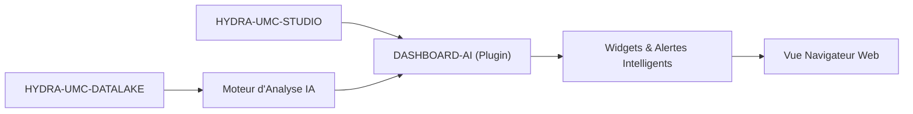

<!-- =============================================================================
HYDRA-UMC-DASHBOARD-AI - Statistical summaries and anomaly highlights for the STUDIO web dashboard
Copyright (C) JuanenRac (Electro Hobby 3D) <electrohobby3d@gmail.com>
GPL-3.0-or-later - see LICENSE
============================================================================= -->

<p align="center">
  
</p>

# 🧠 HYDRA-UMC-DASHBOARD-AI

<p align="center"><a href="README.md">🇺🇸 English</a> | <a href="README_spa.md">🇪🇸 Español</a> | 🇫🇷 <b>Français</b> | <a href="README_ita.md">🇮🇹 Italiano</a> | <a href="README_deu.md">🇩🇪 Deutsch</a> | <a href="README_zho.md">🇨🇳 简体中文</a> | <a href="README_jpn.md">🇯🇵 日本語</a> | <a href="README_por.md">🇵🇹 Português</a></p>

### 📈 Synthèses statistiques et mise en évidence d'anomalies pour le tableau de bord web de STUDIO (sans modèle de langage)

<p align="center">
  
  
  
  
  
  
</p>

---

> **Vérification d'honnêteté - ce qui fonctionne réellement aujourd'hui :** les statistiques de résumé de tendance (`lib/summary.ts`), la porte de fournisseur d'IA et son repli statistique honnête (`lib/aiProvider.ts`), le garde de contrat externe, les vrais clients HTTP (`api/datalakeClient.ts`, `api/anomalyClient.ts`), et l'isolation des échecs de rendu par panneau (`components/ErrorBoundary.tsx` - un plantage dans le rendu d'un panneau reste contenu dans la carte de ce panneau au lieu de démonter toute l'application) sont réels et couverts par 189 tests Vitest qui passent (`npm test` - `tests/*.test.ts(x)`) ; le serveur de fichiers statiques pour la CM5 (`scripts/serve_static.py`) a ses propres 11 tests `unittest` qui passent (pas de liste de répertoires, en-têtes de durcissement, délai pour les connexions inactives, pas de remontée de chemin). Il n'existe aucun vrai fournisseur d'IA basé sur un LLM nulle part dans ce dépôt - la porte d'`aiProvider.ts` est réelle, mais chaque récit affiché aujourd'hui est le repli statistique `NO_PROVIDER_CONFIGURED`, clairement étiqueté comme tel. La Prédiction de Tendance (un vrai modèle de prévision) et les Conseils d'Optimisation sont tous deux entièrement aspirationnels - aucun code n'existe encore pour l'un ou l'autre. La Mise en Évidence d'Anomalies ne fait que vérifier la ligne de base déjà ajustée d'HYDRA-UMC-ANOMALY-DETECTOR ; elle n'en ajuste jamais une elle-même. Voir `CHANGELOG.md` pour ce qui a été exactement livré jusqu'à présent.

---

> **État de la sûreté et de la cybersécurité :** cet écosystème n'est pas un système de sécurité certifié. Il n'existe pas encore de chaîne d'E-STOP matérielle, ni de limites ou de verrouillages imposés par le firmware, ni de commande de mouvement vérifiée ; les images de firmware sont contrôlées par CRC-32 et une signature Ed25519, et une compilation de version refuse les clés de développement publiées (les têtes d'outil et les cartes d'extension derrière le relais utilisent encore les chargeurs d'URTC, qui prennent un HMAC-SHA256 à clé partagée au lieu d'une signature) ; TLS et TLS mutuel sont optionnels et désactivés par défaut ; aucune carte propre n'a encore été assemblée ni testée. Lisez la [base de sécurité](https://github.com/JuanenRac/HYDRA-UMC-DOCS/blob/main/docs/SECURITY_BASELINE.md) et le [modèle de menaces](https://github.com/JuanenRac/HYDRA-UMC-DOCS/blob/main/docs/THREAT_MODEL.md) avant de vous fier à une affirmation d'ici pour la sécurité d'une personne.

---

## 📋 En un coup d'œil

| | |
|---|---|
| Version | `0.1.9` |
| Maturité | Fonctionnel |
| Tests | 189 (`npm test`) |
| Technologie | TypeScript/React / Vite |
| Cible | Le Raspberry Pi CM5 d'une cellule HYDRA-UMC |
| Sur matériel réel | Pas encore : aucune exécution sur du matériel réel n'est consignée pour cette version |

**Aller à :** [Présentation](#-présentation) · [Architecture](#-architecture) · [Sécurité et protection](#-sécurité-et-protection) · [Interfaces](#-interfaces) · [Configuration](#-configuration) · [Démarrage rapide](#-démarrage-rapide) · [Tests](#-tests) · [Dépannage](#-dépannage) · [Structure du dépôt](#-structure-du-dépôt) · [Projets liés](#-projets-liés)

## 🚦 État du projet

Chaque ligne est une partie de ce dépôt et le feu dit où elle en est aujourd'hui. Elle est écrite d'après ce que le dépôt peut montrer (tests, compilations, exécutions), pas d'après ce qui est prévu.

🟢 Fait et vérifié · 🟡 Fonctionne, avec des limites connues · 🟠 À moitié fait ou pas encore vérifié · 🔴 Pas fait ou ne fonctionne pas

| Domaine | État | Ce que cela veut dire ici |
|---|---|---|
| Logiciel | 🟡 | Fonctionne pour son usage principal ; la vérification d'honnêteté ci-dessus liste ce qui manque encore |
| Tests | 🟢 | 189 tests automatiques, exécutés à chaque modification |
| Matériel réel | 🔴 | Pas encore : aucune exécution sur du matériel réel n'est consignée pour cette version |
| Documentation | 🟢 | README en huit langues, vérifié par rapport au manifeste à chaque modification |

## 🎯 Présentation

**HYDRA-UMC-DASHBOARD-AI** est le plugin analytique de l'interface web de STUDIO. Il ajoute des synthèses calculées à partir de l'historique stocké (minimum, maximum, moyenne, dernière valeur et direction de la tendance) et met en évidence des anomalies à partir des statistiques du détecteur d'anomalies. Aucun modèle de langage ni aucune prévision n'intervient encore.

Il est destiné à transformer la télémétrie brute en synthèses exploitables de la performance de l'essaim et des profils de consommation d'énergie, directement dans le navigateur (prévu : alertes de maintenance prédictive et analyses générées par IA). Il réutilise la pile propre de HYDRA-UMC-STUDIO (React 19 + Vite + TypeScript) plutôt que d'en introduire une nouvelle, afin de pouvoir être intégré à terme comme panneau dans STUDIO lui-même.

### Fonctionnalités Clés :
* 🧠 **Résumés Intelligents (v0)** — statistiques réelles de min/max/moyenne/dernière valeur/tendance calculées à partir de l'historique réel de HYDRA-UMC-DATALAKE, chaque min/max/dernière valeur étant relié à l'horodatage réel de l'observation qui l'a produit. *(implémenté comme statistiques réelles, pas encore un résumé généré par IA — voir COMPILATION ET EXÉCUTION ci-dessous)*
* 🔒 **Verrou de Fournisseur IA (v0)** — validation réelle du schéma d'entrée/sortie pour la future narration basée sur un LLM, plus un repli statistique réel et honnêtement étiqueté utilisé chaque fois qu'aucun fournisseur IA n'est configuré ou qu'un fournisseur échoue/renvoie une sortie non structurée. *(implémenté et câblé dans le panneau Résumé de Tendance aujourd'hui ; un vrai fournisseur basé sur un LLM est prévu)*
* 🛡️ **Garde de Contrat Externe (v0)** — valide chaque réponse du Datalake et du service d'anomalies avant qu'un panneau ne calcule ou l'affiche ; les nombres, indicateurs, identifiants surdimensionnés et caractères de contrôle non sûrs malformés sont rejetés. *(implémenté ; voir [`docs/SECURITY.md`](docs/SECURITY.md))*
* 📈 **Prédiction de Tendances** — un véritable modèle de prédiction, au-delà de l'indicateur de direction réel-mais-simple de v0. *(prévu)*
* 🚨 **Mise en Évidence des Anomalies (v0)** — vérifie les échantillons réels les plus récents par rapport à une ligne de base réelle déjà ajustée de HYDRA-UMC-ANOMALY-DETECTOR. *(implémenté comme un vrai panneau textuel ; le superposer à la vue 3D de STUDIO est prévu)*
* 🛠️ **Conseils d'Optimisation** — suggère des changements de paramètres pour améliorer le temps de cycle ou la durée de vie des moteurs. *(prévu)*
* ⏳ **Durée de vie restante (v0, désactivée par défaut)** — une carte qui demande à HYDRA-UMC-ANOMALY-DETECTOR les jours avant que la tendance des scores d'anomalie atteigne une limite, avec une plage, des états explicites (données insuffisantes, ne monte pas, limite atteinte), un petit graphique et des avertissements configurables ; testée avec un data lake et un détecteur simulés. *(implémenté ; voir [`docs/REMAINING_USEFUL_LIFE.md`](docs/REMAINING_USEFUL_LIFE.md))*
* ✅ **Socle du toolchain** — une véritable application React/Vite/TypeScript qui compile proprement avec `tsc --noEmit` et se sert avec Vite. *(implémenté — voir COMPILATION ET EXÉCUTION ci-dessous)*
* 🧯 **Isolation des Échecs de Rendu par Panneau** — chaque panneau est enveloppé dans son propre `ErrorBoundary` ; une exception au moment du rendu dans l'un d'eux affiche une carte de repli contenue au lieu de démonter tout le tableau de bord. *(implémenté — voir `components/ErrorBoundary.tsx`)*

## 🧩 Rôle dans HYDRA-UMC

**HYDRA-UMC-DASHBOARD-AI** est un panneau en lecture seule à côté de STUDIO : il transforme l'historique réel de HYDRA-UMC-DATALAKE en résumés de tendance (minimum, maximum, moyenne, dernière valeur et direction, chacun lié à l'échantillon qui l'a produit) et compare les échantillons les plus récents à la base de référence de HYDRA-UMC-ANOMALY-DETECTOR. Il n'a pas de modèle de langage propre : sans fournisseur d'IA configuré, il affiche un texte statistique et le dit.

## 🏛️ Architecture

<p align="center">
  
</p>

<details>
<summary>Version texte du diagramme (Mermaid)</summary>



</details>

### ARCHITECTURE & DÉCISIONS DE CONCEPTION

* **Pourquoi c'est un projet Node/TS, pas un projet Python comme les autres projets liés à l'IA.** C'est une extension directe du propre frontend React/Vite de HYDRA-UMC-STUDIO, pas un service IA autonome - correspondre à la propre stack de STUDIO (plutôt qu'à la stack Python de HYDRA-UMC-COGNITIVE-NODE) est ce qui lui permet de vraiment se monter comme un vrai panneau de STUDIO plus tard, pas une application séparée vers laquelle les utilisateurs devraient basculer.
* **Pourquoi c'est un frère de STUDIO, pas un dossier à l'intérieur.** Garder ceci comme son propre dépôt/build permet à la couche dashboard IA de se versionner et de se publier indépendamment du propre calendrier de sortie de contrôle robotique de STUDIO - la même raison qui a en son temps séparé HYDRA-UMC-SERVER de STUDIO.
* **Pourquoi le point d'entrée ne fait qu'imprimer identité/version/rôle aujourd'hui.** Étape d'andamiaje : prouver que le paquet compile proprement précède les vrais panneaux du tableau de bord.
* **Comment cela s'intègre dans le reste de l'écosystème.** Étend HYDRA-UMC-STUDIO avec des synthèses statistiques et la mise en évidence d'anomalies ; un back-end de modèle de langage fourni par HYDRA-UMC-COGNITIVE-NODE est prévu et n'est pas connecté aujourd'hui.
* **Pourquoi le panneau de Vérification des Anomalies vérifie `/stats` avant de proposer de noter quoi que ce soit.** Le propre détecteur de HYDRA-UMC-ANOMALY-DETECTOR est une unique ligne de base partagée, ajustée en mémoire (voir le propre `api.py` de ce projet) - ce dashboard ne gère délibérément pas son ajustement (muter l'état partagé du détecteur depuis un dashboard orienté lecture serait un vrai couplage indésirable). Un véritable état « pas encore ajusté » est affiché exactement comme tel, jamais fondu dans une erreur générique.
* **Pourquoi le Résumé de Tendances rapporte une « direction », pas une prédiction.** Un vrai signe de delta premier-à-dernier (avec un petit seuil de bruit relatif pour qu'un signal plat ne clignote pas entre « hausse »/« baisse ») est honnête sur ce que v0 calcule réellement - un véritable modèle de prédiction est un travail futur réel et distinct, pas quelque chose à simuler avec une extrapolation linéaire déguisée en « prédiction ».
* **Pourquoi `safeGenerateNarrative()` valide la requête mais ne lève jamais d'exception pour une mauvaise réponse.** Une requête malformée est un vrai bug de câblage dans ce code - il n'y a pas de résumé vers lequel se replier honnêtement, donc elle est autorisée à lever une exception. Une réponse *malformée/non structurée* d'un fournisseur est un fait de la vie pour toute API externe réelle - ce chemin dégrade toujours vers le vrai repli statistique au lieu de faire planter le panneau, car l'appelant dispose déjà de tout ce dont il a besoin (le vrai résumé) pour dire quelque chose de vrai.
* **Pourquoi `NO_PROVIDER_CONFIGURED` réutilise `summary.ts` plutôt qu'une implémentation de repli séparée.** Une seconde formule de « narration de repli » indépendante dériverait des vraies statistiques auxquelles le panneau fait déjà confiance et qu'il affiche déjà numériquement - réutiliser les mêmes valeurs `TrendSummary` maintient la narration de repli prouvablement cohérente avec les nombres juste à côté.

## 🖼️ Captures d'écran

Capturées en 1920×1080 sur un banc d'essai, avec des données d'exemple et sans installation réelle derrière.

<table>
<tr><td width="50%" valign="top"><br><sub>Les deux panneaux : le résumé de tendance d'une série de vibrations lue dans le lac de données, et le contrôle d'anomalies qui note sa dernière fenêtre par rapport à la base ajustée.</sub></td></tr>
</table>

## 🔒 Sécurité et protection

| Menace | Défense | Où |
|---|---|---|
| Le serveur statique relaie plus que prévu | Seuls `/api/datalake` et `/api/anomaly` sont relayés ; avec un jeton, seulement les appels de `TOKEN_ALLOWED_CALLS` ; les corps sont limités à 4 MiB | `scripts/serve_static.py` |
| Jetons de service exposés sur le réseau | Avec des jetons de service, le serveur refuse de démarrer sur une adresse non loopback sauf demande explicite ; un jeton avec un caractère de contrôle est rejeté | `scripts/serve_static.py` |
| Une page qui charge des scripts ou appelle des hôtes non prévus | Une Content-Security-Policy sur chaque réponse : scripts seulement de la page, pas de cadres, connexions seulement vers sa propre origine ; les origines en plus s'ajoutent une à une avec `--connect-src` et doivent être simples | `scripts/serve_static.py` |
| Texte d'un fournisseur d'IA avec des caractères de contrôle ou bidirectionnels, ou réponse mal formée | Le texte est limité à 2000 caractères et les caractères dangereux sont écartés ; une réponse mal formée retombe sur le texte statistique au lieu de casser le panneau | `src/lib/aiProvider.ts` |
| Un service bloqué qui fige la page | Chaque requête a une limite de 5 s, une requête demande au plus 5000 échantillons par fenêtre et 12 essais de fenêtre, et un panneau qui plante affiche une carte contenue pendant que l'autre continue | `src/api/fetchWithTimeout.ts`, `src/api/datalakeClient.ts`, `src/components/ErrorBoundary.tsx` |

**Ce qu'il ne fait jamais :** écrire dans le stockage d'historique, ajuster la base de référence d'anomalies ou agir sur un robot. C'est un panneau de lecture.

## 🔌 Interfaces

| Topic ou route | Ce qu'il porte |
|---|---|
| `/api/datalake/*` | relayé vers HYDRA-UMC-DATALAKE sur `127.0.0.1:8095` (appels de lecture seulement avec un jeton) |
| `/api/anomaly/*` | relayé vers HYDRA-UMC-ANOMALY-DETECTOR sur `127.0.0.1:8097` |
| `/dashboard-ai`, `/api/ai/datalake`, `/api/ai/anomaly-detector` | derrière HYDRA-UMC-SERVER la page est à `/dashboard-ai` et lit par le relais de ce serveur, avec le jeton d'accès de la session STUDIO |
| `/api/anomaly/rul` | seulement avec la carte de durée de vie restante activée : la page envoie les scores d'anomalie les plus récents et lit les jours jusqu'à la limite, avec une plage et un état explicite ; le détecteur doit tourner avec `--rul` |

## ⚙️ Configuration

| Variable | Par défaut | Ce qu'elle définit |
|---|---|---|
| `--dir` | `dist/` | la page compilée à servir |
| `--addr`, `--port` | `127.0.0.1`, `8115` | où écouter |
| `--datalake`, `--anomaly` | `http://127.0.0.1:8095`, `http://127.0.0.1:8097` | où sont les deux services |
| `--connect-src` | aucun | une origine de plus que la page peut appeler, pour un build avec `VITE_DATALAKE_URL` / `VITE_ANOMALY_URL` ; à répéter par origine |
| `--csp`, `HYDRA_DASHBOARD_CSP` | `default` | `default`, ou une politique complète personnelle |
| `HYDRA_UMC_DATALAKE_READ_TOKEN`, `HYDRA_UMC_DATALAKE_TOKEN`, `HYDRA_UMC_ANOMALY_TOKEN` | pas de jeton | le jeton que le serveur présente à chaque service ; les variantes `_FILE` le lisent depuis un fichier |
| `VITE_DATALAKE_URL`, `VITE_ANOMALY_URL` | `/api/datalake`, `/api/anomaly` | URL de service visibles dans le navigateur, fixées à la compilation ; n'y mettez jamais d'identifiant |
| `VITE_RUL_ENABLED` | `false` | `true` (exactement) ajoute la carte de durée de vie restante ; avec toute autre valeur il n'y a ni carte ni requête au détecteur |
| `VITE_RUL_URL`, `VITE_RUL_SOURCE_ID`, `VITE_RUL_KIND`, `VITE_RUL_FIELD`, `VITE_RUL_LIMIT`, `VITE_RUL_POINTS` | the anomaly URL, `robot-1`, `anomaly_score`, `value`, `1`, `200` | le détecteur qui répond à `POST /rul`, la série de scores d'anomalie lue dans le data lake, le score qui compte comme limite et combien des échantillons les plus récents (1 à 1000) sont envoyés |
| `VITE_RUL_WARN_DAYS`, `VITE_RUL_CRITICAL_DAYS`, `VITE_RUL_TIMEOUT_MS` | `30`, `7`, `5000` | la carte avertit quand le jour plausible le plus proche tombe dans ce nombre de jours et devient critique dans le second nombre (jamais au-dessus du premier) ; le délai de la requête en millisecondes |

## 🚀 Démarrage rapide

Nécessite Node.js 20 ou plus récent avec npm ; le serveur statique demande Python 3.10 ou plus récent.

```bash
./dev.sh                                    # installs the dependencies and starts the Vite dev server on port 5174 (dev.bat on Windows)
./build.sh                                  # runs the tests, type-checks and builds dist/ (build.bat on Windows)
python scripts/serve_static.py --port 8115  # serves dist/ and forwards /api/datalake and /api/anomaly
```

## 🧪 Tests

189 tests automatiques s'exécutent avec `npm test`. Le serveur statique a ses propres tests Python dans `scripts/test_serve_static.py`. Ils n'ont besoin ni de matériel ni d'un service en marche.

La CI exécute `HYDRA_UMC_CI=1 python tools/ci_validate.py`, qui vérifie le manifeste, les documents, les huit README et les images.

## 🏗️ Compilation et publication

Nécessite Node.js >= 20.

```bash
# Linux/macOS
./dev.sh      # installe les dépendances, démarre le serveur Vite sur le port :5174
./build.sh    # installe les dépendances, exécute la vraie suite de tests, vérifie les types, compile dist/

# Windows
dev.bat
build.bat
```

`npm run build` enchaîne `tsc --noEmit && vite build` ; il ne change jamais la version, donc un build cassé ne publie jamais un numéro de version incrémenté. `npm run dev` démarre Vite sur le port `5174` (distinct du `5173` propre à HYDRA-UMC-STUDIO, pour que les deux puissent tourner en même temps). `npm test` exécute directement la vraie suite Vitest.

Par défaut, les deux vrais panneaux appellent les chemins de même origine `/api/datalake` et `/api/anomaly`, que `scripts/serve_static.py` (et le serveur de développement Vite) transmettent à HYDRA-UMC-DATALAKE sur `127.0.0.1:8095` et à HYDRA-UMC-ANOMALY-DETECTOR sur `127.0.0.1:8097` (aucun des services n'envoie d'en-têtes CORS, le navigateur ne pourrait pas les appeler directement) - à surcharger avec `VITE_DATALAKE_URL`/`VITE_ANOMALY_URL` (définies avant `vite build`/`vite dev`, Vite les intègre au moment du build) pour pointer vers un déploiement différent.

Derrière HYDRA-UMC-SERVER, la page est servie sur `/dashboard-ai` (le `build-frontend` de HYDRA-UMC-SERVER la compile et la copie quand ce dépôt est récupéré à côté). Elle y lit par le relais de ce serveur, `/api/ai/datalake` (lecture seule) et `/api/ai/anomaly-detector`, avec le jeton d'accès de la personne connectée à HYDRA-UMC-STUDIO dans le même navigateur (le jeton n'est envoyé qu'à des adresses de même origine) ; les rôles du serveur s'appliquent donc et les services gardent leurs propres jetons Bearer privés au serveur. Une session refusée est signalée dans le panneau (se connecter via STUDIO ; il faut un administrateur ou un opérateur). Avec le tableau de bord à cet endroit, HYDRA-UMC-ANOMALY-DETECTOR peut être démarré avec `HYDRA_UMC_ANOMALY_PROTECT_READS=1`.

`scripts/serve_static.py` envoie une Content-Security-Policy avec chaque réponse : scripts uniquement issus de la page elle-même (ni scripts en ligne ni plugins), pas d'inclusion dans un cadre et connexions uniquement vers l'origine de la page. Un build avec `VITE_DATALAKE_URL`/`VITE_ANOMALY_URL` ajoute les origines qu'il appelle avec `--connect-src ORIGINE` (répétable) ; `--csp off` (ou `HYDRA_DASHBOARD_CSP=off`) n'en envoie aucune, pour un proxy frontal qui la définit, et toute autre valeur de `--csp` est utilisée comme politique complète. `npm run lint` exécute ESLint (règles recommandées, typescript-eslint et les règles des hooks React) ; la CI l'exécute avec la vérification des types et les tests. En mode autonome, le même script présente le jeton Bearer d'un service qui en demande un (`HYDRA_UMC_DATALAKE_READ_TOKEN`, sinon `HYDRA_UMC_DATALAKE_TOKEN`, et `HYDRA_UMC_ANOMALY_TOKEN`, chacun aussi sous la forme `..._FILE`, un fichier dont la première ligne est le jeton), de sorte que la page ne le détient jamais. Le jeton ne part que sur les appels que fait le tableau de bord (les lectures du data lake, l'état du détecteur et le scoring d'une fenêtre) ; ajuster une base de référence, écrire dans le data lake ou sa rétention partent sans lui et le service les refuse. Un serveur lié à une adresse autre que loopback refuse de démarrer avec des jetons sauf si `--allow-tokens-off-loopback` est donné.

Lisez [`docs/SECURITY.md`](docs/SECURITY.md) avant de configurer ces URL visibles par le navigateur ou de connecter un véritable fournisseur IA ; il définit la validation des réponses, la sécurité du contenu, le comportement en cas d'échec et la règle d'absence de secrets.

Chaque vraie récupération du Résumé de Tendance exécute aussi le vrai verrou de fournisseur IA. Sans vrai fournisseur configuré (le défaut honnête de v0), le panneau affiche le vrai repli statistique, clairement étiqueté :

```ts
import { safeGenerateNarrative, NO_PROVIDER_CONFIGURED } from './lib/aiProvider'

const narrative = await safeGenerateNarrative(NO_PROVIDER_CONFIGURED, { sourceId, kind, field, summary })
// { narrative: "robot-1/motor_temp/value: 4 sample(s), ranging 10.00 to 50.00,
//    averaging 29.00, latest 36.00 (rising).", generatedBy: 'statistical-fallback' }
```

Un fournisseur qui lève une exception, ou renvoie une réponse avec un `narrative` manquant ou malformé, dégrade vers ce même vrai repli au lieu de faire planter le panneau ou de n'afficher rien.

## 🩺 Dépannage

| Vous voyez | Parce que | Faites |
|---|---|---|
| Les panneaux sont vides et la console signale une requête en échec | Le serveur statique ne tourne pas, ou DATALAKE ou le service d'anomalies n'est pas à l'adresse donnée | Lancez `scripts/serve_static.py` et vérifiez `--datalake` et `--anomaly` |
| Le serveur refuse de démarrer avec des jetons | Un jeton de service est défini et `--addr` n'est pas une adresse loopback | Écoutez sur `127.0.0.1` ou placez la page derrière HYDRA-UMC-SERVER |
| Le résumé indique « repli statistique » | Aucun fournisseur d'IA n'est configuré, ou il a répondu quelque chose qui a échoué à la validation | C'est le comportement par défaut attendu ; les chiffres sont réels |
| Les tests dépassent le délai quand beaucoup tournent ensemble | La machine est chargée et un worker Vitest n'a pas répondu à temps | Lancez `npx vitest run --pool=threads`, ou faites-le quand rien d'autre ne compile |

## 📂 Structure du dépôt

<p align="center">
  
</p>

<details>
<summary>Version texte de l'arborescence</summary>

```text
HYDRA-UMC-DASHBOARD-AI/
├── src/                                                     code source
│   ├── api/                                                 Vrais clients HTTP : datalakeClient.ts, anomalyClient.ts, rulClient.ts
│   ├── lib/                                                 statistiques, porte du fournisseur d'IA, session et adresses, lecture de la durée de vie restante et textes
│   ├── components/                                          les panneaux (un désactivé par défaut), le graphique, la limite d'erreurs
│   ├── main.tsx                                             Point d'entrée de l'application
│   ├── App.tsx                                              Composant racine - monte les deux vrais panneaux
│   ├── index.css                                            Feuille de style de base
│   └── vite-env.d.ts                                        Typage de VITE_DATALAKE_URL / VITE_ANOMALY_URL / VITE_RUL_*
├── tests/                                                   Vrais tests : allers-retours HTTP + tests de composants
├── scripts/                                                 le serveur statique et ses tests
├── systemd/                                                 unité de service
├── tools/                                                   outils du projet et vérifications de la CI
├── docs/                                                    documents du projet
├── images/                                                  Médias et diagrammes
├── .github/                                                 workflow de CI et modèles de tickets
├── index.html                                               HTML d'entrée de Vite
├── vite.config.ts                                           Configuration du bundler Vite + Vitest
├── tsconfig.json / tsconfig.app.json / tsconfig.node.json   configuration TypeScript (application et node)
├── bump_manifest_version.py                                 Synchronise la version de hydra-umc.project.json avec celle de package.json (--sync)
├── dev.sh / dev.bat                                         Serveur de dev réel : installe les dépendances + vite
├── build.sh / build.bat                                     Valide et compile (compiler ne change jamais la version)
├── package.json                                             métadonnées et scripts du paquet
├── CHANGELOG.md                                             ce qui a changé à chaque version
├── build-test.sh                                            vérification de build sans modification
├── hydra-umc.project.json                                   manifeste : version, maturité, famille
└── test.sh                                                  lance les tests
```

</details>

## 🗺️ Feuille de route et limites connues

**Limites connues aujourd'hui**

* **Prévu :** une vraie prévision (prédiction de tendance), des conseils d'optimisation, un fournisseur d'IA derrière la porte (HYDRA-UMC-COGNITIVE-NODE est le backend visé et n'est pas connecté) et une superposition du verdict d'anomalie sur la vue 3D de STUDIO.
* Les résumés sont des statistiques (minimum, maximum, moyenne, dernière valeur et direction), pas une prévision.
* Essayé contre des services voisins réels sur un ordinateur ; jamais avec des données d'une vraie installation.

## 🌍 Langues

Ce README et les documents du dépôt existent en huit langues : anglais, espagnol, allemand, français, italien, japonais, chinois et portugais (Portugal). Ils sont écrits ensemble et la CI vérifie que les huit fichiers ont les mêmes sections et les mêmes liens.

## 🔗 Projets liés

Ce projet fait partie de l'écosystème robotique HYDRA-UMC du même auteur (JuanenRac / Electro Hobby 3D). Bon à savoir, car une demande pourrait en réalité concerner l'un de ceux-ci plutôt que ce dépôt.

**Directement Liés**
- **[HYDRA-UMC-STUDIO](https://github.com/JuanenRac/HYDRA-UMC-STUDIO)** — tableau de bord de contrôle web avec visualisation 3D multi-robot en temps réel — le tableau de bord que ce projet étend directement.
- **[HYDRA-UMC-COGNITIVE-NODE](https://github.com/JuanenRac/HYDRA-UMC-COGNITIVE-NODE)** — hub d'intégration pour le pipeline cognitif Hailo-10 (orchestration LLM/VLA/voix) — le backend IA qui alimente ce tableau de bord.
- **[HYDRA-UMC-DATALAKE](https://github.com/JuanenRac/HYDRA-UMC-DATALAKE)** — vrai magasin de séries temporelles basé sur sqlite3, avec une vraie API HTTP d'ingestion/requête — l'historique réel à partir duquel le panneau Smart Summaries calcule ses statistiques.
- **[HYDRA-UMC-ANOMALY-DETECTOR](https://github.com/JuanenRac/HYDRA-UMC-ANOMALY-DETECTOR)** — vrai détecteur d'anomalies FFT + ligne de base statistique, avec surveillance de dérive — la ligne de base ajustée par rapport à laquelle le panneau Anomaly Highlighting note les échantillons récents.

**Fait Également Partie de l'Écosystème**

*Matériel & Plateforme de Base*
- **[HYDRA-UMC](https://github.com/JuanenRac/HYDRA-UMC)** — la conception de la carte mère du bras robotique : hôte CM5 + coprocesseur STM32H745 double cœur, destinée à coordonner jusqu'à 8 bras-outils via CAN-OTA/SPI-OTA (firmware à un stade précoce ; aucune carte assemblée pour l'instant).
- **[HYDRA-UMC-OS](https://github.com/JuanenRac/HYDRA-UMC-OS)** — couche produit reproductible sur Raspberry Pi OS pour le CM5 : agent en lecture seule, config/profils validés, provisionnement WiFi de premier contact.
- **[HYDRA-UMC-SDK](https://github.com/JuanenRac/HYDRA-UMC-SDK)** — le contrat JSON-Schema partagé et la barrière logicielle de contrôle des jobs contre laquelle chaque bridge valide ses commandes (pas une fonction de sécurité certifiée).
- **[HYDRA-UMC-CONNECTOR-HUB](https://github.com/JuanenRac/HYDRA-UMC-CONNECTOR-HUB)** — registre déclaratif et validateur de manifestes d'adaptateur pour les connecteurs de machines externes ; étend la propre idée de contrat du SDK aux machines externes sans remplacer les projets de passerelle industrielle.

*Backend Central & Clients*
- **[HYDRA-UMC-SERVER](https://github.com/JuanenRac/HYDRA-UMC-SERVER)** — le vrai backend headless (REST/WebSocket) auquel parle réellement chaque client de contrôle.
- **[HYDRA-UMC-SUITE](https://github.com/JuanenRac/HYDRA-UMC-SUITE)** — centre de commande d'essaim de bureau (PySide6) pour plusieurs serveurs à la fois, empaqueté en exécutable autonome.
- **[HYDRA-UMC-ANDROID-CONTROL](https://github.com/JuanenRac/HYDRA-UMC-ANDROID-CONTROL)** — application de contrôle Android native avec connexion biométrique et un compagnon Wear OS jumelé.
- **[HYDRA-UMC-IOS-CONTROL](https://github.com/JuanenRac/HYDRA-UMC-IOS-CONTROL)** — application de contrôle iOS/iPadOS (Flutter) avec synchronisation WebSocket en temps réel.
- **[HYDRA-UMC-DSI](https://github.com/JuanenRac/HYDRA-UMC-DSI)** — interface tactile native pour l'écran tactile DSI 7" embarqué, intégrée directement sur le CM5.
- **[HYDRA-UMC-EDITOR-URDF](https://github.com/JuanenRac/HYDRA-UMC-EDITOR-URDF)** — créateur/éditeur graphique de bureau pour URDF qui envoie les modèles terminés vers le propre catalogue de STUDIO.
- **[HYDRA-UMC-EDITOR-STL](https://github.com/JuanenRac/HYDRA-UMC-EDITOR-STL)** — éditeur de bureau de modèles STL, transformant/remplaçant/retirant/ajoutant de vraies pièces dans le même catalogue de modèles qu'édite aussi HYDRA-UMC-EDITOR-URDF.
- **[HYDRA-UMC-BRIDGE-AMR](https://github.com/JuanenRac/HYDRA-UMC-BRIDGE-AMR)** — frontière de coordination pour les flottes AGV/AMR via un éditeur MQTT VDA 5050 (testé uniquement contre une flotte émulée).
- **[HYDRA-UMC-BRIDGE-CNC](https://github.com/JuanenRac/HYDRA-UMC-BRIDGE-CNC)** — coordinateur haut niveau pour cellules CNC avec accès au statut/octets de contrôle GRBL (testé uniquement contre un émulateur).
- **[HYDRA-UMC-BRIDGE-DROIDS](https://github.com/JuanenRac/HYDRA-UMC-BRIDGE-DROIDS)** — frontière de coordination pour droïdes à pattes/humanoïdes, avec un émetteur de commandes Boston Dynamics Spot (testé uniquement contre un émulateur).
- **[HYDRA-UMC-BRIDGE-LASER](https://github.com/JuanenRac/HYDRA-UMC-BRIDGE-LASER)** — coordinateur de cellules laser lisant 3 signaux GPIO de clé/enceinte/verrouillage (testé uniquement contre une puce simulée ; il ne peut ni armer ni tirer un laser).
- **[HYDRA-UMC-BRIDGE-OPENPNP](https://github.com/JuanenRac/HYDRA-UMC-BRIDGE-OPENPNP)** — coordinateur haut niveau sûr pour le flux de cartes du pick-and-place OpenPnP.
- **[HYDRA-UMC-BRIDGE-PRINTER3D](https://github.com/JuanenRac/HYDRA-UMC-BRIDGE-PRINTER3D)** — frontière de coordination sûre pour imprimantes 3D Moonraker/Klipper, avec de vraies commandes de tâche contrôlées.
- **[HYDRA-UMC-BRIDGE-ROS2](https://github.com/JuanenRac/HYDRA-UMC-BRIDGE-ROS2)** — coordinateur avec un transport ROS 2 rclpy à importation paresseuse (pas encore exécuté contre une installation ROS 2).
- **[HYDRA-UMC-BRIDGE-UAV](https://github.com/JuanenRac/HYDRA-UMC-BRIDGE-UAV)** — frontière de coordination pour UAV équipés de caméra, avec un émetteur de commandes MAVLink (testé uniquement contre un émulateur).

*Plateforme d'Outils URTC*
- **[URTC](https://github.com/JuanenRac/URTC)** — firmware pour la carte physique Universal Robot Tool Controller, plus de 25 profils d'outil sur bus CAN.
- **[URTC-FLASHER](https://github.com/JuanenRac/URTC-FLASHER)** — outil de bureau à interface graphique pour flasher les cartes URTC, CAN-OTA plus SWD/JTAG puce complète.
- **[URTC-TESTER](https://github.com/JuanenRac/URTC-TESTER)** — outil de bureau de diagnostic CAN-bus en direct pour cartes URTC, un panneau par profil d'outil.
- **[URTC-WEB-STUDIO](https://github.com/JuanenRac/URTC-WEB-STUDIO)** — alternative basée navigateur à URTC-TESTER via la Web Serial API, sans installation locale.
- **[URTC-GATEWAY](https://github.com/JuanenRac/URTC-GATEWAY)** — passerelle devant le bus CAN d'URTC : liste d'identifiants autorisés, limite de débit et clé de session ; logiciel testé sur ordinateur, pas encore sur un bus réel.

*Nœud IA de Vision (Hailo-8)*
- **[HYDRA-UMC-VISION-NODE](https://github.com/JuanenRac/HYDRA-UMC-VISION-NODE)** — hub d'intégration pour le pipeline de vision Hailo-8, avec une vraie vérification de disponibilité matérielle par étape.
- **[HYDRA-UMC-DETECTION-HEF](https://github.com/JuanenRac/HYDRA-UMC-DETECTION-HEF)** — registre réel de modèles compilés avec vérification de chargement sécurisé par architecture Hailo/checksum.
- **[HYDRA-UMC-VISION-STREAMER](https://github.com/JuanenRac/HYDRA-UMC-VISION-STREAMER)** — générateur réel de pipeline GStreamer + config MediaMTX, avec une vraie frontière d'intégration HailoRT.
- **[HYDRA-UMC-VISUAL-SERVOING-API](https://github.com/JuanenRac/HYDRA-UMC-VISUAL-SERVOING-API)** — loi de correction Position-Based Visual Servoing avec autorisation conditionnée à l'état de zone ; pas encore d'estimation de pose par caméra.
- **[HYDRA-UMC-SAFETY-ZONES](https://github.com/JuanenRac/HYDRA-UMC-SAFETY-ZONES)** — logique v0 de violation de zone, de fraîcheur de calibration et de demande d'E-STOP qui lit les positions d'objets dans un fichier ; aucun détecteur ne l'alimente et aucun E-STOP physique n'y est encore relié.

*Nœud IA Cognitif (Hailo-10)*
- **[HYDRA-UMC-VLA-ENGINE](https://github.com/JuanenRac/HYDRA-UMC-VLA-ENGINE)** — vrai encodage/décodage de jetons d'action et génération de trajectoire pour un modèle Vision-Language-Action.
- **[HYDRA-UMC-VOICE-UI](https://github.com/JuanenRac/HYDRA-UMC-VOICE-UI)** — vrai front-end vocal (VAD + analyseur d'intention) avec un relais Watch borné et soumis à confirmation.
- **[HYDRA-UMC-SEMANTIC-PLANNER](https://github.com/JuanenRac/HYDRA-UMC-SEMANTIC-PLANNER)** — vraie décomposition de tâches basée sur des règles et récupération sémantique d'erreurs sur les codes d'erreur MCU.
- **[HYDRA-UMC-DOCS-QA](https://github.com/JuanenRac/HYDRA-UMC-DOCS-QA)** — vraie recherche documentaire TF-IDF (bibliothèque standard uniquement) sur les propres documents Markdown de cet écosystème.
- **[HYDRA-UMC-LOCAL-TECHNICIAN](https://github.com/JuanenRac/HYDRA-UMC-LOCAL-TECHNICIAN)** — technicien de maintenance IA local et à portes de politique pour l'écosystème lui-même - observe, diagnostique et propose des corrections ; les deux niveaux de risque les plus élevés ne sont délibérément pas encore implémentés.

*Orchestration & Essaim*
- **[HYDRA-UMC-ORCHESTRATOR](https://github.com/JuanenRac/HYDRA-UMC-ORCHESTRATOR)** — hub d'intégration avec un vrai contrat de rapport de santé gRPC/Protobuf et une machine à états de mission.
- **[HYDRA-UMC-JOB-DISPATCHER](https://github.com/JuanenRac/HYDRA-UMC-JOB-DISPATCHER)** — vraie file de tâches basée sur la priorité avec déduplication, via une vraie API HTTP.
- **[HYDRA-UMC-NODE-HEALING](https://github.com/JuanenRac/HYDRA-UMC-NODE-HEALING)** — vrai chien de garde de santé de flotte basé sur gRPC, avec retry/backoff et détection d'incohérence d'identité.
- **[HYDRA-UMC-PATH-PLANNER-3D](https://github.com/JuanenRac/HYDRA-UMC-PATH-PLANNER-3D)** — vrai planificateur de trajectoire 3D basé sur RRT, avec vraie validation des collisions obstacle/espace de travail.
- **[HYDRA-UMC-SWARM-SYNC](https://github.com/JuanenRac/HYDRA-UMC-SWARM-SYNC)** — vraie synchronisation d'état CRDT LWW-Element-Map, testée par propriétés pour la convergence multi-cellule.

*Jumeau Numérique & Simulation*
- **[HYDRA-UMC-TWIN](https://github.com/JuanenRac/HYDRA-UMC-TWIN)** — hub d'intégration pour le moteur de jumeau numérique, avec un vrai contrat de synchronisation par compatibilité de version.
- **[HYDRA-UMC-HIL-BRIDGE](https://github.com/JuanenRac/HYDRA-UMC-HIL-BRIDGE)** — routeur hardware-in-the-loop avec un verrouillage logiciel de collision entre simulation et matériel réel (testé sans matériel réel).
- **[HYDRA-UMC-PHYSICS-REPLICA](https://github.com/JuanenRac/HYDRA-UMC-PHYSICS-REPLICA)** — vraie cinématique directe et validation des limites articulaires sur un vrai sous-ensemble URDF.
- **[HYDRA-UMC-SYNTHETIC-DATA-GEN](https://github.com/JuanenRac/HYDRA-UMC-SYNTHETIC-DATA-GEN)** — vrai générateur procédural de scènes 2D avec export d'annotations YOLO/COCO.

*Données & Analytique*
- **[HYDRA-UMC-PRODUCTION-REPORTS](https://github.com/JuanenRac/HYDRA-UMC-PRODUCTION-REPORTS)** — vrai calcul OEE/disponibilité sur l'historique de DATALAKE, avec export CSV reproductible.
- **[HYDRA-UMC-TELEMETRY-COLLECTOR](https://github.com/JuanenRac/HYDRA-UMC-TELEMETRY-COLLECTOR)** — vrai pipeline d'ingestion CAN/WebSocket vers DATALAKE, avec déduplication par séquence.

*Passerelle Industrielle*
- **[HYDRA-UMC-GATEWAY-INDUSTRIAL](https://github.com/JuanenRac/HYDRA-UMC-GATEWAY-INDUSTRIAL)** — hub d'intégration relayant vers les protocoles industriels, avec une vraie couche de liste blanche de commandes/contre-pression.
- **[HYDRA-UMC-OPCUA-SERVER](https://github.com/JuanenRac/HYDRA-UMC-OPCUA-SERVER)** — vrai espace d'adressage OPC-UA, vérifié avec une vraie session client du protocole binaire.
- **[HYDRA-UMC-MQTT-BROKER](https://github.com/JuanenRac/HYDRA-UMC-MQTT-BROKER)** — vrai broker MQTT avec authentification par client optionnelle et ACL de sujets.
- **[HYDRA-UMC-MTCONNECT-ADAPTER](https://github.com/JuanenRac/HYDRA-UMC-MTCONNECT-ADAPTER)** — vrais points de terminaison XML MTConnect `/probe` et `/current`, avec sortie en mode dégradé.

*Outils Complémentaires & Opérations de l'Écosystème*
- **[HYDRA-UMC-TOOL-CLI](https://github.com/JuanenRac/HYDRA-UMC-TOOL-CLI)** — CLI de flotte avec un vrai contrat de codes de sortie stable, un vrai client en direct de la propre API de HYDRA-UMC-SERVER.
- **[HYDRA-UMC-WATCH](https://github.com/JuanenRac/HYDRA-UMC-WATCH)** — application compagnon WearOS avec des motifs d'alerte haptique et un relais vocal vers le téléphone jumelé (pas encore exécutée sur une montre physique).
- **[URTC-SMART-RACK](https://github.com/JuanenRac/URTC-SMART-RACK)** — firmware pour un rack de montage de cartes avec décodage réel d'ID d'outil et logique de préchauffage Smart Idle.
- **[URTC-VISION-TOOL](https://github.com/JuanenRac/URTC-VISION-TOOL)** — firmware plus un vrai compagnon de vision Python pour une tête d'outil d'inspection thermique/RGB.
- **[HYDRA-UMC-UPDATER](https://github.com/JuanenRac/HYDRA-UMC-UPDATER)** — outil administratif de bureau qui découvre, clone et met à jour chaque dépôt de cet écosystème.
- **[HYDRA-UMC-OS-REBUILDER](https://github.com/JuanenRac/HYDRA-UMC-OS-REBUILDER)** — outil de bureau Windows/Linux qui construit une image de la CM5 prête à graver, préchargée avec les versions les plus actuelles de l'écosystème, avec une configuration de premier démarrage Wi-Fi/utilisateur/SSH façon Raspberry Pi Imager.
- **[HYDRA-UMC-OPS-AGENT](https://github.com/JuanenRac/HYDRA-UMC-OPS-AGENT)** — coordinateur d'incidents de maintenance : un rôle edge à faible privilège collecte un instantané d'inventaire/santé assaini, un rôle control-plane le rend en lecture seule et demande à un fournisseur d'IA de suggérer un diagnostic - n'applique jamais de correctif ni ne déploie rien.
- **[HYDRA-UMC-DEV-SERVER](https://github.com/JuanenRac/HYDRA-UMC-DEV-SERVER)** — hôte de développement reproductible (Raspberry Pi 5 / CM5) qui héberge le code source de l'écosystème et exécute des tâches de compilation/test délimitées via une file d'attente durable ; un rôle de développement dédié, explicitement distinct d'un CM5 opérationnel.

## 📚 Documentation

Où lire la suite :

* [Base de sécurité de l'écosystème](https://github.com/JuanenRac/HYDRA-UMC-DOCS/blob/main/docs/SECURITY_BASELINE.md)
* [Modèle de menaces de l'écosystème](https://github.com/JuanenRac/HYDRA-UMC-DOCS/blob/main/docs/THREAT_MODEL.md)
* [Journal des modifications de ce dépôt](CHANGELOG.md)
* [Licence de ce dépôt](LICENSE.md)

## 🤝 Contribuer et communauté

* Avant une pull request, exécutez `HYDRA_UMC_CI=1 py -3 tools/ci_validate.py` (ou `HYDRA_UMC_CI=1 python3 tools/ci_validate.py`) : il doit afficher `CI_VALIDATION=PASS`. N'exécutez pas `build.sh` ni `build.bat` pour cette vérification ; compiler n'est pas vérifier.
* Les huit README sont écrits à partir d'une source unique dans HYDRA-UMC-DOCS ; ne les modifiez pas à la main. Changez la source et réécrivez-les avec `tools/make_readmes.py`.
* N'affirmez pas dans un README ce qui n'a pas tourné : écrivez « simulé » ou « non essayé sur matériel » quand c'est la vérité.
* Voir [CONTRIBUTING.md](CONTRIBUTING.md), le [code de conduite](CODE_OF_CONDUCT.md), [SECURITY.md](SECURITY.md) et [SUPPORT.md](SUPPORT.md).

## 👤 AUTEUR

**JuanenRac (Electro Hobby 3D)** · electrohobby3d@gmail.com

## 📜 LICENCE

GPL-3.0-or-later - [LICENSE](LICENSE).
