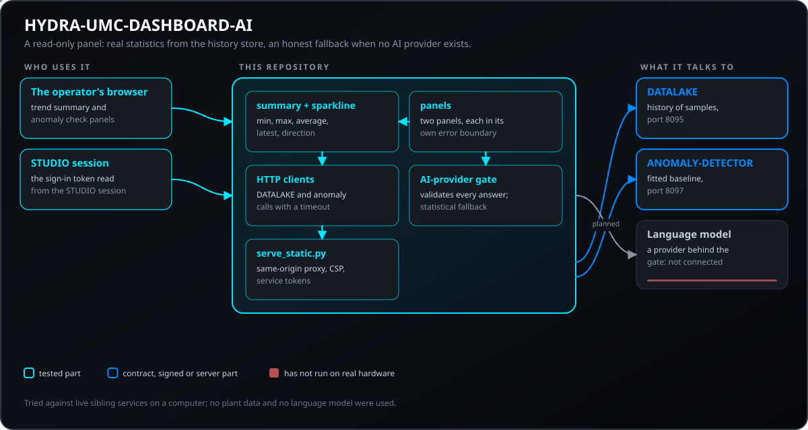
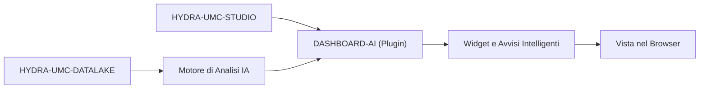
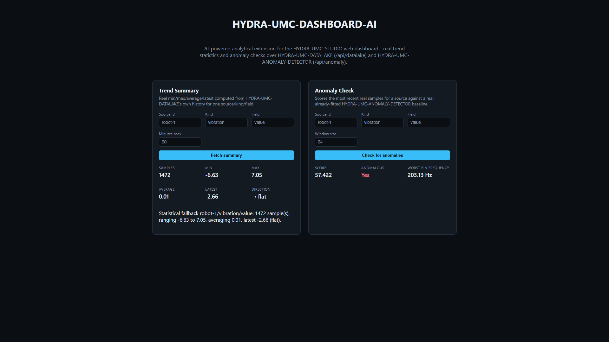
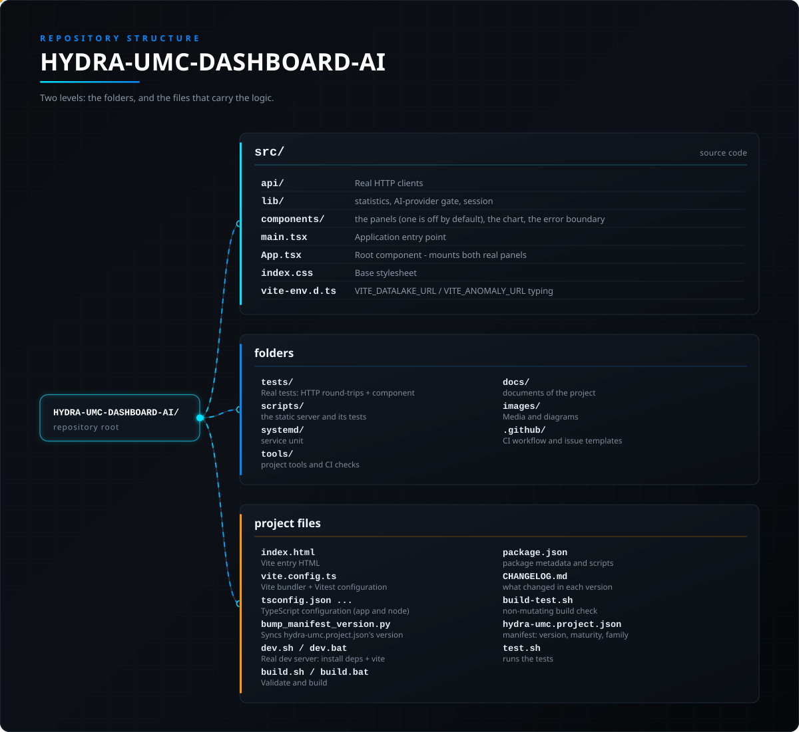

<!-- =============================================================================
HYDRA-UMC-DASHBOARD-AI - Statistical summaries and anomaly highlights for the STUDIO web dashboard
Copyright (C) JuanenRac (Electro Hobby 3D) <electrohobby3d@gmail.com>
GPL-3.0-or-later - see LICENSE
============================================================================= -->

<p align="center">
  
</p>

# 🧠 HYDRA-UMC-DASHBOARD-AI

<p align="center"><a href="README.md">🇺🇸 English</a> | <a href="README_spa.md">🇪🇸 Español</a> | <a href="README_fra.md">🇫🇷 Français</a> | 🇮🇹 <b>Italiano</b> | <a href="README_deu.md">🇩🇪 Deutsch</a> | <a href="README_zho.md">🇨🇳 简体中文</a> | <a href="README_jpn.md">🇯🇵 日本語</a> | <a href="README_por.md">🇵🇹 Português</a></p>

### 📈 Riepiloghi statistici ed evidenziazione delle anomalie per la dashboard web di STUDIO (nessun modello linguistico)

<p align="center">
  
  
  
  
  
  
</p>

---

> **Verifica di onestà - cosa funziona davvero oggi:** le statistiche di riepilogo del trend (`lib/summary.ts`), il gate del provider AI e il suo onesto fallback statistico (`lib/aiProvider.ts`), il guardiano del contratto esterno, i veri client HTTP (`api/datalakeClient.ts`, `api/anomalyClient.ts`), e l'isolamento dei fallimenti di rendering per pannello (`components/ErrorBoundary.tsx` - un crash nel rendering di un pannello resta contenuto nella scheda di quel pannello invece di smontare l'intera app) sono reali e coperti da 164 test Vitest superati (`npm test` - `tests/*.test.ts(x)`); il server di file statici per la CM5 (`scripts/serve_static.py`) ha i suoi 11 test `unittest` superati (nessun elenco di directory, intestazioni di rafforzamento, timeout per le connessioni inattive, nessuna risalita di percorso). Non esiste alcun vero provider AI basato su LLM in questo repository - il gate di `aiProvider.ts` è reale, ma ogni narrazione mostrata oggi è il fallback statistico `NO_PROVIDER_CONFIGURED`, chiaramente etichettato come tale. La Predizione del Trend (un vero modello di previsione) e i Consigli di Ottimizzazione sono entrambi completamente aspirazionali - non esiste ancora codice per nessuno dei due. L'Evidenziazione delle Anomalie controlla solo la baseline già adattata di HYDRA-UMC-ANOMALY-DETECTOR; non ne adatta mai una da sola. Vedi `CHANGELOG.md` per cosa è stato esattamente consegnato finora.

---

> **Stato di sicurezza (safety e security):** questo ecosistema non è un sistema di sicurezza certificato. Non esiste ancora un percorso E-STOP hardware, né limiti o interblocchi imposti dal firmware, né un comando di movimento verificato; le immagini firmware sono controllate con CRC-32 e una firma Ed25519, e una compilazione di rilascio rifiuta le chiavi di sviluppo pubblicate (le teste utensile e le schede di espansione dietro il relè usano ancora i bootloader di URTC, che accettano un HMAC-SHA256 a chiave condivisa invece di una firma); TLS e TLS reciproco sono opzionali e disattivati per impostazione predefinita; nessuna scheda propria è stata ancora assemblata o provata. Leggi la [base di sicurezza](https://github.com/JuanenRac/HYDRA-UMC-DOCS/blob/main/docs/SECURITY_BASELINE.md) e il [modello delle minacce](https://github.com/JuanenRac/HYDRA-UMC-DOCS/blob/main/docs/THREAT_MODEL.md) prima di fidarti di qualsiasi affermazione qui per la sicurezza di una persona.

---

## 📋 In breve

| | |
|---|---|
| Versione | `0.1.7` |
| Maturità | Funzionale |
| Test | 164 (`npm test`) |
| Tecnologia | TypeScript/React / Vite |
| Destinazione | Il Raspberry Pi CM5 di una cella HYDRA-UMC |
| Su hardware reale | Non ancora: per questa versione non risulta alcuna esecuzione su hardware reale |

**Vai a:** [Panoramica](#-panoramica) · [Architettura](#-architettura) · [Sicurezza e protezione](#-sicurezza-e-protezione) · [Interfacce](#-interfacce) · [Configurazione](#-configurazione) · [Avvio rapido](#-avvio-rapido) · [Test](#-test) · [Risoluzione dei problemi](#-risoluzione-dei-problemi) · [Struttura del repository](#-struttura-del-repository) · [Progetti correlati](#-progetti-correlati)

## 🚦 Stato del progetto

Ogni riga è una parte di questo repository e il semaforo dice a che punto è oggi. È scritta in base a ciò che il repository può mostrare (test, compilazioni, esecuzioni), non a ciò che è previsto.

🟢 Fatto e verificato · 🟡 Funziona, con limiti noti · 🟠 Fatto a metà o non ancora verificato · 🔴 Non fatto o non funzionante

| Area | Stato | Cosa significa qui |
|---|---|---|
| Software | 🟡 | Funziona per il suo scopo principale; la verifica di onestà qui sopra elenca ciò che manca ancora |
| Test | 🟢 | 164 test automatici, eseguiti a ogni modifica |
| Hardware reale | 🔴 | Non ancora: per questa versione non risulta alcuna esecuzione su hardware reale |
| Documentazione | 🟢 | README in otto lingue, verificato rispetto al manifesto a ogni modifica |

## 🎯 Panoramica

**HYDRA-UMC-DASHBOARD-AI** è il plugin analitico per l'interfaccia web di STUDIO. Aggiunge riepiloghi calcolati dallo storico memorizzato (minimo, massimo, media, ultimo valore e direzione del trend) ed evidenzia le anomalie con le statistiche del rilevatore di anomalie. Non intervengono ancora né un modello linguistico né previsioni.

È pensato per trasformare la telemetria grezza in riepiloghi utilizzabili delle prestazioni dello sciame e dei profili di consumo energetico, direttamente nel browser (previsto: avvisi di manutenzione predittiva e approfondimenti generati dall'IA). Riutilizza lo stack proprio di HYDRA-UMC-STUDIO (React 19 + Vite + TypeScript) invece di introdurne uno nuovo, così da poter essere incorporato in futuro come pannello dentro STUDIO stesso.

### Caratteristiche Principali:
* 🧠 **Riepiloghi Intelligenti (v0)** — statistiche reali di minimo/massimo/media/ultimo valore/tendenza calcolate dallo storico reale di HYDRA-UMC-DATALAKE, con minimo/massimo/ultimo valore ciascuno collegato al timestamp reale dell'osservazione che lo ha prodotto. *(implementato come statistiche reali, non ancora un riepilogo generato dall'IA — vedi COMPILAZIONE ED ESECUZIONE sotto)*
* 🔒 **Verifica del Fornitore IA (v0)** — validazione reale dello schema di input/output per la futura narrazione basata su LLM, più un fallback statistico reale ed etichettato onestamente usato ogni volta che nessun fornitore IA è configurato o uno fallisce/restituisce output non strutturato. *(implementato e collegato al pannello Riepilogo Tendenza oggi; un vero fornitore basato su LLM è pianificato)*
* 🛡️ **Protezione del Contratto Esterno (v0)** — convalida ogni risposta di Datalake e del servizio anomalie prima che un pannello la elabori o la mostri; numeri, flag, identificatori sovradimensionati e caratteri di controllo non sicuri malformati vengono rifiutati. *(implementato; vedi [`docs/SECURITY.md`](docs/SECURITY.md))*
* 📈 **Previsione delle Tendenze** — un vero modello di previsione, oltre l'indicatore di direzione reale-ma-semplice di v0. *(pianificato)*
* 🚨 **Evidenziazione delle Anomalie (v0)** — verifica i campioni reali più recenti rispetto a una baseline reale già calibrata di HYDRA-UMC-ANOMALY-DETECTOR. *(implementato come un vero pannello testuale; sovrapporlo alla vista 3D di STUDIO è pianificato)*
* 🛠️ **Suggerimenti di Ottimizzazione** — suggerisce modifiche ai parametri per migliorare il tempo di ciclo o la durata dei motori. *(pianificato)*
* ✅ **Base del toolchain** — una vera applicazione React/Vite/TypeScript che compila pulita con `tsc --noEmit` e viene servita con Vite. *(implementato — vedi COMPILAZIONE ED ESECUZIONE sotto)*
* 🧯 **Isolamento dei Fallimenti di Rendering per Pannello** — ogni pannello è avvolto nel proprio `ErrorBoundary`; un'eccezione durante il rendering in uno di essi mostra una scheda di fallback contenuta invece di smontare l'intera dashboard. *(implementato — vedi `components/ErrorBoundary.tsx`)*

## 🧩 Ruolo in HYDRA-UMC

**HYDRA-UMC-DASHBOARD-AI** è un pannello in sola lettura accanto a STUDIO: trasforma lo storico reale di HYDRA-UMC-DATALAKE in riepiloghi di tendenza (minimo, massimo, media, ultimo valore e direzione, ciascuno collegato al campione che lo ha prodotto) e confronta i campioni più recenti con la linea di base di HYDRA-UMC-ANOMALY-DETECTOR. Non ha un modello linguistico proprio: senza un fornitore di IA configurato mostra un testo statistico e lo dichiara.

## 🏛️ Architettura

<p align="center">
  
</p>

<details>
<summary>Versione testuale del diagramma (Mermaid)</summary>



</details>

### ARCHITETTURA E DECISIONI DI PROGETTAZIONE

* **Perché è un progetto Node/TS, non uno Python come gli altri progetti affini all'IA.** È un'estensione diretta del frontend React/Vite proprio di HYDRA-UMC-STUDIO, non un servizio IA autonomo - allinearsi allo stack proprio di STUDIO (invece dello stack Python di HYDRA-UMC-COGNITIVE-NODE) è ciò che gli permette di montarsi davvero come un vero pannello di STUDIO più avanti, non un'app separata a cui gli utenti devono passare.
* **Perché è fratello di STUDIO, non una cartella al suo interno.** Mantenere questo come proprio repo/build permette al livello dashboard IA di versionarsi e pubblicarsi indipendentemente dal calendario di rilascio del controllo robot proprio di STUDIO - lo stesso motivo che a suo tempo ha separato HYDRA-UMC-SERVER da STUDIO.
* **Perché il punto di ingresso oggi stampa solo identità/versione/ruolo.** Fase di andamiaje: dimostrare che il pacchetto compila in modo pulito precede i veri pannelli della dashboard.
* **Come si inserisce nel resto dell'ecosistema.** Estende HYDRA-UMC-STUDIO con riepiloghi statistici ed evidenziazione delle anomalie; un back end di modello linguistico fornito da HYDRA-UMC-COGNITIVE-NODE è previsto e oggi non è collegato.
* **Perché il pannello di Verifica Anomalie controlla `/stats` prima di offrire di valutare qualsiasi cosa.** Il rilevatore proprio di HYDRA-UMC-ANOMALY-DETECTOR è un'unica baseline condivisa, calibrata in memoria (vedi l'`api.py` proprio di quel progetto) - questa dashboard deliberatamente non gestisce la sua calibrazione (mutare lo stato condiviso del rilevatore da una dashboard orientata alla lettura sarebbe un vero accoppiamento indebito). Uno stato reale di "non ancora calibrato" viene mostrato esattamente come tale, mai confuso con un errore generico.
* **Perché il Riepilogo delle Tendenze riporta una "direzione", non una previsione.** Un vero segno di delta primo-a-ultimo (con una piccola soglia di rumore relativo affinché un segnale piatto non lampeggi tra "su"/"giù") è onesto su ciò che v0 calcola davvero - un vero modello di previsione è lavoro futuro reale e separato, non qualcosa da simulare con un'estrapolazione lineare travestita da "previsione".
* **Perché `safeGenerateNarrative()` valida la richiesta ma non lancia mai eccezioni per una risposta sbagliata.** Una richiesta malformata è un vero bug di cablaggio in questo codice - non c'è un riepilogo a cui ricorrere onestamente, quindi le è permesso lanciare un'eccezione. Una risposta *malformata/non strutturata* da un fornitore è un dato di fatto per qualsiasi API esterna reale - quel percorso degrada sempre al vero fallback statistico invece di far crashare il pannello, perché chi chiama ha già tutto ciò che serve (il vero riepilogo) per dire qualcosa di vero.
* **Perché `NO_PROVIDER_CONFIGURED` riusa `summary.ts` invece di un'implementazione di fallback separata.** Una seconda formula di "narrazione di fallback" indipendente divergerebbe dalle vere statistiche di cui il pannello già si fida e che già mostra numericamente - riusare gli stessi valori `TrendSummary` mantiene la narrazione di fallback dimostrabilmente coerente con i numeri proprio accanto.

## 🖼️ Schermate

Catturate a 1920×1080 su un banco di prova, con dati di esempio e senza alcuna installazione reale dietro.

<table>
<tr><td width="50%" valign="top"><br><sub>I due pannelli: il riepilogo di tendenza di una serie di vibrazioni letta dal data lake, e il controllo delle anomalie che valuta l'ultima finestra rispetto alla baseline adattata.</sub></td></tr>
</table>

## 🔒 Sicurezza e protezione

| Minaccia | Difesa | Dove |
|---|---|---|
| Il server statico inoltra più del dovuto | Si inoltrano solo `/api/datalake` e `/api/anomaly`; con token, solo le chiamate di `TOKEN_ALLOWED_CALLS`; i corpi sono limitati a 4 MiB | `scripts/serve_static.py` |
| Token di servizio esposti sulla rete | Con token di servizio configurati, il server rifiuta di avviarsi su un indirizzo non loopback salvo richiesta esplicita; un token con un carattere di controllo è rifiutato | `scripts/serve_static.py` |
| Una pagina che carica script o chiama host non previsti | Una Content-Security-Policy su ogni risposta: script solo dalla pagina stessa, niente frame, connessioni solo alla propria origine; origini extra una a una con `--connect-src`, devono essere origini semplici | `scripts/serve_static.py` |
| Testo di un fornitore di IA con caratteri di controllo o bidirezionali, o risposta malformata | Il testo è limitato a 2000 caratteri e i caratteri pericolosi vengono scartati; una risposta malformata ripiega sul testo statistico invece di rompere il pannello | `src/lib/aiProvider.ts` |
| Un servizio bloccato che congela la pagina | Ogni richiesta ha un limite di 5 s, una query chiede al massimo 5000 campioni per finestra e 12 tentativi di finestra, e un pannello che si rompe mostra una scheda contenuta mentre l'altro continua | `src/api/fetchWithTimeout.ts`, `src/api/datalakeClient.ts`, `src/components/ErrorBoundary.tsx` |

**Cosa non fa mai:** scrivere nell'archivio dello storico, adattare la linea di base delle anomalie o agire su un robot. È un pannello di lettura.

## 🔌 Interfacce

| Topic o rotta | Cosa porta |
|---|---|
| `/api/datalake/*` | inoltrato a HYDRA-UMC-DATALAKE su `127.0.0.1:8095` (solo chiamate di lettura con token) |
| `/api/anomaly/*` | inoltrato a HYDRA-UMC-ANOMALY-DETECTOR su `127.0.0.1:8097` |
| `/dashboard-ai`, `/api/ai/datalake`, `/api/ai/anomaly-detector` | dietro HYDRA-UMC-SERVER la pagina sta in `/dashboard-ai` e legge dal relay di quel server, con il token di accesso della sessione STUDIO |

## ⚙️ Configurazione

| Variabile | Predefinito | Cosa imposta |
|---|---|---|
| `--dir` | `dist/` | la pagina compilata da servire |
| `--addr`, `--port` | `127.0.0.1`, `8115` | dove ascoltare |
| `--datalake`, `--anomaly` | `http://127.0.0.1:8095`, `http://127.0.0.1:8097` | dove sono i due servizi |
| `--connect-src` | nessuno | un'origine in più che la pagina può chiamare, per una build con `VITE_DATALAKE_URL` / `VITE_ANOMALY_URL`; si ripete per origine |
| `--csp`, `HYDRA_DASHBOARD_CSP` | `default` | `default`, o una policy completa propria |
| `HYDRA_UMC_DATALAKE_READ_TOKEN`, `HYDRA_UMC_DATALAKE_TOKEN`, `HYDRA_UMC_ANOMALY_TOKEN` | nessun token | il token che il server presenta a ogni servizio; le varianti `_FILE` lo leggono da un file |
| `VITE_DATALAKE_URL`, `VITE_ANOMALY_URL` | `/api/datalake`, `/api/anomaly` | URL dei servizi visibili nel browser, fissate in compilazione; non metterci mai una credenziale |

## 🚀 Avvio rapido

Richiede Node.js 20 o successivo con npm; il server statico richiede Python 3.10 o successivo.

```bash
./dev.sh                                    # installs the dependencies and starts the Vite dev server on port 5174 (dev.bat on Windows)
./build.sh                                  # runs the tests, type-checks and builds dist/ (build.bat on Windows)
python scripts/serve_static.py --port 8115  # serves dist/ and forwards /api/datalake and /api/anomaly
```

## 🧪 Test

164 test automatici si eseguono con `npm test`. Il server statico ha propri test Python in `scripts/test_serve_static.py`. Non richiedono hardware né servizi in esecuzione.

La CI esegue `HYDRA_UMC_CI=1 python tools/ci_validate.py`, che controlla il manifesto, i documenti, gli otto README e le immagini.

## 🏗️ Compilazione e rilascio

Richiede Node.js >= 20.

```bash
# Linux/macOS
./dev.sh      # installa le dipendenze, avvia il server Vite sulla porta :5174
./build.sh    # installa le dipendenze, esegue la vera suite di test, verifica i tipi, compila dist/

# Windows
dev.bat
build.bat
```

`npm run build` concatena `tsc --noEmit && vite build`; non cambia mai la versione, quindi un build rotto non pubblica mai un numero di versione incrementato. `npm run dev` avvia Vite sulla porta `5174` (separata dalla `5173` propria di HYDRA-UMC-STUDIO, così entrambi possono girare insieme). `npm test` esegue direttamente la vera suite Vitest.

Per impostazione predefinita i due veri pannelli chiamano i percorsi della stessa origine `/api/datalake` e `/api/anomaly`, che `scripts/serve_static.py` (e il server di sviluppo Vite) inoltrano a HYDRA-UMC-DATALAKE su `127.0.0.1:8095` e a HYDRA-UMC-ANOMALY-DETECTOR su `127.0.0.1:8097` (nessuno dei servizi invia intestazioni CORS, il browser non potrebbe chiamarli direttamente) - sovrascrivibile con `VITE_DATALAKE_URL`/`VITE_ANOMALY_URL` (definite prima di `vite build`/`vite dev`, Vite le incorpora in fase di build) per puntare a un deployment diverso.

Dietro HYDRA-UMC-SERVER la pagina viene servita su `/dashboard-ai` (il `build-frontend` di HYDRA-UMC-SERVER la compila e la copia se questo repository è presente accanto). Lì legge tramite il relay di quel server, `/api/ai/datalake` (sola lettura) e `/api/ai/anomaly-detector`, con il token di accesso di chi ha effettuato l'accesso a HYDRA-UMC-STUDIO nello stesso browser (il token viene inviato solo a indirizzi della stessa origine); si applicano quindi i ruoli del server e i servizi mantengono i propri token Bearer privati al server. Una sessione rifiutata viene segnalata nel pannello (accedere tramite STUDIO; serve un amministratore o un operatore). Con la dashboard lì, HYDRA-UMC-ANOMALY-DETECTOR può essere avviato con `HYDRA_UMC_ANOMALY_PROTECT_READS=1`.

`scripts/serve_static.py` invia una Content-Security-Policy con ogni risposta: script solo dalla pagina stessa (nessuno script inline, nessun plugin), nessun incorporamento in frame e connessioni solo all'origine della pagina. Una build con `VITE_DATALAKE_URL`/`VITE_ANOMALY_URL` aggiunge le origini che chiama con `--connect-src ORIGINE` (ripetibile); `--csp off` (o `HYDRA_DASHBOARD_CSP=off`) non ne invia alcuna, per un proxy davanti che la imposta, e qualsiasi altro valore di `--csp` è usato come policy completa. `npm run lint` esegue ESLint (regole raccomandate, typescript-eslint e le regole degli hook React); la CI lo esegue insieme al controllo dei tipi e ai test. In modalità autonoma lo stesso script presenta il token Bearer di un servizio che lo richiede (`HYDRA_UMC_DATALAKE_READ_TOKEN`, altrimenti `HYDRA_UMC_DATALAKE_TOKEN`, e `HYDRA_UMC_ANOMALY_TOKEN`, ciascuno anche come `..._FILE`, un file la cui prima riga è il token), così la pagina non lo detiene mai. Il token esce solo sulle chiamate che fa la dashboard (le letture del data lake, lo stato del rilevatore e il punteggio di una finestra); adattare una baseline, scrivere nel data lake o la sua retention escono senza e il servizio le rifiuta. Un server legato a un indirizzo diverso da loopback si rifiuta di avviarsi con i token salvo che sia dato `--allow-tokens-off-loopback`.

Leggi [`docs/SECURITY.md`](docs/SECURITY.md) prima di configurare questi URL visibili nel browser o collegare un vero fornitore IA; definisce la convalida delle risposte, la sicurezza del contenuto, il comportamento in caso di errore e la regola di non includere segreti.

Ogni vero fetch del Riepilogo Tendenza esegue anche la vera verifica del fornitore IA. Senza un vero fornitore configurato (il default onesto di v0), il pannello mostra il vero fallback statistico, chiaramente etichettato:

```ts
import { safeGenerateNarrative, NO_PROVIDER_CONFIGURED } from './lib/aiProvider'

const narrative = await safeGenerateNarrative(NO_PROVIDER_CONFIGURED, { sourceId, kind, field, summary })
// { narrative: "robot-1/motor_temp/value: 4 sample(s), ranging 10.00 to 50.00,
//    averaging 29.00, latest 36.00 (rising).", generatedBy: 'statistical-fallback' }
```

Un fornitore che lancia un'eccezione, o restituisce una risposta con `narrative` mancante o malformato, degrada a questo stesso vero fallback invece di far crashare il pannello o non mostrare nulla.

## 🩺 Risoluzione dei problemi

| Vedi | Perché | Fai |
|---|---|---|
| I pannelli sono vuoti e la console segnala una richiesta fallita | Il server statico non è in esecuzione, o DATALAKE o il servizio anomalie non è all'indirizzo indicato | Avvia `scripts/serve_static.py` e controlla `--datalake` e `--anomaly` |
| Il server rifiuta di avviarsi con i token | È impostato un token di servizio e `--addr` non è un indirizzo loopback | Ascolta su `127.0.0.1` o metti la pagina dietro HYDRA-UMC-SERVER |
| Il riepilogo indica «ripiego statistico» | Nessun fornitore di IA è configurato, o ha risposto con qualcosa che non ha superato la validazione | È il comportamento predefinito previsto; i numeri sono reali |
| I test vanno in timeout quando ne girano molti insieme | La macchina è carica e un worker di Vitest non ha risposto in tempo | Esegui `npx vitest run --pool=threads`, o fallo quando nient'altro compila |

## 📂 Struttura del repository

<p align="center">
  
</p>

<details>
<summary>Versione testuale dell'albero</summary>

```text
HYDRA-UMC-DASHBOARD-AI/
├── src/                                                     codice sorgente
│   ├── api/                                                 Veri client HTTP: datalakeClient.ts, anomalyClient.ts
│   ├── lib/                                                 statistiche, gate del fornitore di IA, sessione e indirizzi
│   ├── components/                                          i due pannelli, il piccolo grafico e il limite degli errori
│   ├── main.tsx                                             Punto di ingresso dell'applicazione
│   ├── App.tsx                                              Componente radice - monta entrambi i veri pannelli
│   ├── index.css                                            Foglio di stile di base
│   └── vite-env.d.ts                                        Tipizzazione di VITE_DATALAKE_URL / VITE_ANOMALY_URL
├── tests/                                                   Veri test: round-trip HTTP + test dei componenti
├── scripts/                                                 il server statico e i suoi test
├── systemd/                                                 unità di servizio
├── tools/                                                   strumenti del progetto e controlli della CI
├── docs/                                                    documenti del progetto
├── images/                                                  Media e diagrammi
├── .github/                                                 workflow di CI e modelli di segnalazione
├── index.html                                               HTML di ingresso di Vite
├── vite.config.ts                                           Configurazione del bundler Vite + Vitest
├── tsconfig.json / tsconfig.app.json / tsconfig.node.json   configurazione TypeScript (app e node)
├── bump_manifest_version.py                                 Sincronizza la versione di hydra-umc.project.json con quella di package.json (--sync)
├── dev.sh / dev.bat                                         Server di sviluppo reale: installa le dipendenze + vite
├── build.sh / build.bat                                     Valida e compila (compilare non cambia mai la versione)
├── package.json                                             metadati e script del pacchetto
├── CHANGELOG.md                                             cosa è cambiato in ogni versione
├── build-test.sh                                            controllo di build senza modifiche
├── hydra-umc.project.json                                   manifesto: versione, maturità, famiglia
└── test.sh                                                  esegue i test
```

</details>

## 🗺️ Roadmap e limiti noti

**Limiti noti oggi**

* **Previsto:** una vera previsione (predizione di tendenza), suggerimenti di ottimizzazione, un fornitore di IA dietro il gate (HYDRA-UMC-COGNITIVE-NODE è il backend previsto e non è collegato) e una sovrapposizione del verdetto sulle anomalie sulla vista 3D di STUDIO.
* I riepiloghi sono statistiche (minimo, massimo, media, ultimo valore e direzione), non una previsione.
* Provato con servizi fratelli reali su un computer; mai con dati di un impianto reale.

## 🌍 Lingue

Questo README e i documenti del repository esistono in otto lingue: inglese, spagnolo, tedesco, francese, italiano, giapponese, cinese e portoghese (Portogallo). Sono scritti insieme e la CI verifica che gli otto file abbiano le stesse sezioni e gli stessi link.

## 🔗 Progetti correlati

Questo progetto fa parte dell'ecosistema robotico HYDRA-UMC dello stesso autore (JuanenRac / Electro Hobby 3D). Vale la pena conoscerlo, poiché una richiesta potrebbe in realtà riguardare uno di questi invece di questo repository.

**Direttamente Correlati**
- **[HYDRA-UMC-STUDIO](https://github.com/JuanenRac/HYDRA-UMC-STUDIO)** — dashboard di controllo web con visualizzazione 3D multi-robot in tempo reale — la dashboard che questo progetto estende direttamente.
- **[HYDRA-UMC-COGNITIVE-NODE](https://github.com/JuanenRac/HYDRA-UMC-COGNITIVE-NODE)** — hub di integrazione per la pipeline cognitiva Hailo-10 (orchestrazione LLM/VLA/voce) — il backend IA che alimenta questa dashboard.
- **[HYDRA-UMC-DATALAKE](https://github.com/JuanenRac/HYDRA-UMC-DATALAKE)** — vero archivio di serie temporali basato su sqlite3, con una vera API HTTP di ingestione/query — lo storico reale da cui il pannello Smart Summaries calcola le proprie statistiche.
- **[HYDRA-UMC-ANOMALY-DETECTOR](https://github.com/JuanenRac/HYDRA-UMC-ANOMALY-DETECTOR)** — vero rilevatore di anomalie FFT + baseline statistica, con monitoraggio della deriva — la baseline adattata contro cui il pannello Anomaly Highlighting valuta i campioni recenti.

**Fa Anche Parte dell'Ecosistema**

*Hardware e Piattaforma di Base*
- **[HYDRA-UMC](https://github.com/JuanenRac/HYDRA-UMC)** — il progetto della scheda madre del braccio robotico: host CM5 + coprocessore STM32H745 dual-core, pensato per coordinare fino a 8 bracci utensile via CAN-OTA/SPI-OTA (firmware in fase iniziale; nessuna scheda assemblata per ora).
- **[HYDRA-UMC-OS](https://github.com/JuanenRac/HYDRA-UMC-OS)** — livello prodotto riproducibile su Raspberry Pi OS per il CM5: agente in sola lettura, config/profili validati, provisioning WiFi al primo contatto.
- **[HYDRA-UMC-SDK](https://github.com/JuanenRac/HYDRA-UMC-SDK)** — il contratto JSON-Schema condiviso e la barriera software di controllo dei job contro cui ogni bridge valida i propri comandi (non è una funzione di sicurezza certificata).
- **[HYDRA-UMC-CONNECTOR-HUB](https://github.com/JuanenRac/HYDRA-UMC-CONNECTOR-HUB)** — registro dichiarativo e validatore di manifesti adattatore per connettori di macchine esterne; estende la propria idea di contratto dell'SDK alle macchine esterne senza sostituire i progetti di gateway industriale.

*Backend Centrale e Client*
- **[HYDRA-UMC-SERVER](https://github.com/JuanenRac/HYDRA-UMC-SERVER)** — il vero backend headless (REST/WebSocket) con cui parla davvero ogni client di controllo.
- **[HYDRA-UMC-SUITE](https://github.com/JuanenRac/HYDRA-UMC-SUITE)** — centro di comando sciame desktop (PySide6) per più server contemporaneamente, pacchettizzato come eseguibile standalone.
- **[HYDRA-UMC-ANDROID-CONTROL](https://github.com/JuanenRac/HYDRA-UMC-ANDROID-CONTROL)** — app di controllo nativa per Android con login biometrico e un companion Wear OS abbinato.
- **[HYDRA-UMC-IOS-CONTROL](https://github.com/JuanenRac/HYDRA-UMC-IOS-CONTROL)** — app di controllo per iOS/iPadOS (Flutter) con sincronizzazione WebSocket in tempo reale.
- **[HYDRA-UMC-DSI](https://github.com/JuanenRac/HYDRA-UMC-DSI)** — interfaccia touch nativa per il touchscreen DSI da 7" a bordo, incorporata direttamente nel CM5.
- **[HYDRA-UMC-EDITOR-URDF](https://github.com/JuanenRac/HYDRA-UMC-EDITOR-URDF)** — creatore/editor grafico desktop di URDF che invia i modelli finiti al catalogo di STUDIO.
- **[HYDRA-UMC-EDITOR-STL](https://github.com/JuanenRac/HYDRA-UMC-EDITOR-STL)** — editor desktop di modelli STL, che trasforma/sostituisce/rimuove/aggiunge veri pezzi nello stesso catalogo di modelli modificato anche da HYDRA-UMC-EDITOR-URDF.
- **[HYDRA-UMC-BRIDGE-AMR](https://github.com/JuanenRac/HYDRA-UMC-BRIDGE-AMR)** — barriera di coordinamento per flotte AGV/AMR tramite un publisher MQTT VDA 5050 (testato solo contro una flotta emulata).
- **[HYDRA-UMC-BRIDGE-CNC](https://github.com/JuanenRac/HYDRA-UMC-BRIDGE-CNC)** — coordinatore ad alto livello per celle CNC con accesso a stato/byte di controllo GRBL (testato solo contro un emulatore).
- **[HYDRA-UMC-BRIDGE-DROIDS](https://github.com/JuanenRac/HYDRA-UMC-BRIDGE-DROIDS)** — barriera di coordinamento per droidi con zampe/umanoidi, con un mittente di comandi per Boston Dynamics Spot (testato solo contro un emulatore).
- **[HYDRA-UMC-BRIDGE-LASER](https://github.com/JuanenRac/HYDRA-UMC-BRIDGE-LASER)** — coordinatore per celle laser che legge 3 segnali GPIO di chiave/involucro/interblocco (testato solo contro un chip simulato; non può armare né far partire un laser).
- **[HYDRA-UMC-BRIDGE-OPENPNP](https://github.com/JuanenRac/HYDRA-UMC-BRIDGE-OPENPNP)** — coordinatore ad alto livello sicuro per il flusso schede del pick-and-place OpenPnP.
- **[HYDRA-UMC-BRIDGE-PRINTER3D](https://github.com/JuanenRac/HYDRA-UMC-BRIDGE-PRINTER3D)** — barriera di coordinamento sicura per stampanti 3D Moonraker/Klipper, con comandi di lavoro reali e controllati.
- **[HYDRA-UMC-BRIDGE-ROS2](https://github.com/JuanenRac/HYDRA-UMC-BRIDGE-ROS2)** — coordinatore con un trasporto ROS 2 rclpy importato in modo lazy (non ancora eseguito contro un'installazione ROS 2).
- **[HYDRA-UMC-BRIDGE-UAV](https://github.com/JuanenRac/HYDRA-UMC-BRIDGE-UAV)** — barriera di coordinamento per UAV dotati di fotocamera, con un mittente di comandi MAVLink (testato solo contro un emulatore).

*Piattaforma Strumenti URTC*
- **[URTC](https://github.com/JuanenRac/URTC)** — firmware per la scheda fisica dell'Universal Robot Tool Controller, oltre 25 profili utensile su bus CAN.
- **[URTC-FLASHER](https://github.com/JuanenRac/URTC-FLASHER)** — strumento desktop con GUI per il flashing delle schede URTC, CAN-OTA più SWD/JTAG a chip intero.
- **[URTC-TESTER](https://github.com/JuanenRac/URTC-TESTER)** — strumento desktop di diagnostica CAN-bus dal vivo per schede URTC, un pannello per profilo utensile.
- **[URTC-WEB-STUDIO](https://github.com/JuanenRac/URTC-WEB-STUDIO)** — alternativa basata su browser a URTC-TESTER tramite la Web Serial API, senza installazione locale.
- **[URTC-GATEWAY](https://github.com/JuanenRac/URTC-GATEWAY)** — gateway davanti al bus CAN di URTC: elenco di identificatori consentiti, limite di frequenza e chiave di sessione; software provato su computer, non ancora su un bus reale.

*Nodo IA Visione (Hailo-8)*
- **[HYDRA-UMC-VISION-NODE](https://github.com/JuanenRac/HYDRA-UMC-VISION-NODE)** — hub di integrazione per la pipeline di visione Hailo-8, con un vero controllo di prontezza hardware per fase.
- **[HYDRA-UMC-DETECTION-HEF](https://github.com/JuanenRac/HYDRA-UMC-DETECTION-HEF)** — registro reale di modelli compilati con verifica di caricamento sicuro per architettura Hailo/checksum.
- **[HYDRA-UMC-VISION-STREAMER](https://github.com/JuanenRac/HYDRA-UMC-VISION-STREAMER)** — generatore reale di pipeline GStreamer + config MediaMTX, con una vera barriera di integrazione HailoRT.
- **[HYDRA-UMC-VISUAL-SERVOING-API](https://github.com/JuanenRac/HYDRA-UMC-VISUAL-SERVOING-API)** — legge di correzione Position-Based Visual Servoing con autorizzazione condizionata allo stato di zona; ancora nessuna stima di posa da telecamera.
- **[HYDRA-UMC-SAFETY-ZONES](https://github.com/JuanenRac/HYDRA-UMC-SAFETY-ZONES)** — logica v0 di violazione zona, freschezza di calibrazione e richiesta E-STOP che legge le posizioni degli oggetti da un file; nessun rilevatore la alimenta e nessun E-STOP fisico è ancora collegato.

*Nodo IA Cognitivo (Hailo-10)*
- **[HYDRA-UMC-VLA-ENGINE](https://github.com/JuanenRac/HYDRA-UMC-VLA-ENGINE)** — vera codifica/decodifica di token d'azione e generazione di traiettoria per un modello Vision-Language-Action.
- **[HYDRA-UMC-VOICE-UI](https://github.com/JuanenRac/HYDRA-UMC-VOICE-UI)** — vero front-end vocale (VAD + parser di intenti) con un relay verso Watch limitato e soggetto a conferma.
- **[HYDRA-UMC-SEMANTIC-PLANNER](https://github.com/JuanenRac/HYDRA-UMC-SEMANTIC-PLANNER)** — vera scomposizione dei task basata su regole e recupero semantico degli errori sui codici errore MCU.
- **[HYDRA-UMC-DOCS-QA](https://github.com/JuanenRac/HYDRA-UMC-DOCS-QA)** — vera ricerca documentale TF-IDF (solo libreria standard) sui documenti Markdown di questo ecosistema.
- **[HYDRA-UMC-LOCAL-TECHNICIAN](https://github.com/JuanenRac/HYDRA-UMC-LOCAL-TECHNICIAN)** — tecnico di manutenzione IA locale e con cancelli di policy per l'ecosistema stesso - osserva, diagnostica e propone correzioni; i due livelli di rischio più alti non sono deliberatamente ancora implementati.

*Orchestrazione e Sciame*
- **[HYDRA-UMC-ORCHESTRATOR](https://github.com/JuanenRac/HYDRA-UMC-ORCHESTRATOR)** — hub di integrazione con un vero contratto di health-report gRPC/Protobuf e una macchina a stati di missione.
- **[HYDRA-UMC-JOB-DISPATCHER](https://github.com/JuanenRac/HYDRA-UMC-JOB-DISPATCHER)** — vera coda di lavori basata su priorità con deduplicazione, su una vera API HTTP.
- **[HYDRA-UMC-NODE-HEALING](https://github.com/JuanenRac/HYDRA-UMC-NODE-HEALING)** — vero watchdog di salute della flotta basato su gRPC, con retry/backoff e rilevamento di discrepanza d'identità.
- **[HYDRA-UMC-PATH-PLANNER-3D](https://github.com/JuanenRac/HYDRA-UMC-PATH-PLANNER-3D)** — vero pianificatore di percorsi 3D basato su RRT, con vera validazione delle collisioni ostacolo/spazio di lavoro.
- **[HYDRA-UMC-SWARM-SYNC](https://github.com/JuanenRac/HYDRA-UMC-SWARM-SYNC)** — vera sincronizzazione di stato CRDT LWW-Element-Map, con property test per la convergenza multi-cella.

*Gemello Digitale e Simulazione*
- **[HYDRA-UMC-TWIN](https://github.com/JuanenRac/HYDRA-UMC-TWIN)** — hub di integrazione per il motore di gemello digitale, con un vero contratto di sincronizzazione per compatibilità di versione.
- **[HYDRA-UMC-HIL-BRIDGE](https://github.com/JuanenRac/HYDRA-UMC-HIL-BRIDGE)** — router hardware-in-the-loop con un interblocco software di collisione tra simulazione e hardware reale (testato senza hardware reale).
- **[HYDRA-UMC-PHYSICS-REPLICA](https://github.com/JuanenRac/HYDRA-UMC-PHYSICS-REPLICA)** — vera cinematica diretta e validazione dei limiti articolari su un vero sottoinsieme URDF.
- **[HYDRA-UMC-SYNTHETIC-DATA-GEN](https://github.com/JuanenRac/HYDRA-UMC-SYNTHETIC-DATA-GEN)** — vero generatore procedurale di scene 2D con esportazione di annotazioni YOLO/COCO.

*Dati e Analisi*
- **[HYDRA-UMC-PRODUCTION-REPORTS](https://github.com/JuanenRac/HYDRA-UMC-PRODUCTION-REPORTS)** — vero calcolo OEE/disponibilità sullo storico di DATALAKE, con esportazione CSV riproducibile.
- **[HYDRA-UMC-TELEMETRY-COLLECTOR](https://github.com/JuanenRac/HYDRA-UMC-TELEMETRY-COLLECTOR)** — vera pipeline di ingestione CAN/WebSocket verso DATALAKE, con deduplicazione per sequenza.

*Gateway Industriale*
- **[HYDRA-UMC-GATEWAY-INDUSTRIAL](https://github.com/JuanenRac/HYDRA-UMC-GATEWAY-INDUSTRIAL)** — hub di integrazione che inoltra ai protocolli industriali, con un vero livello di allowlist dei comandi/backpressure.
- **[HYDRA-UMC-OPCUA-SERVER](https://github.com/JuanenRac/HYDRA-UMC-OPCUA-SERVER)** — vero spazio di indirizzi OPC-UA, verificato con una vera sessione client del protocollo binario.
- **[HYDRA-UMC-MQTT-BROKER](https://github.com/JuanenRac/HYDRA-UMC-MQTT-BROKER)** — vero broker MQTT con autenticazione opzionale per client e ACL sui topic.
- **[HYDRA-UMC-MTCONNECT-ADAPTER](https://github.com/JuanenRac/HYDRA-UMC-MTCONNECT-ADAPTER)** — veri endpoint XML `/probe` e `/current` di MTConnect, con output in modalità degradata.

*Strumenti Complementari e Operazioni dell'Ecosistema*
- **[HYDRA-UMC-TOOL-CLI](https://github.com/JuanenRac/HYDRA-UMC-TOOL-CLI)** — CLI di flotta con un vero e stabile contratto di exit-code, un client live reale della stessa API di HYDRA-UMC-SERVER.
- **[HYDRA-UMC-WATCH](https://github.com/JuanenRac/HYDRA-UMC-WATCH)** — app companion WearOS con schemi di avviso aptico e un relay vocale verso il telefono abbinato (non ancora eseguita su un orologio fisico).
- **[URTC-SMART-RACK](https://github.com/JuanenRac/URTC-SMART-RACK)** — firmware per un rack di montaggio schede con decodifica reale dell'ID utensile e logica di preriscaldamento Smart Idle.
- **[URTC-VISION-TOOL](https://github.com/JuanenRac/URTC-VISION-TOOL)** — firmware più un vero companion di visione Python per una testa utensile di ispezione termica/RGB.
- **[HYDRA-UMC-UPDATER](https://github.com/JuanenRac/HYDRA-UMC-UPDATER)** — strumento amministrativo desktop che scopre, clona e aggiorna ogni repository di questo ecosistema.
- **[HYDRA-UMC-OS-REBUILDER](https://github.com/JuanenRac/HYDRA-UMC-OS-REBUILDER)** — strumento desktop Windows/Linux che costruisce un'immagine della CM5 pronta da scrivere, precaricata con le versioni più aggiornate dell'ecosistema, con configurazione di primo avvio Wi-Fi/utente/SSH in stile Raspberry Pi Imager.
- **[HYDRA-UMC-OPS-AGENT](https://github.com/JuanenRac/HYDRA-UMC-OPS-AGENT)** — coordinatore di incidenti di manutenzione: un ruolo edge a basso privilegio raccoglie uno snapshot di inventario/salute sanificato, un ruolo control-plane lo rende in sola lettura e chiede a un provider di IA di suggerire una diagnosi - non applica mai una patch né distribuisce nulla.
- **[HYDRA-UMC-DEV-SERVER](https://github.com/JuanenRac/HYDRA-UMC-DEV-SERVER)** — host di sviluppo riproducibile (Raspberry Pi 5 / CM5) che conserva il codice sorgente dell'ecosistema ed esegue attività delimitate di build/test tramite una coda durevole; un ruolo di sviluppo dedicato, esplicitamente distinto da un CM5 operativo.

## 📚 Documentazione

Dove leggere di più:

* [Base di sicurezza dell'ecosistema](https://github.com/JuanenRac/HYDRA-UMC-DOCS/blob/main/docs/SECURITY_BASELINE.md)
* [Modello delle minacce dell'ecosistema](https://github.com/JuanenRac/HYDRA-UMC-DOCS/blob/main/docs/THREAT_MODEL.md)
* [Registro delle modifiche di questo repository](CHANGELOG.md)
* [Licenza di questo repository](LICENSE.md)

## 🤝 Contribuire e comunità

* Prima di una pull request esegui `HYDRA_UMC_CI=1 py -3 tools/ci_validate.py` (oppure `HYDRA_UMC_CI=1 python3 tools/ci_validate.py`): deve stampare `CI_VALIDATION=PASS`. Non eseguire `build.sh` né `build.bat` per questa verifica; compilare non è verificare.
* I otto README sono scritti da un'unica fonte in HYDRA-UMC-DOCS; non modificarli a mano. Cambia la fonte e riscrivili con `tools/make_readmes.py`.
* Non affermare in un README ciò che non è stato eseguito: scrivi «simulato» o «non provato su hardware» quando è la verità.
* Vedi [CONTRIBUTING.md](CONTRIBUTING.md), il [codice di condotta](CODE_OF_CONDUCT.md), [SECURITY.md](SECURITY.md) e [SUPPORT.md](SUPPORT.md).

## 👤 AUTORE

**JuanenRac (Electro Hobby 3D)** · electrohobby3d@gmail.com

## 📜 LICENZA

GPL-3.0-or-later - [LICENSE](LICENSE).
