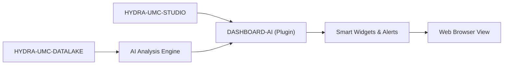

<!-- =============================================================================
HYDRA-UMC-DASHBOARD-AI - Statistical summaries and anomaly highlights for the STUDIO web dashboard
Copyright (C) JuanenRac (Electro Hobby 3D) <electrohobby3d@gmail.com>
GPL-3.0-or-later - see LICENSE
============================================================================= -->

<p align="center">
  
</p>

# 🧠 HYDRA-UMC-DASHBOARD-AI

<p align="center"><a href="README.md">🇺🇸 English</a> | <a href="README_spa.md">🇪🇸 Español</a> | <a href="README_fra.md">🇫🇷 Français</a> | <a href="README_ita.md">🇮🇹 Italiano</a> | <a href="README_deu.md">🇩🇪 Deutsch</a> | <a href="README_zho.md">🇨🇳 简体中文</a> | <a href="README_jpn.md">🇯🇵 日本語</a> | 🇵🇹 <b>Português</b></p>

### 📈 Resumos estatísticos e destaque de anomalias para o painel web do STUDIO (sem modelo de linguagem)

<p align="center">
  
  
  
  
  
  
</p>

---

> **Verificação de honestidade - o que realmente funciona hoje:** as estatísticas do resumo de tendência (`lib/summary.ts`), a porta do fornecedor de IA e o seu recurso estatístico honesto (`lib/aiProvider.ts`), a guarda do contrato externo, os clientes HTTP reais (`api/datalakeClient.ts`, `api/anomalyClient.ts`) e o isolamento de falhas de renderização por painel (`components/ErrorBoundary.tsx` - uma falha no painel fica contida no cartão desse painel em vez de desmontar a aplicação inteira) são reais e estão cobertos por 189 testes Vitest a passar (`npm test` - `tests/*.test.ts(x)`); o servidor de ficheiros estáticos para o CM5 (`scripts/serve_static.py`) tem os seus próprios 11 testes `unittest` a passar (sem listagem de diretórios, cabeçalhos de reforço, um tempo limite para ligações inativas, sem travessia de caminhos). Não existe em todo este repositório nenhum fornecedor de IA real baseado num LLM - a porta do `aiProvider.ts` é real, mas cada narrativa mostrada hoje é o recurso estatístico `NO_PROVIDER_CONFIGURED`, claramente rotulado como tal. A Previsão de Tendências (um modelo de previsão real) e as Dicas de Otimização são ambas totalmente aspiracionais - ainda não existe código para nenhuma. O Realce de Anomalias só consulta a linha de base já ajustada do próprio HYDRA-UMC-ANOMALY-DETECTOR; nunca ajusta uma ele próprio. Veja o `CHANGELOG.md` para saber exatamente o que foi entregue até agora.

---

> **Estado de segurança (safety e security):** este ecossistema não é um sistema de segurança certificado. Ainda não existe um caminho de E-STOP por hardware, nem limites ou interlocks impostos pelo firmware, nem um comando de movimento verificado; as imagens de firmware são verificadas com CRC-32 e uma assinatura Ed25519, e uma compilação de versão recusa as chaves de desenvolvimento publicadas (as cabeças de ferramenta e as placas de expansão atrás do relé ainda usam os bootloaders do URTC, que aceitam um HMAC-SHA256 de chave partilhada em vez de uma assinatura); TLS e TLS mútuo são opcionais e estão desativados por defeito; nenhuma placa própria foi ainda montada ou testada. Leia a [base de segurança](https://github.com/JuanenRac/HYDRA-UMC-DOCS/blob/main/docs/SECURITY_BASELINE.md) e o [modelo de ameaças](https://github.com/JuanenRac/HYDRA-UMC-DOCS/blob/main/docs/THREAT_MODEL.md) antes de confiar em qualquer afirmação aqui para a segurança de uma pessoa.

---

## 📋 Num relance

| | |
|---|---|
| Versão | `0.1.8` |
| Maturidade | Funcional |
| Testes | 189 (`npm test`) |
| Tecnologia | TypeScript/React / Vite |
| Destino | O Raspberry Pi CM5 de uma célula HYDRA-UMC |
| Em hardware real | Ainda não: não há registo de execução em hardware real para esta versão |

**Ir para:** [Visão geral](#-visão-geral) · [Arquitetura](#-arquitetura) · [Segurança e proteção](#-segurança-e-proteção) · [Interfaces](#-interfaces) · [Configuração](#-configuração) · [Início rápido](#-início-rápido) · [Testes](#-testes) · [Resolução de problemas](#-resolução-de-problemas) · [Estrutura do repositório](#-estrutura-do-repositório) · [Projetos relacionados](#-projetos-relacionados)

## 🚦 Estado do projeto

Cada linha é uma parte deste repositório e a luz diz até onde chega hoje. É escrita com o que o repositório consegue demonstrar (testes, compilações, execuções), não com o que está previsto.

🟢 Feito e verificado · 🟡 Funciona, com limites conhecidos · 🟠 Feito a meio ou ainda por verificar · 🔴 Por fazer ou a não funcionar

| Área | Estado | O que significa aqui |
|---|---|---|
| Software | 🟡 | Funciona para o seu propósito principal; a verificação de honestidade acima lista o que ainda falta |
| Testes | 🟢 | 189 testes automáticos, executados a cada alteração |
| Hardware real | 🔴 | Ainda não: não há registo de execução em hardware real para esta versão |
| Documentação | 🟢 | README em oito idiomas, verificado contra o manifesto a cada alteração |

## 🎯 Visão geral

O **HYDRA-UMC-DASHBOARD-AI** é o plugin analítico da interface web do STUDIO. Acrescenta resumos calculados a partir do histórico guardado (mínimo, máximo, média, último valor e direção da tendência) e destaca anomalias com as estatísticas do detetor de anomalias. Ainda não intervêm nem um modelo de linguagem nem previsões.

Destina-se a transformar a telemetria em bruto em resumos úteis do desempenho do enxame e dos padrões de consumo de energia, diretamente no navegador (previsto: alertas de manutenção preditiva e perceções geradas por IA). Reutiliza a pilha própria do HYDRA-UMC-STUDIO (React 19 + Vite + TypeScript) em vez de introduzir uma nova, para poder vir a ser integrado como painel dentro do próprio STUDIO.

### Funcionalidades principais:
* 🧠 **Resumos Inteligentes (v0)** — estatísticas reais de mínimo/máximo/média/último/direção calculadas a partir do histórico real do HYDRA-UMC-DATALAKE, com o mínimo, o máximo e o último ligados à marca temporal real da observação que os produziu. *(implementado como estatísticas reais, ainda não como resumo gerado por um LLM — veja COMPILAR E EXECUTAR abaixo)*
* 🔒 **Porta do fornecedor de IA (v0)** — validação real de esquema de entrada/saída para a eventual narrativa baseada num LLM, mais um recurso estatístico real e honestamente rotulado, usado sempre que nenhum fornecedor de IA está configurado ou que um falha/devolve uma saída não estruturada. *(implementado e ligado hoje ao painel de Resumo de Tendência; um fornecedor real baseado num LLM está planeado)*
* 🛡️ **Guarda do contrato externo (v0)** — valida cada resposta do Datalake e do serviço de anomalias antes de um painel calcular com ela ou a apresentar; números malformados, bandeiras, identificadores sobredimensionados e caracteres de controlo inseguros são rejeitados. *(implementado; veja [`docs/SECURITY.md`](docs/SECURITY.md))*
* 📈 **Previsão de tendências** — um modelo de previsão real, para lá do indicador de direção real mas simples da v0. *(planeado)*
* 🚨 **Realce de anomalias (v0)** — compara as amostras reais mais recentes com uma linha de base real, já ajustada, do HYDRA-UMC-ANOMALY-DETECTOR. *(implementado como painel de texto real; sobrepô-lo à vista 3D do próprio STUDIO está planeado)*
* 🛠️ **Dicas de otimização** — sugere alterações de parâmetros para melhorar o tempo de ciclo ou a vida útil dos motores. *(planeado)*
* ⏳ **Vida útil restante (v0, desligada por defeito)** — um cartão que pergunta ao HYDRA-UMC-ANOMALY-DETECTOR os dias até a tendência das pontuações de anomalia atingir um limite, com um intervalo, estados explícitos (dados insuficientes, não sobe, limite atingido), um gráfico pequeno e avisos configuráveis; testado com um data lake e um detetor simulados. *(implementado; ver [`docs/REMAINING_USEFUL_LIFE.md`](docs/REMAINING_USEFUL_LIFE.md))*
* ✅ **Andaime da cadeia de ferramentas** — uma aplicação real React/Vite/TypeScript que compila limpa com `tsc --noEmit` e é servida com o Vite. *(implementado — veja COMPILAR E EXECUTAR abaixo)*
* 🧯 **Isolamento de falhas de renderização por painel** — cada painel está envolvido no seu próprio `ErrorBoundary`; uma exceção de renderização num deles mostra um cartão de recurso contido em vez de desmontar todo o painel. *(implementado — veja `components/ErrorBoundary.tsx`)*

## 🧩 Papel no HYDRA-UMC

O **HYDRA-UMC-DASHBOARD-AI** é um painel só de leitura ao lado do STUDIO: transforma o histórico real guardado no HYDRA-UMC-DATALAKE em resumos de tendência (mínimo, máximo, média, último valor e direção, cada um ligado à amostra que o produziu) e compara as amostras mais recentes com a linha de base do HYDRA-UMC-ANOMALY-DETECTOR. Não tem modelo de linguagem próprio: sem fornecedor de IA configurado mostra um texto estatístico e di-lo.

## 🏛️ Arquitetura

<p align="center">
  
</p>

<details>
<summary>Versão em texto do diagrama (Mermaid)</summary>



</details>

### ARQUITETURA E DECISÕES DE DESENHO

* **Porque é um projeto Node/TS e não Python como os outros projetos próximos da IA.** É uma extensão direta do frontend React/Vite do próprio HYDRA-UMC-STUDIO, não um serviço de IA autónomo - seguir a pilha do próprio STUDIO (em vez da pilha Python do HYDRA-UMC-COGNITIVE-NODE) é o que lhe permite montar-se mais tarde como um painel real do STUDIO, e não como uma aplicação à parte para a qual os utilizadores têm de mudar.
* **Porque é irmão do STUDIO e não uma pasta dentro dele.** Mantê-lo como repositório/compilação próprios permite que a camada do painel de IA tenha versões e saia independentemente do ritmo de lançamentos de controlo de robôs do próprio STUDIO, o mesmo raciocínio que separou o HYDRA-UMC-SERVER do STUDIO em primeiro lugar.
* **Porque o ponto de entrada só imprime a identidade/versão/papel hoje.** Fase de andaimes (scaffolding): provar que o pacote compila limpo precede os painéis reais do painel de controlo.
* **Como isto se encaixa no resto do ecossistema.** Estende o HYDRA-UMC-STUDIO com resumos estatísticos e destaque de anomalias; um back end de modelo de linguagem do HYDRA-UMC-COGNITIVE-NODE está previsto e hoje não está ligado.
* **Porque o painel de Verificação de Anomalias consulta o `/stats` antes de se oferecer para pontuar seja o que for.** O detetor do próprio HYDRA-UMC-ANOMALY-DETECTOR é uma linha de base partilhada, ajustada em memória (veja o `api.py` desse projeto) - este painel deliberadamente não gere o seu ajuste (alterar o estado partilhado do detetor a partir de um painel orientado para a leitura seria um verdadeiro mau cheiro de acoplamento). Um estado real de "ainda não ajustado" é mostrado exatamente como tal, e não diluído num erro genérico.
* **Porque o Resumo de Tendência reporta "direção" e não uma previsão.** O sinal real do delta do primeiro ao último valor (com um pequeno limiar de ruído relativo para que um sinal plano não oscile entre "sobe"/"desce") é honesto sobre o que a v0 realmente calcula - um modelo de previsão real é trabalho futuro à parte, e não algo a fingir com uma extrapolação linear disfarçada de "previsão".
* **Porque o `safeGenerateNarrative()` valida o pedido mas nunca lança erro por uma resposta má.** Um pedido malformado é um verdadeiro erro de ligação neste código - não há resumo honesto a que recorrer, pelo que se permite que lance erro. Uma resposta malformada/não estruturada de um fornecedor é um facto da vida de qualquer API externa real - esse caminho degrada sempre para o recurso estatístico real em vez de derrubar o painel, porque quem chama já tem tudo o que precisa (o resumo real) para dizer algo verdadeiro.
* **Porque o `NO_PROVIDER_CONFIGURED` reutiliza o `summary.ts` em vez de uma implementação de recurso separada.** Uma segunda fórmula independente de "narrativa de recurso" divergiria das estatísticas reais em que o painel já confia e que mostra numericamente - reutilizar os mesmos valores de `TrendSummary` mantém a narrativa de recurso demonstravelmente coerente com os números mesmo ao lado dela.

## 🖼️ Capturas de ecrã

Capturadas a 1920×1080 numa bancada de testes, com dados de exemplo e sem qualquer instalação real por trás.

<table>
<tr><td width="50%" valign="top"><br><sub>Os dois painéis: o resumo de tendência de uma série de vibração lida do lago de dados e a verificação de anomalias que pontua a sua última janela contra a linha de base ajustada.</sub></td></tr>
</table>

## 🔒 Segurança e proteção

| Ameaça | Defesa | Onde |
|---|---|---|
| O servidor estático reencaminha mais do que devia | Só se reencaminham `/api/datalake` e `/api/anomaly`; com token, apenas as chamadas de `TOKEN_ALLOWED_CALLS`; os corpos são limitados a 4 MiB | `scripts/serve_static.py` |
| Tokens de serviço expostos na rede | Com tokens de serviço configurados, o servidor recusa arrancar num endereço que não seja loopback, salvo pedido explícito; um token com carácter de controlo é rejeitado | `scripts/serve_static.py` |
| Uma página que carrega scripts ou chama anfitriões que não deve | Uma Content-Security-Policy em cada resposta: scripts só da própria página, sem molduras, ligações só à sua origem; origens extra uma a uma com `--connect-src`, têm de ser origens simples | `scripts/serve_static.py` |
| Texto de um fornecedor de IA com caracteres de controlo ou bidirecionais, ou resposta mal formada | O texto é limitado a 2000 caracteres e os caracteres perigosos são descartados; uma resposta mal formada volta ao texto estatístico em vez de partir o painel | `src/lib/aiProvider.ts` |
| Um serviço bloqueado a congelar a página | Cada pedido tem um limite de 5 s, uma consulta pede no máximo 5000 amostras por janela e 12 tentativas de janela, e um painel que falha mostra um cartão contido enquanto o outro continua | `src/api/fetchWithTimeout.ts`, `src/api/datalakeClient.ts`, `src/components/ErrorBoundary.tsx` |

**O que nunca faz:** escrever no armazém de histórico, ajustar a linha de base de anomalias ou atuar num robô. É um painel de leitura.

## 🔌 Interfaces

| Tópico ou rota | O que leva |
|---|---|
| `/api/datalake/*` | reencaminhado para o HYDRA-UMC-DATALAKE em `127.0.0.1:8095` (só chamadas de leitura com token) |
| `/api/anomaly/*` | reencaminhado para o HYDRA-UMC-ANOMALY-DETECTOR em `127.0.0.1:8097` |
| `/dashboard-ai`, `/api/ai/datalake`, `/api/ai/anomaly-detector` | atrás do HYDRA-UMC-SERVER a página fica em `/dashboard-ai` e lê pelo reencaminhamento desse servidor, com o token de acesso da sessão do STUDIO |
| `/api/anomaly/rul` | só com o cartão de vida útil restante ligado: a página envia as pontuações de anomalia mais recentes e lê os dias até ao limite, com um intervalo e um estado explícito; o detetor tem de correr com `--rul` |

## ⚙️ Configuração

| Variável | Predefinição | O que define |
|---|---|---|
| `--dir` | `dist/` | a página compilada a servir |
| `--addr`, `--port` | `127.0.0.1`, `8115` | onde escutar |
| `--datalake`, `--anomaly` | `http://127.0.0.1:8095`, `http://127.0.0.1:8097` | onde estão os dois serviços |
| `--connect-src` | nenhum | uma origem extra que a página pode chamar, para uma compilação com `VITE_DATALAKE_URL` / `VITE_ANOMALY_URL`; repete-se por origem |
| `--csp`, `HYDRA_DASHBOARD_CSP` | `default` | `default`, ou uma política completa própria |
| `HYDRA_UMC_DATALAKE_READ_TOKEN`, `HYDRA_UMC_DATALAKE_TOKEN`, `HYDRA_UMC_ANOMALY_TOKEN` | sem token | o token que o servidor apresenta a cada serviço; as variantes `_FILE` leem-no de um ficheiro |
| `VITE_DATALAKE_URL`, `VITE_ANOMALY_URL` | `/api/datalake`, `/api/anomaly` | URL de serviço visíveis no navegador, definidas na compilação; nunca ponha lá uma credencial |
| `VITE_RUL_ENABLED` | `false` | `true` (exatamente isso) acrescenta o cartão de vida útil restante; com qualquer outro valor não há cartão nem pedido ao detetor |
| `VITE_RUL_URL`, `VITE_RUL_SOURCE_ID`, `VITE_RUL_KIND`, `VITE_RUL_FIELD`, `VITE_RUL_LIMIT`, `VITE_RUL_POINTS` | the anomaly URL, `robot-1`, `anomaly_score`, `value`, `1`, `200` | o detetor que responde a `POST /rul`, a série de pontuações de anomalia lida do data lake, a pontuação que conta como limite e quantas das amostras mais recentes (1 a 1000) são enviadas |
| `VITE_RUL_WARN_DAYS`, `VITE_RUL_CRITICAL_DAYS`, `VITE_RUL_TIMEOUT_MS` | `30`, `7`, `5000` | o cartão avisa quando o dia plausível mais próximo cai dentro destes dias e passa a crítico dentro do segundo número (nunca acima do primeiro); o limite de tempo do pedido em milissegundos |

## 🚀 Início rápido

Requer Node.js 20 ou superior com npm; o servidor estático precisa de Python 3.10 ou superior.

```bash
./dev.sh                                    # installs the dependencies and starts the Vite dev server on port 5174 (dev.bat on Windows)
./build.sh                                  # runs the tests, type-checks and builds dist/ (build.bat on Windows)
python scripts/serve_static.py --port 8115  # serves dist/ and forwards /api/datalake and /api/anomaly
```

## 🧪 Testes

189 testes automáticos correm com `npm test`. O servidor estático tem os seus próprios testes Python em `scripts/test_serve_static.py`. Não precisam de hardware nem de nenhum serviço a correr.

A CI executa `HYDRA_UMC_CI=1 python tools/ci_validate.py`, que verifica o manifesto, os documentos, os oito README e as imagens.

## 🏗️ Compilação e publicação

Requer o Node.js >= 20.

```bash
# Linux/macOS
./dev.sh      # instala as dependências, arranca o servidor de desenvolvimento do Vite em :5174
./build.sh    # instala as dependências, executa a suite de testes real, verifica os tipos, compila o dist/

# Windows
dev.bat
build.bat
```

O `npm run build` encadeia `tsc --noEmit && vite build`; nunca altera a versão, por isso uma compilação partida nunca publica um número de versão incrementado. O `npm run dev` arranca o Vite na porta `5174` (separada da `5173` do próprio HYDRA-UMC-STUDIO, para que ambos possam correr lado a lado). O `npm test` executa diretamente a suite Vitest real.

Por omissão, os dois painéis reais chamam os caminhos de mesma origem `/api/datalake` e `/api/anomaly`, que o `scripts/serve_static.py` (e o servidor de desenvolvimento do Vite) reencaminham para o HYDRA-UMC-DATALAKE em `127.0.0.1:8095` e para o HYDRA-UMC-ANOMALY-DETECTOR em `127.0.0.1:8097` (nenhum dos serviços envia cabeçalhos CORS, o navegador não os poderia chamar diretamente) - substitua com `VITE_DATALAKE_URL`/`VITE_ANOMALY_URL` (definidos antes de `vite build`/`vite dev`, o Vite incorpora-os na compilação) para apontar para outra implementação.

Atrás do HYDRA-UMC-SERVER a página é servida em `/dashboard-ai` (o `build-frontend` do HYDRA-UMC-SERVER compila-a e copia-a se este repositório estiver descarregado ao lado). Aí lê através do relay desse servidor, `/api/ai/datalake` (só leitura) e `/api/ai/anomaly-detector`, com o token de acesso de quem iniciou sessão no HYDRA-UMC-STUDIO no mesmo navegador (o token só é enviado para endereços da mesma origem), pelo que se aplicam os papéis do servidor e os serviços mantêm os seus próprios tokens Bearer privados do servidor. Uma sessão recusada é indicada no painel (iniciar sessão através do STUDIO; é preciso um administrador ou um operador). Com o dashboard aí, o HYDRA-UMC-ANOMALY-DETECTOR pode arrancar com `HYDRA_UMC_ANOMALY_PROTECT_READS=1`.

`scripts/serve_static.py` envia uma Content-Security-Policy com cada resposta: scripts apenas da própria página (sem scripts em linha nem plug-ins), sem inclusão em frames e ligações apenas à origem da própria página. Uma compilação com `VITE_DATALAKE_URL`/`VITE_ANOMALY_URL` acrescenta as origens que chama com `--connect-src ORIGEM` (repetível); `--csp off` (ou `HYDRA_DASHBOARD_CSP=off`) não envia nenhuma, para um proxy à frente que a defina, e qualquer outro valor de `--csp` é usado como política completa. `npm run lint` executa o ESLint (regras recomendadas, typescript-eslint e as regras dos hooks do React); a CI executa-o junto com a verificação de tipos e os testes. No modo autónomo o mesmo script apresenta o token Bearer de um serviço que o peça (`HYDRA_UMC_DATALAKE_READ_TOKEN`, senão `HYDRA_UMC_DATALAKE_TOKEN`, e `HYDRA_UMC_ANOMALY_TOKEN`, cada um também como `..._FILE`, um ficheiro cuja primeira linha é o token), de modo que a página nunca o tem. O token só sai nas chamadas que o painel faz (as leituras do data lake, o estado do detetor e a pontuação de uma janela); ajustar uma linha de base, escrever no data lake ou a sua retenção saem sem ele e o serviço recusa-os. Um servidor ligado a um endereço que não seja loopback recusa-se a arrancar com tokens, a menos que se passe `--allow-tokens-off-loopback`.

Leia o [`docs/SECURITY.md`](docs/SECURITY.md) antes de configurar esses URLs visíveis no navegador ou de ligar um fornecedor de IA real; define a validação de respostas, a segurança do conteúdo, o comportamento em caso de falha e a regra de implementação sem segredos.

Cada obtenção real de Resumo de Tendência executa também a porta real do fornecedor de IA. Sem nenhum fornecedor real configurado (o valor por omissão honesto da v0), o painel mostra o recurso estatístico real, claramente rotulado:

```ts
import { safeGenerateNarrative, NO_PROVIDER_CONFIGURED } from './lib/aiProvider'

const narrative = await safeGenerateNarrative(NO_PROVIDER_CONFIGURED, { sourceId, kind, field, summary })
// { narrative: "robot-1/motor_temp/value: 4 sample(s), ranging 10.00 to 50.00,
//    averaging 29.00, latest 36.00 (rising).", generatedBy: 'statistical-fallback' }
```

Um fornecedor que lance erro, ou devolva uma resposta com `narrative` em falta/malformado, degrada para esse mesmo recurso real em vez de derrubar o painel ou não mostrar nada.

## 🩺 Resolução de problemas

| Vê | Porque | Faça |
|---|---|---|
| Os painéis estão vazios e a consola diz que um pedido falhou | O servidor estático não está a correr, ou o DATALAKE ou o serviço de anomalias não está no endereço indicado | Arranque `scripts/serve_static.py` e verifique `--datalake` e `--anomaly` |
| O servidor recusa arrancar com tokens | Há um token de serviço e `--addr` não é um endereço loopback | Escute em `127.0.0.1` ou ponha a página atrás do HYDRA-UMC-SERVER |
| O resumo diz «recurso estatístico» | Não há fornecedor de IA configurado, ou respondeu algo que não passou a validação | É o comportamento por defeito esperado; os números são reais |
| Os testes esgotam o tempo quando correm muitos ao mesmo tempo | A máquina está carregada e um worker do Vitest não respondeu a tempo | Execute `npx vitest run --pool=threads`, ou faça-o quando nada mais estiver a compilar |

## 📂 Estrutura do repositório

<p align="center">
  
</p>

<details>
<summary>Versão em texto da árvore</summary>

```text
HYDRA-UMC-DASHBOARD-AI/
├── src/                                                     código-fonte
│   ├── api/                                                 Clientes HTTP reais: datalakeClient.ts, anomalyClient.ts, rulClient.ts
│   ├── lib/                                                 estatísticas, porta do fornecedor de IA, sessão e endereços, leitura da vida útil restante e textos
│   ├── components/                                          os painéis (um desligado por defeito), o gráfico, o limite de erros
│   ├── main.tsx                                             Ponto de entrada da aplicação
│   ├── App.tsx                                              Componente raiz - monta os dois painéis reais
│   ├── index.css                                            Folha de estilos base
│   └── vite-env.d.ts                                        Tipagem de VITE_DATALAKE_URL / VITE_ANOMALY_URL / VITE_RUL_*
├── tests/                                                   Testes reais: idas e voltas HTTP + testes de componentes
├── scripts/                                                 o servidor estático e os seus testes
├── systemd/                                                 unidade de serviço
├── tools/                                                   ferramentas do projeto e verificações da CI
├── docs/                                                    documentos do projeto
├── images/                                                  Multimédia e diagramas
├── .github/                                                 fluxo de CI e modelos de problemas
├── index.html                                               HTML de entrada do Vite
├── vite.config.ts                                           Empacotador Vite + configuração do Vitest
├── tsconfig.json / tsconfig.app.json / tsconfig.node.json   configuração do TypeScript (aplicação e node)
├── bump_manifest_version.py                                 Sincroniza a versão do hydra-umc.project.json com a do package.json (--sync)
├── dev.sh / dev.bat                                         Servidor de desenvolvimento real: instala dependências + vite
├── build.sh / build.bat                                     Valida e compila (compilar nunca altera a versão)
├── package.json                                             metadados e scripts do pacote
├── CHANGELOG.md                                             o que mudou em cada versão
├── build-test.sh                                            verificação de compilação sem alterações
├── hydra-umc.project.json                                   manifesto: versão, maturidade, família
└── test.sh                                                  executa os testes
```

</details>

## 🗺️ Roteiro e limites conhecidos

**Limites conhecidos hoje**

* **Previsto:** uma previsão real (previsão de tendência), sugestões de otimização, um fornecedor de IA atrás da porta (o HYDRA-UMC-COGNITIVE-NODE é o destino previsto e não está ligado) e uma sobreposição do veredicto de anomalias na vista 3D do STUDIO.
* Os resumos são estatísticas (mínimo, máximo, média, último valor e direção), não uma previsão.
* Experimentado com serviços irmãos reais num computador; nunca com dados de uma fábrica real.

## 🌍 Idiomas

Este README e os documentos do repositório existem em oito idiomas: inglês, espanhol, alemão, francês, italiano, japonês, chinês e português (Portugal). São escritos em conjunto e a CI verifica que os oito ficheiros têm as mesmas secções e as mesmas ligações.

## 🔗 Projetos relacionados

Este projeto faz parte do ecossistema de robótica HYDRA-UMC do mesmo autor (JuanenRac / Electro Hobby 3D). Vale a pena conhecê-los, porque um pedido pode ser, na verdade, sobre um destes e não sobre este repositório.

**Diretamente relacionados**
- **[HYDRA-UMC-STUDIO](https://github.com/JuanenRac/HYDRA-UMC-STUDIO)** — painel web de controlo com visualização 3D em tempo real de vários robôs — o painel que este projeto estende diretamente.
- **[HYDRA-UMC-COGNITIVE-NODE](https://github.com/JuanenRac/HYDRA-UMC-COGNITIVE-NODE)** — centro de integração do pipeline cognitivo do Hailo-10 (orquestração de LLM/VLA/voz) — o back-end de IA que alimenta este painel.
- **[HYDRA-UMC-DATALAKE](https://github.com/JuanenRac/HYDRA-UMC-DATALAKE)** — armazém real de séries temporais sobre sqlite3 com uma API HTTP real de ingestão/consulta — o histórico real a partir do qual o painel de Resumos Inteligentes calcula as suas estatísticas.
- **[HYDRA-UMC-ANOMALY-DETECTOR](https://github.com/JuanenRac/HYDRA-UMC-ANOMALY-DETECTOR)** — detetor real de anomalias com FFT + linha de base estatística e monitorização de deriva — a linha de base ajustada contra a qual o painel de Realce de Anomalias avalia as amostras recentes.

**Também fazem parte do ecossistema**

*Hardware e plataforma centrais*
- **[HYDRA-UMC](https://github.com/JuanenRac/HYDRA-UMC)** — o desenho da placa-mãe do braço robótico: anfitrião CM5 + STM32H745 de dois núcleos, pensado para orquestrar até 8 braços de ferramenta por CAN-OTA/SPI-OTA (firmware numa fase inicial; ainda sem placa montada).
- **[HYDRA-UMC-OS](https://github.com/JuanenRac/HYDRA-UMC-OS)** — camada de produto reproduzível do Raspberry Pi OS para o CM5: agente só de leitura, configuração/perfis validados, aprovisionamento Wi-Fi de primeiro contacto.
- **[HYDRA-UMC-SDK](https://github.com/JuanenRac/HYDRA-UMC-SDK)** — o contrato JSON-Schema partilhado e a fronteira de software de controlo de trabalhos contra a qual cada bridge valida os seus comandos (não é uma função de segurança certificada).
- **[HYDRA-UMC-CONNECTOR-HUB](https://github.com/JuanenRac/HYDRA-UMC-CONNECTOR-HUB)** — registo declarativo de manifestos de adaptador e validador para conectores de máquinas externas; estende a ideia de contrato do SDK a máquinas externas sem substituir os projetos de gateway industrial.

*Backend central e clientes*
- **[HYDRA-UMC-SERVER](https://github.com/JuanenRac/HYDRA-UMC-SERVER)** — o back-end headless real (REST/WebSocket) com que todos os clientes de controlo realmente comunicam.
- **[HYDRA-UMC-SUITE](https://github.com/JuanenRac/HYDRA-UMC-SUITE)** — centro de comando de enxame para desktop (PySide6) para vários servidores ao mesmo tempo, empacotado como executável independente.
- **[HYDRA-UMC-ANDROID-CONTROL](https://github.com/JuanenRac/HYDRA-UMC-ANDROID-CONTROL)** — aplicação Android nativa de controlo, com início de sessão biométrico e um companheiro Wear OS emparelhado.
- **[HYDRA-UMC-IOS-CONTROL](https://github.com/JuanenRac/HYDRA-UMC-IOS-CONTROL)** — aplicação de controlo para iOS/iPadOS (Flutter) com sincronização WebSocket em tempo real.
- **[HYDRA-UMC-DSI](https://github.com/JuanenRac/HYDRA-UMC-DSI)** — interface tátil nativa para o ecrã tátil DSI de 7" integrado, executada no próprio CM5.
- **[HYDRA-UMC-EDITOR-URDF](https://github.com/JuanenRac/HYDRA-UMC-EDITOR-URDF)** — criador/editor gráfico de URDF para desktop que envia os modelos concluídos para o catálogo do STUDIO.
- **[HYDRA-UMC-EDITOR-STL](https://github.com/JuanenRac/HYDRA-UMC-EDITOR-STL)** — editor de modelos STL para desktop que transforma/substitui/remove/adiciona peças reais no mesmo catálogo de modelos que o HYDRA-UMC-EDITOR-URDF também edita.
- **[HYDRA-UMC-BRIDGE-AMR](https://github.com/JuanenRac/HYDRA-UMC-BRIDGE-AMR)** — fronteira de coordenação para frotas AGV/AMR através de um publicador MQTT VDA 5050 (testado apenas contra uma frota emulada).
- **[HYDRA-UMC-BRIDGE-CNC](https://github.com/JuanenRac/HYDRA-UMC-BRIDGE-CNC)** — coordenador de células CNC de alto nível com acesso ao estado GRBL e aos bytes de controlo (testado apenas contra um emulador).
- **[HYDRA-UMC-BRIDGE-DROIDS](https://github.com/JuanenRac/HYDRA-UMC-BRIDGE-DROIDS)** — fronteira de coordenação para droides com patas/humanoides, com um emissor de comandos para o Boston Dynamics Spot (testado apenas contra um emulador).
- **[HYDRA-UMC-BRIDGE-LASER](https://github.com/JuanenRac/HYDRA-UMC-BRIDGE-LASER)** — coordenador de células laser que lê 3 sinais GPIO (chave, caixa e interlock) (testado apenas contra um chip simulado; não pode armar nem disparar um laser).
- **[HYDRA-UMC-BRIDGE-OPENPNP](https://github.com/JuanenRac/HYDRA-UMC-BRIDGE-OPENPNP)** — coordenador seguro de fluxo de placa de alto nível para pick-and-place com OpenPnP.
- **[HYDRA-UMC-BRIDGE-PRINTER3D](https://github.com/JuanenRac/HYDRA-UMC-BRIDGE-PRINTER3D)** — fronteira de coordenação segura para impressoras 3D Moonraker/Klipper, com comandos de trabalho reais protegidos por portas.
- **[HYDRA-UMC-BRIDGE-ROS2](https://github.com/JuanenRac/HYDRA-UMC-BRIDGE-ROS2)** — coordenador com um transporte ROS 2 baseado em rclpy importado sob demanda (ainda não executado contra uma instalação ROS 2).
- **[HYDRA-UMC-BRIDGE-UAV](https://github.com/JuanenRac/HYDRA-UMC-BRIDGE-UAV)** — fronteira de coordenação para UAV com câmara, com um emissor de comandos MAVLink (testado apenas contra um emulador).

*Plataforma de ferramentas URTC*
- **[URTC](https://github.com/JuanenRac/URTC)** — firmware da placa física Universal Robot Tool Controller, mais de 25 perfis de ferramenta por barramento CAN.
- **[URTC-FLASHER](https://github.com/JuanenRac/URTC-FLASHER)** — ferramenta gráfica de gravação para desktop das placas URTC, por CAN-OTA e também SWD/JTAG de chip completo.
- **[URTC-TESTER](https://github.com/JuanenRac/URTC-TESTER)** — ferramenta de diagnóstico CAN em tempo real para desktop das placas URTC, com um painel por perfil de ferramenta.
- **[URTC-WEB-STUDIO](https://github.com/JuanenRac/URTC-WEB-STUDIO)** — alternativa no navegador ao URTC-TESTER através da Web Serial API, sem instalação local.
- **[URTC-GATEWAY](https://github.com/JuanenRac/URTC-GATEWAY)** — gateway à frente do barramento CAN do URTC: lista de identificadores permitidos, limite de taxa e chave de sessão; software testado num computador, ainda não num barramento real.

*Nó de IA de visão (Hailo-8)*
- **[HYDRA-UMC-VISION-NODE](https://github.com/JuanenRac/HYDRA-UMC-VISION-NODE)** — centro de integração do pipeline de visão Hailo-8, com uma verificação real de prontidão de hardware por fase.
- **[HYDRA-UMC-DETECTION-HEF](https://github.com/JuanenRac/HYDRA-UMC-DETECTION-HEF)** — registo real de modelos compilados com verificação segura de carga por arquitetura Hailo e soma de verificação.
- **[HYDRA-UMC-VISION-STREAMER](https://github.com/JuanenRac/HYDRA-UMC-VISION-STREAMER)** — pipeline GStreamer real e gerador de configuração MediaMTX com uma fronteira de integração HailoRT real.
- **[HYDRA-UMC-VISUAL-SERVOING-API](https://github.com/JuanenRac/HYDRA-UMC-VISUAL-SERVOING-API)** — lei de correção de servovisão baseada em posição com autorização condicionada ao estado da zona; ainda sem estimativa de pose por câmara.
- **[HYDRA-UMC-SAFETY-ZONES](https://github.com/JuanenRac/HYDRA-UMC-SAFETY-ZONES)** — lógica v0 de violação de zonas, atualidade da calibração e pedido de E-STOP que lê as posições dos objetos de um ficheiro; nenhum detetor a alimenta e ainda não há E-STOP físico ligado.

*Nó de IA cognitiva (Hailo-10)*
- **[HYDRA-UMC-VLA-ENGINE](https://github.com/JuanenRac/HYDRA-UMC-VLA-ENGINE)** — codificação/descodificação real de tokens de ação e geração de trajetórias para um modelo Visão-Linguagem-Ação.
- **[HYDRA-UMC-VOICE-UI](https://github.com/JuanenRac/HYDRA-UMC-VOICE-UI)** — front-end de voz real (VAD + analisador de intenções) com um relé para o relógio limitado e protegido por confirmação.
- **[HYDRA-UMC-SEMANTIC-PLANNER](https://github.com/JuanenRac/HYDRA-UMC-SEMANTIC-PLANNER)** — decomposição real de tarefas baseada em regras e recuperação semântica de erros sobre os códigos de erro do MCU.
- **[HYDRA-UMC-DOCS-QA](https://github.com/JuanenRac/HYDRA-UMC-DOCS-QA)** — pesquisa real de documentos TF-IDF só com a biblioteca padrão sobre a documentação Markdown deste ecossistema.
- **[HYDRA-UMC-LOCAL-TECHNICIAN](https://github.com/JuanenRac/HYDRA-UMC-LOCAL-TECHNICIAN)** — técnico de manutenção de IA local, protegido por políticas, para o próprio ecossistema: observa, diagnostica e propõe correções; os dois níveis de maior risco não estão implementados de propósito.

*Orquestração e enxame*
- **[HYDRA-UMC-ORCHESTRATOR](https://github.com/JuanenRac/HYDRA-UMC-ORCHESTRATOR)** — centro de integração com um contrato real de relatório de saúde gRPC/Protobuf e uma máquina de estados de missões.
- **[HYDRA-UMC-JOB-DISPATCHER](https://github.com/JuanenRac/HYDRA-UMC-JOB-DISPATCHER)** — fila real de trabalhos por prioridade com deduplicação, sobre uma API HTTP real.
- **[HYDRA-UMC-NODE-HEALING](https://github.com/JuanenRac/HYDRA-UMC-NODE-HEALING)** — vigilante real de saúde da frota por gRPC com repetição/recuo e deteção de identidade incoerente.
- **[HYDRA-UMC-PATH-PLANNER-3D](https://github.com/JuanenRac/HYDRA-UMC-PATH-PLANNER-3D)** — planeador real de trajetórias 3D baseado em RRT com validação real de colisões com obstáculos e espaço de trabalho.
- **[HYDRA-UMC-SWARM-SYNC](https://github.com/JuanenRac/HYDRA-UMC-SWARM-SYNC)** — sincronização real de estado CRDT LWW-Element-Map, testada por propriedades para a convergência de várias células.

*Gémeo digital e simulação*
- **[HYDRA-UMC-TWIN](https://github.com/JuanenRac/HYDRA-UMC-TWIN)** — centro de integração do motor de gémeo digital, com um contrato real de sincronização de compatibilidade de versões.
- **[HYDRA-UMC-HIL-BRIDGE](https://github.com/JuanenRac/HYDRA-UMC-HIL-BRIDGE)** — encaminhador hardware-in-the-loop com um interlock de software de colisão entre a simulação e o hardware real (testado sem hardware real).
- **[HYDRA-UMC-PHYSICS-REPLICA](https://github.com/JuanenRac/HYDRA-UMC-PHYSICS-REPLICA)** — cinemática direta real e validação de limites de juntas sobre um subconjunto real de URDF.
- **[HYDRA-UMC-SYNTHETIC-DATA-GEN](https://github.com/JuanenRac/HYDRA-UMC-SYNTHETIC-DATA-GEN)** — gerador procedural real de cenas 2D com exportação de anotações YOLO/COCO.

*Dados e análise*
- **[HYDRA-UMC-PRODUCTION-REPORTS](https://github.com/JuanenRac/HYDRA-UMC-PRODUCTION-REPORTS)** — cálculo real de OEE/disponibilidade sobre o histórico do DATALAKE, com exportação CSV reprodutível.
- **[HYDRA-UMC-TELEMETRY-COLLECTOR](https://github.com/JuanenRac/HYDRA-UMC-TELEMETRY-COLLECTOR)** — pipeline real de ingestão CAN/WebSocket para o DATALAKE, com deduplicação por sequência.

*Gateway industrial*
- **[HYDRA-UMC-GATEWAY-INDUSTRIAL](https://github.com/JuanenRac/HYDRA-UMC-GATEWAY-INDUSTRIAL)** — centro de integração que retransmite para protocolos industriais, com uma camada real de lista de comandos permitidos e contrapressão.
- **[HYDRA-UMC-OPCUA-SERVER](https://github.com/JuanenRac/HYDRA-UMC-OPCUA-SERVER)** — espaço de endereços OPC-UA real, verificado com uma sessão de cliente real do protocolo binário.
- **[HYDRA-UMC-MQTT-BROKER](https://github.com/JuanenRac/HYDRA-UMC-MQTT-BROKER)** — broker MQTT real com autenticação opcional por cliente e ACL de tópicos.
- **[HYDRA-UMC-MTCONNECT-ADAPTER](https://github.com/JuanenRac/HYDRA-UMC-MTCONNECT-ADAPTER)** — endpoints XML MTConnect `/probe` e `/current` reais com saída em modo degradado.

*Ferramentas complementares e operações do ecossistema*
- **[HYDRA-UMC-TOOL-CLI](https://github.com/JuanenRac/HYDRA-UMC-TOOL-CLI)** — CLI da frota com um contrato de códigos de saída real e estável, um cliente vivo genuíno da API do HYDRA-UMC-SERVER.
- **[HYDRA-UMC-WATCH](https://github.com/JuanenRac/HYDRA-UMC-WATCH)** — aplicação companheira WearOS com padrões de alerta tátil e um relé de voz para o telemóvel emparelhado (ainda não executada num relógio físico).
- **[URTC-SMART-RACK](https://github.com/JuanenRac/URTC-SMART-RACK)** — firmware de um rack de montagem de placas com descodificação real do ID da ferramenta e lógica de pré-aquecimento Smart Idle.
- **[URTC-VISION-TOOL](https://github.com/JuanenRac/URTC-VISION-TOOL)** — firmware mais um companheiro de visão em Python real para uma cabeça de ferramenta de inspeção térmica/RGB.
- **[HYDRA-UMC-UPDATER](https://github.com/JuanenRac/HYDRA-UMC-UPDATER)** — ferramenta administrativa de desktop que descobre, clona e atualiza todos os repositórios deste ecossistema.
- **[HYDRA-UMC-OS-REBUILDER](https://github.com/JuanenRac/HYDRA-UMC-OS-REBUILDER)** — ferramenta de desktop para Windows/Linux que constrói uma imagem do CM5 pronta a gravar com as versões mais recentes do ecossistema, com configuração de primeiro arranque de Wi-Fi/utilizador/SSH ao estilo do Raspberry Pi Imager.
- **[HYDRA-UMC-OPS-AGENT](https://github.com/JuanenRac/HYDRA-UMC-OPS-AGENT)** — coordenador de incidentes de manutenção: um papel de borda de poucos privilégios recolhe um inventário/estado higienizado, um papel de plano de controlo mostra-o só de leitura e pede a um fornecedor de IA que sugira um diagnóstico; nunca aplica um patch nem implanta nada.
- **[HYDRA-UMC-DEV-SERVER](https://github.com/JuanenRac/HYDRA-UMC-DEV-SERVER)** — anfitrião de desenvolvimento reproduzível (Raspberry Pi 5 / CM5) que guarda o código-fonte do ecossistema e executa tarefas limitadas de compilação/teste numa fila durável; um papel de desenvolvimento dedicado, explicitamente não um CM5 operacional.

## 📚 Documentação

Onde ler mais:

* [Base de segurança do ecossistema](https://github.com/JuanenRac/HYDRA-UMC-DOCS/blob/main/docs/SECURITY_BASELINE.md)
* [Modelo de ameaças do ecossistema](https://github.com/JuanenRac/HYDRA-UMC-DOCS/blob/main/docs/THREAT_MODEL.md)
* [Registo de alterações deste repositório](CHANGELOG.md)
* [Licença deste repositório](LICENSE.md)

## 🤝 Contribuir e comunidade

* Antes de um pull request execute `HYDRA_UMC_CI=1 py -3 tools/ci_validate.py` (ou `HYDRA_UMC_CI=1 python3 tools/ci_validate.py`): tem de imprimir `CI_VALIDATION=PASS`. Não execute `build.sh` nem `build.bat` para esta verificação; compilar não é verificar.
* Os oito README são escritos a partir de uma única fonte em HYDRA-UMC-DOCS; não os edite à mão. Altere a fonte e escreva-os de novo com `tools/make_readmes.py`.
* Não afirme num README o que não foi executado: diga «simulado» ou «não testado em hardware» quando for a verdade.
* Consulte [CONTRIBUTING.md](CONTRIBUTING.md), o [código de conduta](CODE_OF_CONDUCT.md), [SECURITY.md](SECURITY.md) e [SUPPORT.md](SUPPORT.md).

## 👤 AUTOR

**JuanenRac (Electro Hobby 3D)** · electrohobby3d@gmail.com

## 📜 LICENÇA

GPL-3.0-or-later - [LICENSE](LICENSE).
