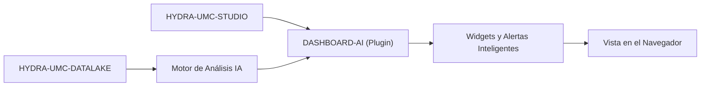

<p align="center">
  
</p>

# 🧠 HYDRA-UMC-DASHBOARD-AI

<p align="center"><a href="README.md">🇺🇸 English</a> | 🇪🇸 <b>Español</b> | <a href="README_fra.md">🇫🇷 Français</a> | <a href="README_ita.md">🇮🇹 Italiano</a> | <a href="README_deu.md">🇩🇪 Deutsch</a> | <a href="README_zho.md">🇨🇳 简体中文</a> | <a href="README_jpn.md">🇯🇵 日本語</a> | <a href="README_por.md">🇵🇹 Português</a></p>

### 📈 Resúmenes estadísticos y destacado de anomalías para el panel web de STUDIO (sin modelo de lenguaje)

<p align="center">
  
  
  
</p>

---

> **Comprobación de honestidad - qué funciona realmente hoy:** las estadísticas de resumen de tendencia (`lib/summary.ts`), la puerta de proveedor de IA y su fallback estadístico honesto (`lib/aiProvider.ts`), el guardián de contrato externo, los clientes HTTP reales (`api/datalakeClient.ts`, `api/anomalyClient.ts`), y el aislamiento de fallos de renderizado por panel (`components/ErrorBoundary.tsx` - un fallo en el renderizado de un panel queda contenido en la propia tarjeta de ese panel en vez de desmontar toda la app) son reales y están cubiertos por 149 tests de Vitest que pasan (`npm test` - `tests/*.test.ts(x)`); el servidor de archivos estáticos para la CM5 (`scripts/serve_static.py`) tiene sus propios 11 tests de `unittest` que pasan (sin listado de directorios, cabeceras de refuerzo, tiempo límite para conexiones inactivas, sin salto de ruta). No existe ningún proveedor de IA real basado en LLM en todo este repositorio - la puerta de `aiProvider.ts` es real, pero toda narrativa mostrada hoy es el fallback estadístico `NO_PROVIDER_CONFIGURED`, claramente etiquetado como tal. La Predicción de Tendencia (un modelo de pronóstico real) y los Consejos de Optimización son ambos completamente aspiracionales - todavía no existe código para ninguno de los dos. El Resaltado de Anomalías solo comprueba la línea base ya ajustada de HYDRA-UMC-ANOMALY-DETECTOR; nunca ajusta una por sí mismo. Ver `CHANGELOG.md` para lo que se ha entregado exactamente hasta ahora.

---

> **Estado de seguridad física y de ciberseguridad:** este ecosistema no es un sistema de seguridad certificado. Todavía no existe una ruta de E-STOP por hardware, ni límites ni enclavamientos aplicados por el firmware, ni un comando de movimiento verificado; las imágenes de firmware se comprueban con CRC32 y un HMAC-SHA256 de clave compartida, no con una firma asimétrica; TLS y TLS mutuo son opcionales y están desactivados por defecto; aún no se ha poblado ni probado ninguna placa propia. Lee la [línea base de seguridad](https://github.com/JuanenRac/HYDRA-UMC-DOCS/blob/main/docs/SECURITY_BASELINE.md) y el [modelo de amenazas](https://github.com/JuanenRac/HYDRA-UMC-DOCS/blob/main/docs/THREAT_MODEL.md) antes de fiarte de cualquier afirmación de aquí para la seguridad de una persona.

## 📋 De un vistazo

| | |
|---|---|
| Versión | `0.1.7` |
| Madurez | Funcional |
| Tests | 164 (`npm test`) |
| Tecnología | TypeScript/React / Vite |
| Destino | La Raspberry Pi CM5 de una celda HYDRA-UMC |
| En hardware real | Todavía no: no consta ninguna ejecución en hardware real para esta versión |

## 🚦 Estado del proyecto

Cada línea es una parte de este repositorio y la luz dice hasta dónde llega hoy. Se escribe con lo que el repositorio puede demostrar (pruebas, compilaciones, ejecuciones), no con lo previsto.

🟢 Hecho y verificado · 🟡 Funciona, con límites conocidos · 🟠 Hecho a medias o sin verificar · 🔴 Sin hacer o sin funcionar

| Área | Estado | Qué significa aquí |
|---|---|---|
| Software | 🟡 | Funciona para su propósito principal; la comprobación de honestidad de arriba lista lo que aún falta |
| Pruebas | 🟢 | 164 pruebas automáticas, ejecutadas en cada cambio |
| Hardware real | 🔴 | Todavía no: no consta ninguna ejecución en hardware real para esta versión |
| Documentación | 🟢 | README en ocho idiomas, comprobado contra el manifiesto en cada cambio |

## 1. 🛠️ VISIÓN TÉCNICA GENERAL

**HYDRA-UMC-DASHBOARD-AI** es el complemento analítico de la interfaz web de STUDIO. Añade resúmenes calculados a partir del historial almacenado (mínimo, máximo, media, último valor y dirección de la tendencia) y destaca anomalías con las estadísticas del detector de anomalías. Todavía no interviene ningún modelo de lenguaje ni ninguna previsión.

Está pensado para convertir la telemetría en bruto en resúmenes accionables del rendimiento del enjambre y de los patrones de consumo de energía, directamente en el navegador (previsto: alertas de mantenimiento predictivo e información generada por IA). Reutiliza la propia pila de HYDRA-UMC-STUDIO (React 19 + Vite + TypeScript) en lugar de introducir una nueva, de modo que pueda acabar integrándose como un panel dentro del propio STUDIO.

### Características Clave:
* 🧠 **Resúmenes Inteligentes (v0)** — estadísticas reales de mínimo/máximo/promedio/último valor/tendencia calculadas a partir del historial real de HYDRA-UMC-DATALAKE, con el mínimo/máximo/último valor enlazados cada uno a la marca de tiempo real de la observación que lo produjo. *(implementado como estadísticas reales, todavía no un resumen generado por IA — ver COMPILACIÓN Y EJECUCIÓN abajo)*
* 🔒 **Verja de Proveedor de IA (v0)** — validación real de esquema de entrada/salida para la futura narrativa basada en LLM, más un respaldo estadístico real y honestamente etiquetado usado siempre que no hay proveedor de IA configurado o uno falla/devuelve salida no estructurada. *(implementado y conectado al panel de Resumen de Tendencia hoy; un proveedor real basado en LLM está planeado)*
* 🛡️ **Verja de Contrato Externo (v0)** — valida cada respuesta de Datalake y del servicio de anomalías antes de que un panel calcule o la muestre; rechaza números, flags, identificadores sobredimensionados y caracteres de control no seguros malformados. *(implementado; ver [`docs/SECURITY.md`](docs/SECURITY.md))*
* 📈 **Predicción de Tendencias** — un modelo de predicción real, más allá del indicador de dirección real-pero-simple de v0. *(planeado)*
* 🚨 **Resaltado de Anomalías (v0)** — comprueba las muestras reales más recientes contra una línea base real ya ajustada de HYDRA-UMC-ANOMALY-DETECTOR. *(implementado como un panel de texto real; superponerlo en la vista 3D de STUDIO está planeado)*
* 🛠️ **Consejos de Optimización** — sugiere cambios de parámetros para mejorar el tiempo de ciclo o la vida útil de los motores. *(planeado)*
* ✅ **Andamiaje del toolchain** — una aplicación React/Vite/TypeScript real que compila limpio con `tsc --noEmit` y sirve con Vite. *(implementado — ver COMPILACIÓN Y EJECUCIÓN abajo)*
* 🧯 **Aislamiento de Fallos de Renderizado por Panel** — cada panel está envuelto en su propio `ErrorBoundary`; una excepción en tiempo de renderizado en uno de ellos muestra una tarjeta de respaldo contenida en vez de desmontar todo el dashboard. *(implementado — ver `components/ErrorBoundary.tsx`)*

---

## 2. 🔄 FLUJO DE DASHBOARD AI



---

## 3. 🧱 ARQUITECTURA Y DECISIONES DE DISEÑO

* **Por qué es un proyecto Node/TS, no uno en Python como los otros proyectos afines a IA.** Es una extensión directa del propio frontend React/Vite de HYDRA-UMC-STUDIO, no un servicio de IA independiente - igualar el propio stack de STUDIO (en vez del stack Python de HYDRA-UMC-COGNITIVE-NODE) es lo que le permite montarse de verdad como un panel real de STUDIO más adelante, no una app aparte a la que los usuarios tengan que cambiar.
* **Por qué es hermano de STUDIO, no una carpeta dentro de él.** Mantener esto como su propio repo/build permite que la capa de dashboard de IA se versione y publique de forma independiente al propio calendario de lanzamientos de control de robots de STUDIO - el mismo motivo que en su día separó a HYDRA-UMC-SERVER de STUDIO.
* **Por qué el punto de entrada solo imprime identidad/versión/rol hoy.** Etapa de andamiaje: probar que el paquete compila limpiamente precede a los paneles reales del dashboard.
* **Cómo encaja en el resto del ecosistema.** Extiende HYDRA-UMC-STUDIO con resúmenes estadísticos y resaltado de anomalías; un back end de modelo de lenguaje de HYDRA-UMC-COGNITIVE-NODE está previsto y hoy no está conectado.
* **Por qué el panel de Comprobación de Anomalías comprueba `/stats` antes de ofrecer puntuar nada.** El propio detector de HYDRA-UMC-ANOMALY-DETECTOR es una única línea base compartida, ajustada en memoria (ver el propio `api.py` de ese proyecto) - este dashboard deliberadamente no gestiona su ajuste (mutar el estado compartido del detector desde un dashboard orientado a lectura sería un acoplamiento real indebido). Un estado real de "todavía no ajustado" se muestra exactamente como tal, no se mezcla con un error genérico.
* **Por qué el Resumen de Tendencias reporta "dirección", no una predicción.** Un signo real de delta primero-a-último (con un pequeño umbral de ruido relativo para que una señal plana no parpadee entre "sube"/"baja") es honesto sobre lo que v0 realmente calcula - un modelo de predicción real es trabajo futuro real y separado, no algo que fingir con una extrapolación lineal disfrazada de "predicción".
* **Por qué `safeGenerateNarrative()` valida la petición pero nunca lanza excepción por una respuesta mala.** Una petición malformada es un bug real de conexionado en este código - no hay un resumen al que recurrir honestamente, así que se le permite lanzar excepción. Una respuesta *malformada/no estructurada* de un proveedor es un hecho de la vida para cualquier API externa real - ese camino siempre degrada al respaldo estadístico real en vez de romper el panel, porque quien llama ya tiene todo lo que necesita (el resumen real) para decir algo verdadero.
* **Por qué `NO_PROVIDER_CONFIGURED` reutiliza `summary.ts` en vez de una implementación de respaldo separada.** Una segunda fórmula de "narrativa de respaldo" independiente se desincronizaría de las estadísticas reales en las que el panel ya confía y que ya muestra numéricamente - reutilizar los mismos valores de `TrendSummary` mantiene la narrativa de respaldo demostrablemente consistente con los números justo al lado.

---

## 📂 ESTRUCTURA DE DIRECTORIOS

Aplicación puramente software — sin hardware, firmware ni sistema operativo propios; esas carpetas se omiten por política de estructura del repositorio.

```text
HYDRA-UMC-DASHBOARD-AI/
├── src/
│   ├── api/                 # Clientes HTTP reales: datalakeClient.ts, anomalyClient.ts
│   ├── lib/
│   │   ├── summary.ts        # Estadísticas reales de resumen de tendencias
│   │   ├── sparkline.ts      # La geometría del gráfico pequeño de una serie
│   │   ├── aiProvider.ts     # Verja real de proveedor de IA: validación de esquema + respaldo honesto
│   │   ├── session.ts        # The STUDIO session behind HYDRA-UMC-SERVER (same-origin only)
│   │   └── endpoints.ts      # Relay of HYDRA-UMC-SERVER or proxy of the static server
│   ├── components/
│   │   ├── TrendSummaryPanel.tsx
│   │   ├── Sparkline.tsx         # El gráfico pequeño de una serie y sus muestras marcadas
│   │   ├── AnomalyCheckPanel.tsx
│   │   └── ErrorBoundary.tsx     # Aislamiento de fallos de renderizado por panel (un panel roto no tumba al otro)
│   ├── main.tsx              # Punto de entrada de la aplicación
│   ├── App.tsx                # Componente raíz - monta ambos paneles reales
│   ├── index.css              # Hoja de estilos base
│   └── vite-env.d.ts          # Tipado de VITE_DATALAKE_URL / VITE_ANOMALY_URL
├── tests/                   # Tests reales: round-trips HTTP + tests de componentes
├── scripts/
│   ├── serve_static.py     # Servidor real de archivos estáticos para el SPA compilado en dist/ (hueco de despliegue en la CM5 encontrado en vivo)
│   └── test_serve_static.py # Tests reales para serve_static.py
├── systemd/
│   └── hydra-umc-dashboard-ai.service # Unidad systemd del servidor estático local en la CM5
├── tools/
│   ├── build_test.py       # Comprobación de compilación sin versionado
│   ├── ci_validate.py      # Validación de manifiesto/CHANGELOG/docs usada por CI
│   ├── _doc_policy.py      # Reglas de documentación compartidas por la familia (copia de la de HYDRA-UMC-SDK, mantenida en sincronía)
│   ├── _readme_parity.py   # Comprobación de que los ocho README comparten estructura (copia de la de HYDRA-UMC-SDK, mantenida en sincronía)
│   └── hydra_project_tool.py # Los mismos comandos en todos los repositorios: validate, test, ci, version, status, bump
├── docs/
│   └── SECURITY.md          # Contrato público de seguridad de contenido externo y despliegue
├── build/                  # Reservado para artefactos de release (dist/ está ignorado por git)
├── images/                 # Medios y diagramas
├── index.html              # HTML de entrada de Vite
├── vite.config.ts          # Configuración del bundler Vite + Vitest
├── tsconfig.json / tsconfig.app.json / tsconfig.node.json
├── bump_manifest_version.py # Sincroniza la versión de hydra-umc.project.json con la de package.json (--sync)
├── dev.sh / dev.bat        # Servidor de desarrollo real: instala deps + vite
├── build.sh / build.bat    # Valida y compila (compilar nunca cambia la versión)
└── package.json
```

---

## 4. ⚙️ COMPILACIÓN Y EJECUCIÓN

Requiere Node.js >= 20.

```bash
# Linux/macOS
./dev.sh      # instala dependencias, arranca el servidor de Vite en :5174
./build.sh    # instala deps, corre la suite de tests real, valida tipos, compila dist/

# Windows
dev.bat
build.bat
```

`npm run build` encadena `tsc --noEmit && vite build`; nunca cambia la versión, así que un build roto jamás publica un número de versión incrementado. `npm run dev` arranca Vite en el puerto `5174` (separado del `5173` propio de HYDRA-UMC-STUDIO, para que ambos puedan correr a la vez). `npm test` corre la suite real de Vitest directamente.

Por defecto los dos paneles reales llaman a las rutas del mismo origen `/api/datalake` y `/api/anomaly`, que `scripts/serve_static.py` (y el servidor de desarrollo de Vite) reenvían a HYDRA-UMC-DATALAKE en `127.0.0.1:8095` y a HYDRA-UMC-ANOMALY-DETECTOR en `127.0.0.1:8097` (ninguno de los servicios envía cabeceras CORS, el navegador no podría llamarlos directamente) - sobreescribible con `VITE_DATALAKE_URL`/`VITE_ANOMALY_URL` (definidas antes de `vite build`/`vite dev`, Vite las inserta en tiempo de build) para apuntar a un despliegue distinto.

Detrás de HYDRA-UMC-SERVER la página se sirve en `/dashboard-ai` (el `build-frontend` de HYDRA-UMC-SERVER la compila y la copia si este repositorio está descargado a su lado). Allí lee a través del relé de ese servidor, `/api/ai/datalake` (solo lectura) y `/api/ai/anomaly-detector`, con el token de acceso de quien inició sesión en HYDRA-UMC-STUDIO en el mismo navegador (el token solo se envía a direcciones del mismo origen), de modo que se aplican los roles del servidor y los servicios mantienen sus propios tokens Bearer privados del servidor. Una sesión rechazada se indica en el panel (iniciar sesión en STUDIO; hace falta un administrador o un operador). Con el dashboard ahí, HYDRA-UMC-ANOMALY-DETECTOR puede arrancarse con `HYDRA_UMC_ANOMALY_PROTECT_READS=1`.

`scripts/serve_static.py` envía una Content-Security-Policy con cada respuesta: scripts solo de la propia página (sin scripts en línea ni plugins), sin incrustación en marcos y conexiones solo al origen de la propia página. Una compilación con `VITE_DATALAKE_URL`/`VITE_ANOMALY_URL` añade los orígenes a los que llama con `--connect-src ORIGEN` (repetible); `--csp off` (o `HYDRA_DASHBOARD_CSP=off`) no envía ninguna, para un proxy delantero que la fije, y cualquier otro valor de `--csp` se usa como política completa. `npm run lint` ejecuta ESLint (reglas recomendadas, typescript-eslint y las reglas de los hooks de React); la CI lo ejecuta junto con la comprobación de tipos y las pruebas. En el modo independiente el mismo script presenta el token Bearer de un servicio que lo pide (`HYDRA_UMC_DATALAKE_READ_TOKEN`, si no `HYDRA_UMC_DATALAKE_TOKEN`, y `HYDRA_UMC_ANOMALY_TOKEN`, cada uno también como `..._FILE`, un fichero cuya primera línea es el token), de modo que la página nunca lo tiene. El token sale solo en las llamadas que hace el panel (las lecturas del data lake, el estado del detector y la puntuación de una ventana); ajustar una línea base, escribir en el data lake o su retención salen sin él y el servicio los rechaza. Un servidor ligado a una dirección que no sea loopback se niega a arrancar con tokens salvo que se pase `--allow-tokens-off-loopback`.

Lee [`docs/SECURITY.md`](docs/SECURITY.md) antes de configurar esas URL visibles en el navegador o conectar un proveedor de IA real; define la validación de respuestas, seguridad de contenido, comportamiento ante fallos y la regla de no incluir secretos.

Cada fetch real de Resumen de Tendencia también corre la verja real de proveedor de IA. Sin proveedor real configurado (el default honesto de v0), el panel muestra el respaldo estadístico real, claramente etiquetado:

```ts
import { safeGenerateNarrative, NO_PROVIDER_CONFIGURED } from './lib/aiProvider'

const narrative = await safeGenerateNarrative(NO_PROVIDER_CONFIGURED, { sourceId, kind, field, summary })
// { narrative: "robot-1/motor_temp/value: 4 sample(s), ranging 10.00 to 50.00,
//    averaging 29.00, latest 36.00 (rising).", generatedBy: 'statistical-fallback' }
```

Un proveedor que lanza excepción, o devuelve una respuesta con `narrative` ausente o malformada, degrada a ese mismo respaldo real en vez de romper el panel o no mostrar nada.

---

## 🔗 Proyectos Relacionados

Este proyecto es parte del ecosistema de robótica HYDRA-UMC del mismo autor (JuanenRac / Electro Hobby 3D). Vale la pena conocerlo, ya que una petición podría en realidad ser sobre alguno de estos en vez de sobre este repositorio.

**Directamente Relacionados**
- **[HYDRA-UMC-STUDIO](https://github.com/JuanenRac/HYDRA-UMC-STUDIO)** — panel de control web con visualización 3D multi-robot en tiempo real — el panel que este proyecto extiende directamente.
- **[HYDRA-UMC-COGNITIVE-NODE](https://github.com/JuanenRac/HYDRA-UMC-COGNITIVE-NODE)** — nodo de integración para el pipeline cognitivo Hailo-10 (orquestación de LLM/VLA/voz) — el backend de IA que alimenta este panel.
- **[HYDRA-UMC-DATALAKE](https://github.com/JuanenRac/HYDRA-UMC-DATALAKE)** — almacén de series temporales real respaldado por sqlite3, con una API HTTP real de ingesta/consulta — el historial real del que el panel de Resúmenes Inteligentes calcula sus estadísticas.
- **[HYDRA-UMC-ANOMALY-DETECTOR](https://github.com/JuanenRac/HYDRA-UMC-ANOMALY-DETECTOR)** — detector de anomalías real basado en FFT + línea base estadística, con monitorización de deriva — la línea base ajustada contra la que el panel de Resaltado de Anomalías puntúa las muestras recientes.

**También Forma Parte del Ecosistema**

*Hardware y Plataforma Base*
- **[HYDRA-UMC](https://github.com/JuanenRac/HYDRA-UMC)** — el diseño de la placa madre del brazo robótico: host CM5 + coprocesador STM32H745 de doble núcleo, pensado para coordinar hasta 8 brazos herramienta por CAN-OTA/SPI-OTA (firmware en fase temprana; todavía no hay ninguna placa poblada).
- **[HYDRA-UMC-OS](https://github.com/JuanenRac/HYDRA-UMC-OS)** — capa de producto reproducible sobre Raspberry Pi OS para el CM5: agente de solo lectura, config/perfiles validados, aprovisionamiento WiFi de primer contacto.
- **[HYDRA-UMC-SDK](https://github.com/JuanenRac/HYDRA-UMC-SDK)** — el contrato JSON-Schema compartido y la barrera de software de puerta de trabajos contra la que cada bridge valida sus comandos (no es una función de seguridad certificada).
- **[HYDRA-UMC-CONNECTOR-HUB](https://github.com/JuanenRac/HYDRA-UMC-CONNECTOR-HUB)** — registro declarativo y validador de manifiestos de adaptador para conectores de máquinas externas; extiende la propia idea de contrato del SDK a máquinas externas sin sustituir a los proyectos de pasarela industrial.

*Backend Central y Clientes*
- **[HYDRA-UMC-SERVER](https://github.com/JuanenRac/HYDRA-UMC-SERVER)** — el backend headless real (REST/WebSocket) con el que habla de verdad cada cliente de control.
- **[HYDRA-UMC-SUITE](https://github.com/JuanenRac/HYDRA-UMC-SUITE)** — centro de mando de enjambre de escritorio (PySide6) para varios servidores a la vez, empaquetado como ejecutable independiente.
- **[HYDRA-UMC-ANDROID-CONTROL](https://github.com/JuanenRac/HYDRA-UMC-ANDROID-CONTROL)** — app nativa de control para Android con inicio de sesión biométrico y un compañero Wear OS emparejado.
- **[HYDRA-UMC-IOS-CONTROL](https://github.com/JuanenRac/HYDRA-UMC-IOS-CONTROL)** — app de control para iOS/iPadOS (Flutter) con sincronización en tiempo real por WebSocket.
- **[HYDRA-UMC-DSI](https://github.com/JuanenRac/HYDRA-UMC-DSI)** — interfaz táctil nativa para la pantalla táctil DSI de 7" a bordo, embebida en el propio CM5.
- **[HYDRA-UMC-EDITOR-URDF](https://github.com/JuanenRac/HYDRA-UMC-EDITOR-URDF)** — creador/editor gráfico de URDF de escritorio que envía los modelos terminados al propio catálogo de STUDIO.
- **[HYDRA-UMC-EDITOR-STL](https://github.com/JuanenRac/HYDRA-UMC-EDITOR-STL)** — editor de escritorio de modelos STL, que transforma/reemplaza/quita/añade piezas reales en el mismo catálogo de modelos que también edita HYDRA-UMC-EDITOR-URDF.
- **[HYDRA-UMC-BRIDGE-AMR](https://github.com/JuanenRac/HYDRA-UMC-BRIDGE-AMR)** — barrera de coordinación para flotas AGV/AMR mediante un publicador MQTT VDA 5050 (probado solo contra una flota emulada).
- **[HYDRA-UMC-BRIDGE-CNC](https://github.com/JuanenRac/HYDRA-UMC-BRIDGE-CNC)** — coordinador de alto nivel para celdas CNC con acceso a estado/bytes de control GRBL (probado solo contra un emulador).
- **[HYDRA-UMC-BRIDGE-DROIDS](https://github.com/JuanenRac/HYDRA-UMC-BRIDGE-DROIDS)** — barrera de coordinación para droides con patas/humanoides, con un emisor de comandos para Boston Dynamics Spot (probado solo contra un emulador).
- **[HYDRA-UMC-BRIDGE-LASER](https://github.com/JuanenRac/HYDRA-UMC-BRIDGE-LASER)** — coordinador de celdas láser que lee 3 señales GPIO de llave/carcasa/enclavamiento (probado solo contra un chip simulado; no puede armar ni disparar un láser).
- **[HYDRA-UMC-BRIDGE-OPENPNP](https://github.com/JuanenRac/HYDRA-UMC-BRIDGE-OPENPNP)** — coordinador de alto nivel seguro para el flujo de placas de pick-and-place OpenPnP.
- **[HYDRA-UMC-BRIDGE-PRINTER3D](https://github.com/JuanenRac/HYDRA-UMC-BRIDGE-PRINTER3D)** — barrera de coordinación segura para impresoras 3D Moonraker/Klipper, con comandos de trabajo reales y controlados.
- **[HYDRA-UMC-BRIDGE-ROS2](https://github.com/JuanenRac/HYDRA-UMC-BRIDGE-ROS2)** — coordinador con un transporte ROS 2 rclpy importado de forma perezosa (todavía no ejecutado contra una instalación de ROS 2).
- **[HYDRA-UMC-BRIDGE-UAV](https://github.com/JuanenRac/HYDRA-UMC-BRIDGE-UAV)** — barrera de coordinación para UAV equipados con cámara, con un emisor de comandos MAVLink (probado solo contra un emulador).

*Plataforma de Herramientas URTC*
- **[URTC](https://github.com/JuanenRac/URTC)** — firmware para la placa física del Universal Robot Tool Controller, más de 25 perfiles de herramienta por bus CAN.
- **[URTC-FLASHER](https://github.com/JuanenRac/URTC-FLASHER)** — herramienta de escritorio con GUI para flashear placas URTC, CAN-OTA más SWD/JTAG de chip completo.
- **[URTC-TESTER](https://github.com/JuanenRac/URTC-TESTER)** — herramienta de escritorio de diagnóstico CAN-bus en vivo para placas URTC, un panel por perfil de herramienta.
- **[URTC-WEB-STUDIO](https://github.com/JuanenRac/URTC-WEB-STUDIO)** — alternativa basada en navegador a URTC-TESTER mediante la Web Serial API, sin instalación local.
- **[URTC-GATEWAY](https://github.com/JuanenRac/URTC-GATEWAY)** — pasarela delante del bus CAN de URTC: lista de identificadores permitidos, límite de tasa y clave de sesión; software probado en ordenador, aún no en un bus real.

*Nodo IA de Visión (Hailo-8)*
- **[HYDRA-UMC-VISION-NODE](https://github.com/JuanenRac/HYDRA-UMC-VISION-NODE)** — nodo de integración para el pipeline de visión Hailo-8, con una comprobación real de disponibilidad de hardware por etapa.
- **[HYDRA-UMC-DETECTION-HEF](https://github.com/JuanenRac/HYDRA-UMC-DETECTION-HEF)** — registro real de modelos compilados con verificación de carga segura por arquitectura Hailo/checksum.
- **[HYDRA-UMC-VISION-STREAMER](https://github.com/JuanenRac/HYDRA-UMC-VISION-STREAMER)** — generador real de pipeline GStreamer + config MediaMTX, con una frontera de integración HailoRT real.
- **[HYDRA-UMC-VISUAL-SERVOING-API](https://github.com/JuanenRac/HYDRA-UMC-VISUAL-SERVOING-API)** — ley de corrección Position-Based Visual Servoing con autorización condicionada al estado de zona; todavía sin estimación de pose por cámara.
- **[HYDRA-UMC-SAFETY-ZONES](https://github.com/JuanenRac/HYDRA-UMC-SAFETY-ZONES)** — lógica v0 de invasión de zona, vigencia de calibración y solicitud de E-STOP que toma las posiciones de los objetos de un fichero; ningún detector la alimenta y todavía no hay un E-STOP físico conectado.

*Nodo IA Cognitivo (Hailo-10)*
- **[HYDRA-UMC-VLA-ENGINE](https://github.com/JuanenRac/HYDRA-UMC-VLA-ENGINE)** — codificación/decodificación real de tokens de acción y generación de trayectoria para un modelo Vision-Language-Action.
- **[HYDRA-UMC-VOICE-UI](https://github.com/JuanenRac/HYDRA-UMC-VOICE-UI)** — front-end de voz real (VAD + analizador de intención) con un relé a Watch acotado y con confirmación.
- **[HYDRA-UMC-SEMANTIC-PLANNER](https://github.com/JuanenRac/HYDRA-UMC-SEMANTIC-PLANNER)** — descomposición real de tareas basada en reglas y recuperación semántica de errores sobre códigos de error del MCU.
- **[HYDRA-UMC-DOCS-QA](https://github.com/JuanenRac/HYDRA-UMC-DOCS-QA)** — búsqueda real de documentos TF-IDF (solo librería estándar) sobre los propios documentos Markdown de este ecosistema.
- **[HYDRA-UMC-LOCAL-TECHNICIAN](https://github.com/JuanenRac/HYDRA-UMC-LOCAL-TECHNICIAN)** — técnico de mantenimiento con IA local y con puertas de política para el propio ecosistema - observa, diagnostica y propone arreglos; los dos niveles de riesgo más altos están deliberadamente sin implementar todavía.

*Orquestación y Enjambre*
- **[HYDRA-UMC-ORCHESTRATOR](https://github.com/JuanenRac/HYDRA-UMC-ORCHESTRATOR)** — nodo de integración con un contrato real de informe de salud gRPC/Protobuf y una máquina de estados de misión.
- **[HYDRA-UMC-JOB-DISPATCHER](https://github.com/JuanenRac/HYDRA-UMC-JOB-DISPATCHER)** — cola de trabajos real basada en prioridad con deduplicación, sobre una API HTTP real.
- **[HYDRA-UMC-NODE-HEALING](https://github.com/JuanenRac/HYDRA-UMC-NODE-HEALING)** — watchdog de salud de flota real basado en gRPC, con reintento/backoff y detección de discrepancia de identidad.
- **[HYDRA-UMC-PATH-PLANNER-3D](https://github.com/JuanenRac/HYDRA-UMC-PATH-PLANNER-3D)** — planificador de rutas 3D real basado en RRT, con validación real de colisión de obstáculos/espacio de trabajo.
- **[HYDRA-UMC-SWARM-SYNC](https://github.com/JuanenRac/HYDRA-UMC-SWARM-SYNC)** — sincronización de estado real mediante CRDT LWW-Element-Map, con pruebas de propiedades para convergencia multi-celda.

*Gemelo Digital y Simulación*
- **[HYDRA-UMC-TWIN](https://github.com/JuanenRac/HYDRA-UMC-TWIN)** — nodo de integración para el motor de gemelo digital, con un contrato real de sincronización por compatibilidad de versión.
- **[HYDRA-UMC-HIL-BRIDGE](https://github.com/JuanenRac/HYDRA-UMC-HIL-BRIDGE)** — enrutador hardware-in-the-loop con un enclavamiento de software por colisión entre simulación y hardware real (probado sin hardware real).
- **[HYDRA-UMC-PHYSICS-REPLICA](https://github.com/JuanenRac/HYDRA-UMC-PHYSICS-REPLICA)** — cinemática directa real y validación de límites articulares sobre un subconjunto real de URDF.
- **[HYDRA-UMC-SYNTHETIC-DATA-GEN](https://github.com/JuanenRac/HYDRA-UMC-SYNTHETIC-DATA-GEN)** — generador real de escenas 2D procedurales con exportación de anotaciones YOLO/COCO.

*Datos y Analítica*
- **[HYDRA-UMC-PRODUCTION-REPORTS](https://github.com/JuanenRac/HYDRA-UMC-PRODUCTION-REPORTS)** — cálculo real de OEE/disponibilidad sobre el histórico de DATALAKE, con exportación CSV reproducible.
- **[HYDRA-UMC-TELEMETRY-COLLECTOR](https://github.com/JuanenRac/HYDRA-UMC-TELEMETRY-COLLECTOR)** — pipeline real de ingesta CAN/WebSocket hacia DATALAKE, con deduplicación por secuencia.

*Pasarela Industrial*
- **[HYDRA-UMC-GATEWAY-INDUSTRIAL](https://github.com/JuanenRac/HYDRA-UMC-GATEWAY-INDUSTRIAL)** — nodo de integración que retransmite a protocolos industriales, con una capa real de lista blanca de comandos/contrapresión.
- **[HYDRA-UMC-OPCUA-SERVER](https://github.com/JuanenRac/HYDRA-UMC-OPCUA-SERVER)** — espacio de direcciones OPC-UA real, verificado con una sesión de cliente real del protocolo binario.
- **[HYDRA-UMC-MQTT-BROKER](https://github.com/JuanenRac/HYDRA-UMC-MQTT-BROKER)** — broker MQTT real con autenticación por cliente opcional y ACL de tópicos.
- **[HYDRA-UMC-MTCONNECT-ADAPTER](https://github.com/JuanenRac/HYDRA-UMC-MTCONNECT-ADAPTER)** — endpoints XML reales `/probe` y `/current` de MTConnect, con salida en modo degradado.

*Herramientas Complementarias y Operaciones del Ecosistema*
- **[HYDRA-UMC-TOOL-CLI](https://github.com/JuanenRac/HYDRA-UMC-TOOL-CLI)** — CLI de flota con un contrato real y estable de códigos de salida, cliente real y en vivo de la propia API de HYDRA-UMC-SERVER.
- **[HYDRA-UMC-WATCH](https://github.com/JuanenRac/HYDRA-UMC-WATCH)** — app compañera de WearOS con patrones de alerta háptica y un relé de voz al teléfono emparejado (todavía no ejecutada en un reloj físico).
- **[URTC-SMART-RACK](https://github.com/JuanenRac/URTC-SMART-RACK)** — firmware para un rack de montaje de placas con decodificación real de ID de herramienta y lógica de precalentamiento Smart Idle.
- **[URTC-VISION-TOOL](https://github.com/JuanenRac/URTC-VISION-TOOL)** — firmware más un compañero de visión real en Python para un cabezal de inspección térmica/RGB.
- **[HYDRA-UMC-UPDATER](https://github.com/JuanenRac/HYDRA-UMC-UPDATER)** — herramienta administrativa de escritorio que descubre, clona y actualiza cada repositorio de este ecosistema.
- **[HYDRA-UMC-OS-REBUILDER](https://github.com/JuanenRac/HYDRA-UMC-OS-REBUILDER)** — herramienta de escritorio Windows/Linux que construye una imagen de la CM5 lista para grabar, precargada con las versiones más actuales del ecosistema, con configuración de primer arranque de Wi-Fi/usuario/SSH al estilo de Raspberry Pi Imager.
- **[HYDRA-UMC-OPS-AGENT](https://github.com/JuanenRac/HYDRA-UMC-OPS-AGENT)** — coordinador de incidencias de mantenimiento: un rol edge de bajo privilegio recopila un snapshot de inventario/salud saneado, un rol control-plane lo renderiza de solo lectura y pide a un proveedor de IA que sugiera un diagnóstico - nunca aplica un parche ni despliega nada.
- **[HYDRA-UMC-DEV-SERVER](https://github.com/JuanenRac/HYDRA-UMC-DEV-SERVER)** — host de desarrollo reproducible (Raspberry Pi 5 / CM5) que almacena el código del ecosistema y ejecuta tareas acotadas de compilación/pruebas bajo una cola duradera; un rol de desarrollo dedicado, explícitamente distinto de un CM5 operativo.


---

## 📚 Documentación y Comunidad

- **[CONTRIBUTING.md](CONTRIBUTING.md)** — stack tecnológico y pautas de codificación para un pull request.
- **[CODE_OF_CONDUCT.md](CODE_OF_CONDUCT.md)** — los estándares de comportamiento esperados en esta comunidad.
- **[SECURITY.md](SECURITY.md)** — cómo reportar una vulnerabilidad; consulta [`docs/SECURITY.md`](docs/SECURITY.md) para el contrato propio de este proyecto sobre seguridad de contenido externo y despliegue.
- **[SUPPORT.md](SUPPORT.md)** — dónde hacer preguntas y reportar errores.
- **[LICENSE.md](LICENSE.md)** — la licencia propia de este proyecto.

## 👤 AUTOR
**JuanenRac** (Electro Hobby 3D)
📧 electrohobby3d@gmail.com
📺 [youtube.com/@electrohobby3d](https://youtube.com/@electrohobby3d)

## 📜 LICENCIA
GPL-3.0-or-later - Ver LICENSE para más detalles.
